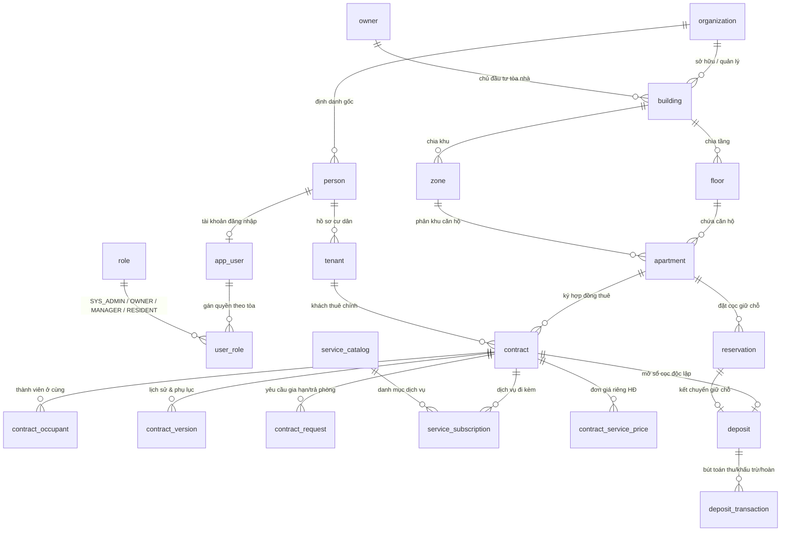

# BÁO CÁO KỸ THUẬT & NGHIỆM THU GIAI ĐOẠN 1 (TUẦN 1 – TUẦN 4)
**VƯỢT QUA RANH GIỚI FRONTEND — XÂY DỰNG NỀN TẢNG FULL STACK (TƯƠNG ĐƯƠNG S1 & S2 TRONG PRD v2.0)**

- **Dự án:** ResiHub — Hệ thống Quản lý Căn hộ & Nhà cho thuê
- **Phạm vi Giai đoạn 1:** Khởi tạo kiến trúc Full Stack & UI Template, Xác thực OTP & Phân quyền RBAC/RLS (M01, M02), Quản lý Bất động sản (M03), Quản lý Hồ sơ Cư dân (M04), Nghiệp vụ Hợp đồng thuê & Dịch vụ đi kèm (M05), Quản lý Giữ chỗ & Sổ cọc độc lập (M06), Cổng Khám phá công khai & Cổng Cư Dân nền tảng.
- **Ngày lập báo cáo:** 09/11/2026
- **Kết quả kiểm thử tự động Giai đoạn 1:** **182 / 182 test cases PASS (100%)** trên 8 bộ test chuyên biệt Giai đoạn 1 (`node --test`); Frontend Production Build thành công (`vite build` — **3.25s**, 0 lỗi).

---

## PHẦN 1. RÀ SOÁT KẾT QUẢ THỰC HIỆN THEO LỘ TRÌNH TUẦN 1 – TUẦN 4

### 1.1. Tuần 1: Khởi tạo Kiến trúc, Khung Giao diện & Database Schema

| Hạng mục yêu cầu | Trạng thái | Chi tiết triển khai & Dẫn chứng trong Source Code |
| :--- | :---: | :--- |
| **1. Thiết lập dự án Full Stack, TailwindCSS, Lucide** | **Đạt 100%** | - **Frontend (`frontend/package.json`, `vite.config.js`, `tailwind.config.js`):** Khởi tạo trên nền **React 19.2 + Vite 8.3**, định tuyến SPA bằng `react-router-dom` v7.18, quản lý state bằng `zustand` v5.0, gọi API qua `axios` v1.20, bộ icon `lucide-react` v1.57 và thiết kế giao diện với **TailwindCSS v3.4** (cấu hình bảng màu `primary`/`secondary`/`surface`, font `Inter` và tiện ích safe-area di động trong `src/index.css`). - **Backend (`api/package.json`, `api/src/server.js`):** Xây dựng RESTful API bằng **Node.js (ES Modules) + Express 4.21**, kết nối **PostgreSQL 16** qua `pg` pool, nén phản hồi Gzip tự động, tích hợp `cors`, `morgan`, `express-rate-limit` và đóng gói đồng bộ qua `docker-compose.yml` + `docker-compose.dev.yml`. |
| **2. Khởi tạo khung giao diện (UI Template & Layouts)** | **Đạt 100%** | - **14 UI Primitives chuẩn hóa (`frontend/src/components/ui/`):** `Button`, `Input`, `Select` (combobox tìm kiếm bỏ dấu tiếng Việt), `MoneyInput` (tự động định dạng hàng nghìn VND), `Modal` (hỗ trợ cả Dialog giữa màn hình, Drawer trượt ngang và Bottom-Sheet trên mobile), `Table`, `Tabs`, `Card`, `Badge`, `Skeleton`, `Tooltip`, `FileUpload` (kèm `AuthImage` / `AuthPdfViewer` đọc tệp bảo mật qua Bearer Token), `Toast`. - **2 Khung bố cục tách biệt (`frontend/src/components/layout/`):** `AdminLayout.jsx` (`Sidebar` lọc menu theo vai trò + `TopBar` chọn tòa nhà toàn cục) dành cho `SYS_ADMIN`/`OWNER`/`MANAGER` và `ResidentLayout.jsx` dành cho `RESIDENT`, bảo vệ bởi `RequireAuth`, `RequireAdminPortal` và `RoleGuard` (`frontend/src/router/index.jsx`). |
| **3. Các giao diện chính (Đăng nhập, Quên mật khẩu, Hồ sơ)** | **Đạt 100%** | - **Đăng nhập (`pages/auth/LoginPage.jsx`):** Hỗ trợ song song 2 chế độ: **Đăng nhập SĐT + OTP 6 số** (mặc định cho Cư dân & hỗ trợ nhân sự) và **Đăng nhập Email + Mật khẩu** (cho nhân sự nội bộ), kèm bộ chọn tài khoản mẫu điền nhanh khi chạy local. - **Quên mật khẩu (`pages/auth/ForgotPasswordPage.jsx`):** Quy trình 2 bước (nhập Email nhận mã xác nhận 6 số có hiệu lực 15 phút → đặt lại mật khẩu mới tối thiểu 8 ký tự và thu hồi các phiên cũ). - **Hồ sơ cá nhân (`components/common/ProfileModal.jsx` & `pages/resident/tabs/ProfileTab.jsx`):** Cho phép cập nhật thông tin cá nhân, tải ảnh đại diện, tải ảnh CCCD 2 mặt (`front`/`back`) và đổi mật khẩu an toàn. |
| **4. Xử lý thông báo (Toast & In-App Notification)** | **Đạt 100%** | - **Toast thời gian thực (`stores/toastStore.js`, `hooks/useToast.js`, `ui/Toast.jsx`):** Hiển thị thông báo trạng thái thao tác (`success`, `error`, `warning`, `info`) tự động đóng sau 4–5.5 giây. - **Trung tâm thông báo In-App (`components/common/NotificationBell.jsx`, `stores/notificationStore.js`):** Hiển thị chuông thông báo trên thanh điều hướng với số lượng chưa đọc (`unreadCount`), tự động đồng bộ định kỳ, hỗ trợ đánh dấu đã đọc từng mục / đọc tất cả và điều hướng sâu (`useNotificationAction.js`) tới đúng hợp đồng, sổ cọc hoặc hồ sơ cư dân liên quan. |
| **5. Sơ đồ CSDL PostgreSQL (PRD 13.2) & Vibe Coding SQL** | **Đạt 100%** | - Xây dựng hệ thống migration phiên bản hóa tự động (`api/src/db/migrate.js` & `api/src/db/migrations/001..009.sql`) bám sát mục 13.2–13.6 của PRD: tiền tệ lưu kiểu `BIGINT` (nguyên đồng VND), thời gian `TIMESTAMPTZ` / `DATE` chuẩn `Asia/Ho_Chi_Minh`, đầy đủ khóa ngoại (`ON DELETE RESTRICT / CASCADE / SET NULL`), `UNIQUE`, Partial Unique Index, `CHECK`, ràng buộc chống chồng lấn `EXCLUDE USING gist` và Triggers bảo toàn tính bất biến. |

---

### 1.2. Tuần 2: Xác thực (Auth) & Phân quyền (RBAC / Row-Level Security)

| Hạng mục yêu cầu | Trạng thái | Chi tiết triển khai & Dẫn chứng trong Source Code |
| :--- | :---: | :--- |
| **1. Đăng nhập OTP qua số điện thoại & Quản lý phiên JWT** | **Đạt 100%** | - **Dịch vụ OTP (`api/src/services/otpService.js`, `routes/auth.js:48-221`):** Chuẩn hóa SĐT 10 số Việt Nam (`+84`/`84` → `0xxxxxxxxx`), sinh mã OTP 6 số hiệu lực **5 phút**, giới hạn tối đa **3 lần yêu cầu/giờ/SĐT** (`429 RATE_LIMIT_EXCEEDED`), khóa tạm thời **15 phút** kèm ghi `audit_log` (`AUTH_LOCK`) nếu nhập sai quá **5 lần**. - **Chống dò quét danh tính (Anti-Enumeration):** Trả thông điệp trung lập giống hệt nhau cho cả SĐT có thực và SĐT chưa đăng ký. - **OTP giả lập phục vụ chạy Local (`NODE_ENV !== 'production'`):** In mã OTP ra terminal backend, trả kèm gợi ý `devOtp` trên giao diện dev và hỗ trợ mã OTP thử nghiệm `123456` trên luồng đăng nhập local. - **Cơ chế Token (`auth.js:31-35, 373-510`):** Cấp cặp `accessToken` (15 phút) và `refreshToken` (7 ngày) gắn `token_version`; tự động làm mới ngầm trên Axios interceptor (`frontend/src/services/api.js:61-90`) và vô hiệu hóa tức thì mọi phiên cũ khi đăng xuất hoặc đổi mật khẩu. |
| **2. Phân quyền RBAC & Row-Level Security (RLS) theo vai trò (`OWNER`, `MANAGER`, `RESIDENT`, `SYS_ADMIN`)** | **Đạt 100%** | - **Quyết định kiến trúc theo PRD 14.1:** Do yêu cầu đặt máy chủ tại Việt Nam (không dùng Supabase Cloud), hệ thống triển khai **Native PostgreSQL 16 Row-Level Security (`ENABLE` + `FORCE ROW LEVEL SECURITY`)** kết hợp Express Middleware (`authenticateToken` + `requireRole`). - **Cô lập kết nối CSDL 2 lớp (`api/src/db/client.js`, `middleware/auth.js:33-58`):** Tách riêng `adminPool` (chỉ dùng cho chạy migration & xác thực ban đầu) và `appPool` kết nối bằng role không có quyền superuser `resihub_app`. Trên mỗi HTTP request đã xác thực, middleware gắn kết nối vào `AsyncLocalStorage`, gọi `SELECT set_config('app.current_user_id', $1, false)` và tự động `ROLLBACK` + `RESET app.current_user_id` ngay khi đóng kết nối. - **Phân quyền 4 vai trò chuẩn hóa (`004_helper_functions.sql`, `005_rls_enable_and_policies.sql`):**   • `SYS_ADMIN`: Quản trị cấu hình, tài khoản người dùng toàn tổ chức và xóa dữ liệu danh mục rỗng chưa phát sinh lịch sử.   • `OWNER`: **Chỉ đọc (`R`)** dữ liệu thuộc đúng các tòa nhà mình đứng tên sở hữu (`get_owner_building_ids()`) và thực hiện quyền phê duyệt hợp đồng giảm giá / tất toán cọc trên tòa nhà của mình; tự động che số CCCD (`****1234`) và chặn xem ảnh giấy tờ gốc.   • `MANAGER`: Toàn quyền tác nghiệp **Tạo – Đọc – Sửa (`CRU`)** chỉ trong phạm vi các tòa nhà được phân công (`get_manager_building_ids()`); không được quyền xóa cứng.   • `RESIDENT`: Chỉ truy cập đúng hợp đồng, căn hộ, sổ cọc, phiếu giữ chỗ và thông báo của chính mình (`get_resident_contract_ids()`). |

---

### 1.3. Tuần 3: Module Bất động sản (M03) & Hồ sơ Cư dân (M04)

| Hạng mục yêu cầu | Trạng thái | Chi tiết triển khai & Dẫn chứng trong Source Code |
| :--- | :---: | :--- |
| **1. API & Giao diện CRUD Tòa nhà, Khu, Tầng, Căn hộ** | **Đạt 100%** | - **Tòa nhà (`routes/buildings.js`, `BuildingsPage.jsx`, `BuildingDetailPage.jsx`):** CRUD tòa nhà, kiểm tra trùng mã `code` realtime, cấu hình tài khoản ngân hàng VietQR nhận tiền theo tòa, gán Chủ sở hữu theo cơ chế bảo mật *Know-Before-You-Link* (`GET /buildings/lookup-owner` khớp chính xác SĐT/Email), tự động gán quyền quản lý tòa nhà mới tạo cho `MANAGER` qua trigger `trg_auto_assign_creator_manager_to_building`. - **Khu & Tầng (`ZoneDetailPage.jsx`, `FloorModal.jsx`, `services/floorBulk.js`):** CRUD Khu (`zone`), CRUD Tầng đơn lẻ và **tạo nhanh hàng loạt dải tầng** (`POST /buildings/:id/floors/bulk`, hỗ trợ tầng hầm `B2..B1`, tầng trệt `0`, dải tầng nổi `1..N`, xem trước `dry_run` và bỏ qua tầng trùng). - **Căn hộ (`routes/apartments.js`, `BulkApartmentModal.jsx`, `ApartmentDetailPage.jsx`):** CRUD căn hộ đơn lẻ (kèm gợi ý mã phòng kế tiếp nếu trùng) và **tạo căn hộ hàng loạt theo mẫu tầng** (`POST /apartments/bulk` — FR-009, tối đa 500 căn/lần với bước xem trước bắt buộc). Chặn xóa cứng mọi tòa/tầng/khu/căn hộ đã phát sinh dữ liệu lịch sử. |
| **2. Sơ đồ trạng thái căn hộ (`AVAILABLE`, `RESERVED`, `OCCUPIED`, `MAINTENANCE`, `INACTIVE`)** | **Đạt 100%** | - **Máy trạng thái tự động (`api/src/services/apartmentStatus.js`):** Chặn người dùng tự gán tay trạng thái `OCCUPIED` hoặc `RESERVED` (`409 DIRECT_STATUS_CHANGE_PROHIBITED`). Hàm `syncApartmentStatus()` khóa dòng `FOR UPDATE` và tự động tính toán trạng thái chuẩn theo thứ tự ưu tiên: `INACTIVE` → Có hợp đồng đang ở hôm nay (`OCCUPIED`) → Đang chờ nghiệm thu sau trả phòng (`MAINTENANCE`) → Có hợp đồng tương lai hoặc giữ chỗ `HELD` còn hạn (`RESERVED`) → `AVAILABLE`. - **Nghiệm thu bàn giao (`PATCH /apartments/:id/handover`):** Lưu biên bản & ảnh nghiệm thu phòng sau khi khách trả, giải phóng căn hộ từ `MAINTENANCE` về `AVAILABLE` (hoặc `RESERVED` nếu đã có khách đặt nối tiếp). - **Sơ đồ mặt bằng trực quan (`FloorPlanPage.jsx`):** Hiển thị lưới căn hộ theo từng tầng từ thấp lên cao, mã màu trực quan theo 5 trạng thái, lọc nhanh theo trạng thái/khu và mở ngăn kéo (`Drawer`) thao tác nhanh (Giữ chỗ, Lập hợp đồng, Nghiệm thu). |
| **3. Xây dựng Hồ sơ Cư dân (M04)** | **Đạt 100%** | - **Mô hình 2 tầng `person` + `tenant` (`routes/tenants.js`, `services/residentAccount.js`, `TenantsPage.jsx`, `TenantDetailPage.jsx`):** Quản lý thông tin định danh gốc (`person`) tách biệt với hồ sơ cư trú (`tenant`: `PENDING`, `APPROVED`, `REJECTED`, `MOVED_OUT`, `MERGED`), quản lý ảnh CCCD 2 mặt (`POST/GET/DELETE /tenants/:id/id-images`) và danh sách thành viên ở cùng (`occupants`). - **Chống trùng, Liên kết liên tòa & Gộp hồ sơ (FR-021):** Kiểm tra trùng SĐT/CCCD realtime (`GET /tenants/check-dup`), tra cứu liên kết khách thuê cũ giữa các tòa không lộ PII (`GET /tenants/lookup`), khóa bảo vệ hồ sơ dùng chung (`SHARED_PROFILE_LOCKED`) và gộp hồ sơ trùng lặp an toàn kèm lý do kiểm toán (`POST /tenants/merge`). - **Tự động cấp tài khoản Cổng Cư Dân (`ensureResidentAccount`):** Tự động khởi tạo `app_user` + gán vai trò `RESIDENT` ngay khi tạo hồ sơ cư dân để cư dân đăng nhập bằng SĐT + OTP. |

---

### 1.4. Tuần 4: Nghiệp vụ Hợp đồng (M05) & Tiền cọc (M06)

| Hạng mục yêu cầu | Trạng thái | Chi tiết triển khai & Dẫn chứng trong Source Code |
| :--- | :---: | :--- |
| **1. Luồng tạo hợp đồng thuê, kiểm tra chồng lấn kỳ hạn & chọn dịch vụ (M05)** | **Đạt 100%** | - **Vòng đời hợp đồng chặt chẽ (`routes/contracts.js`, `ContractsPage.jsx`, `ContractDetailPage.jsx`):** Khởi tạo ở trạng thái nháp `DRAFT` (hỗ trợ chọn cư dân có sẵn, tạo cư dân mới tại chỗ hoặc chuyển tiếp từ phiếu giữ chỗ), xuất bản in hợp đồng mẫu HTML/PDF (`GET /contracts/:id/template`), tải bản scan đã ký (`POST /contracts/:id/scan`) rồi mới kích hoạt `ACTIVE`. Nếu giá thuê thấp hơn 10% so với giá niêm yết (`isDiscountedPrice`), hệ thống tự động chuyển sang `PENDING_APPROVAL` chờ `OWNER` tòa nhà phê duyệt. - **Chống chồng lấn kỳ hạn 2 lớp (`contracts.js:1506-1529` & `003_constraints_and_indexes.sql:13-21`):** Kiểm tra sớm ở tầng API trả danh sách hợp đồng xung đột chi tiết, đồng thời khóa cứng ở tầng PostgreSQL bằng `EXCLUDE USING gist (apartment_id WITH =, daterange(start_date, COALESCE(terminated_at, end_date), '[)') WITH &&)` — dùng nửa khoảng `[)` giúp ký hợp đồng nối tiếp ngày (`end_date` cũ = `start_date` mới) mượt mà nhưng chặn tuyệt đối mọi xung đột dù gọi song song. - **Chọn dịch vụ đi kèm (`syncDraftContractServicesInTx`):** Cho phép đăng ký các gói dịch vụ từ `service_catalog` vào `service_subscription` (hỗ trợ nhập biển số xe `vehicle_plates`, số lượng, khóa giá `is_price_locked` và ghi đè đơn giá riêng trong `contract_service_price`); tự động chuyển từ `PENDING_APPROVAL` sang `ACTIVE` khi hợp đồng kích hoạt. - **Nghiệp vụ mở rộng:** Đầy đủ phụ lục phiên bản hóa (`contract_version`), gia hạn hợp đồng nối tiếp (`POST /:id/renew`), chuyển phòng kết chuyển cọc (`POST /:id/transfer-room`) và xử lý yêu cầu gia hạn/chấm dứt từ cư dân (`contract_request`). |
| **2. Luồng thu/hoàn cọc, cấm cấn trừ tiền thuê & hạn hoàn 3–5 ngày (M06)** | **Đạt 100%** | - **Cọc giữ chỗ (`routes/reservations.js`, `routes/public.js`):** Hỗ trợ cả giữ chỗ nội bộ (`INTERNAL`) và khách vãng lai đặt giữ chỗ online xác thực OTP (`PUBLIC` → `PENDING_CONFIRM` → `HELD`), tự động khóa căn hộ sang `RESERVED` và chuyển cọc giữ chỗ sang sổ cọc hợp đồng (`CONVERTED` + bút toán `TRANSFER_IN`) khi kích hoạt hợp đồng. - **Thu cọc & Tính bất biến Sổ cọc (`routes/deposits.js`, `DepositsPage.jsx`):** Tự động mở sổ cọc (`deposit`) khi hợp đồng `ACTIVE`, thu bổ sung phần cọc còn thiếu (`POST /deposits/:id/transactions` với `type = 'collect'`, chặn thu vượt mức cọc hợp đồng). Mọi bút toán `deposit_transaction` đã duyệt bị khóa cứng không cho sửa/xóa bởi trigger `trg_deposit_txn_immutable`. - **Cấm tuyệt đối cấn trừ cọc vào tiền thuê (FR-023):** Hàm `validateDeduction()` (`services/depositSettlement.js:57-107`) chỉ chấp nhận 4 danh mục khấu trừ có ảnh bằng chứng (`DAMAGE`, `CLEANING`, `UTILITY_DEBT`, `OTHER`) và chặn cứng `category = 'RENT'` với mã lỗi `RENT_DEDUCTION_FORBIDDEN`. Đồng thời, `calculateContractOpenDebts()` (`deposits.js:118-195`) và RPC `fn_apply_deposit_settlement_accounting` tách riêng nợ tiền phòng (`rentDebt`) khỏi nợ tiện ích/dịch vụ (`serviceDebt`), tuyệt đối không lấy tiền cọc bù vào nợ tiền thuê. - **Quy trình hoàn cọc 4 mắt & Cam kết 3–5 ngày (FR-024, FR-068):** Khi chấm dứt hợp đồng, hệ thống tự động gán `refund_due_date` qua hàm `refundDeadline()` (`services/deadlines.js:45-63`): mặc định **hạn hoàn tối đa +5 ngày** và **mốc cảnh báo sớm +3 ngày** (`warnAt = dueAt - 2`). Luồng tất toán tách bạch 3 bước: `MANAGER` lập quyết toán (`PENDING_APPROVAL`) → `OWNER` / người duyệt độc lập phê duyệt 4 mắt (`APPROVED_PENDING_PAYOUT`) → Chi hoàn thực tế (`POST /deposits/:id/payout` sang `REFUNDED` / `PARTIALLY_REFUNDED` / `DEDUCTED_FULL`), hỗ trợ xử lý khiếu nại (`DISPUTED`) và lệnh chi bị ngân hàng hoàn trả (`RETURNED`). |

---

### 1.5. Đánh giá Tiêu chí Nghiệm thu Giai đoạn 1

1. **Tiêu chí 1: "Hệ thống chạy local, đăng nhập thành công bằng OTP giả lập"** → **ĐẠT 100%**
   - Khởi chạy trọn gói qua Docker Compose hoặc chạy trực tiếp Node.js + Vite local (`localhost:3000` ↔ `localhost:5000`). Luồng đăng nhập SĐT hiển thị mã `devOtp` trực tiếp trên console/UI môi trường dev và hỗ trợ mã giả lập `123456`, cấp JWT và phân luồng chính xác vào Cổng Quản Trị hoặc Cổng Cư Dân.
2. **Tiêu chí 2: "Tạo thành công cây dữ liệu Tòa nhà → Căn hộ → Cư dân → Hợp đồng"** → **ĐẠT 100%**
   - Luồng dữ liệu khép kín hoàn chỉnh từ đầu đến cuối: Tạo `building` → Tạo `zone` & `floor` (đơn lẻ hoặc hàng loạt) → Tạo `apartment` (đơn lẻ hoặc theo mẫu tầng) → Tạo `person` & `tenant` (tự động cấp tài khoản `RESIDENT`) → Tạo `contract` (`DRAFT` → đính kèm scan → `ACTIVE`) → Tự động mở `deposit` & chuyển căn hộ sang `OCCUPIED`.
3. **Tiêu chí 3: "Code Backend (API / PostgreSQL RLS) gọi trơn tru từ Frontend"** → **ĐẠT 100%**
   - Frontend giao tiếp mượt mà với Backend qua tầng `services/*.service.js`, tự động đính kèm `Authorization: Bearer`, tự động sinh `Idempotency-Key` chống bấm đúp trên mọi giao dịch hợp đồng/tiền cọc, tự động refresh token khi hết hạn 15 phút và tuân thủ nghiêm ngặt phân quyền RLS theo từng vai trò.

---

## PHẦN 2. CẤU TRÚC CƠ SỞ DỮ LIỆU (DATABASE SCHEMA) GIAI ĐOẠN 1 ĐÃ CHỐT

Lược đồ CSDL Giai đoạn 1 được định nghĩa tại `api/src/db/migrations/` (`001` → `008`), sử dụng các extension `uuid-ossp`, `pgcrypto` và `btree_gist`. Dưới đây là **26 bảng thuộc phạm vi Giai đoạn 1**:

### 2.1. Sơ đồ quan hệ thực thể (ERD) lõi Giai đoạn 1

### 2.2. Danh mục bảng & Ràng buộc (Constraints / Indexes / Triggers) Giai đoạn 1

| Phân hệ | Tên bảng | Các cột chính & Ràng buộc cốt lõi |
| :--- | :--- | :--- |
| **M01 & M02 — Tổ chức, Xác thực, Phân quyền & Hạ tầng** | `organization` | `id`, `name`, `tax_code`, `settings` (`JSONB`), `payment_account` (`JSONB`). |
| | `person` | `id`, `org_id`, `full_name`, `phone`, `email`, `dob`, `id_number`, `id_images` (`TEXT[]`), `avatar_url`, `address`, `privacy_consent_at`. • Unique: `(org_id, phone)` và Partial Unique `uq_person_id_number_per_org` trên `(org_id, id_number) WHERE id_number IS NOT NULL`. |
| | `app_user` | `id`, `person_id` (`FK person`), `auth_uid` (`UNIQUE`), `password_hash`, `status` (`ACTIVE`, `SUSPENDED`), `token_version`, `last_login_at`. |
| | `owner` | `id`, `org_id`, `person_id` (`FK person`), `full_name`, `phone`, `email` — Hồ sơ Chủ sở hữu tòa nhà. |
| | `role`, `user_role` | - `role`: `id`, `org_id`, `code` (`SYS_ADMIN`, `OWNER`, `MANAGER`, `RESIDENT`), `scope` (`org`, `building`). `UNIQUE (org_id, code)`. - `user_role`: `user_id`, `role_id`, `building_id`. `UNIQUE (user_id, role_id, building_id)`. |
| | `notification` | `id`, `org_id`, `user_id` (`NULL` = toàn tổ chức), `title`, `content`, `type`, `payload` (`JSONB`), `read_at`, `created_at`. |
| | `attachment` | `id`, `owner_entity` (`person`, `contract`, `deposit`, `reservation`, `apartment`), `owner_id`, `storage_path`, `mime`, `size_bytes`, `uploaded_by`. |
| | `audit_log` | `id` (`BIGSERIAL`), `actor_id`, `action`, `entity`, `entity_id`, `before` (`JSONB`), `after` (`JSONB`), `ip`, `at`. • Trigger `trg_audit_log_no_update_delete`: Chặn tuyệt đối `UPDATE` / `DELETE` (chỉ ghi thêm). |
| | `system_setting`, `idempotency_key` | - `system_setting`: Cấu hình tham số tổ chức (`sla_config.deposit_refund_days = 5`, `reservation_cancel_policy`, `approval_config`). `UNIQUE (org_id, key)`. - `idempotency_key`: Chống thực thi trùng request theo `(org_id, scope_key, method, route_path, idem_key)`. |
| **M03 — Bất động sản** | `building` | `id`, `org_id`, `owner_id` (`FK owner`), `code`, `name`, `address`, `timezone`, `lease_terms` (`JSONB` chứa `payment_account`), `status` (`ACTIVE`, `INACTIVE`). • Unique: `(org_id, code)`. • Triggers: `trg_auto_assign_creator_manager_to_building` & `trg_cleanup_user_roles_on_building_delete`. |
| | `floor` | `id`, `building_id` (`FK building ON DELETE CASCADE`), `level` (`INTEGER`), `name`. • Unique: `(building_id, level)`. |
| | `zone` | `id`, `org_id`, `building_id` (`FK building ON DELETE CASCADE`), `code`, `name`. • Unique: `(building_id, code)`. |
| | `apartment` | `id`, `building_id`, `floor_id`, `zone_id`, `code`, `area_m2`, `type`, `bedrooms`, `base_rent` (`BIGINT`), `amenities` (`JSONB`), `status` (`AVAILABLE`, `RESERVED`, `OCCUPIED`, `MAINTENANCE`, `INACTIVE`). • Unique: `(building_id, code)`. |
| **M04 — Cư dân** | `tenant` | `id`, `org_id`, `person_id` (`FK person`), `type` (`primary`, `occupant`), `status` (`PENDING`, `APPROVED`, `REJECTED`, `MOVED_OUT`, `MERGED`), `desired_building_id`, `desired_apartment_id`, `rejection_reason`, `consent_given`. |
| **M05 — Hợp đồng & Dịch vụ đi kèm** | `contract` | `id`, `building_id`, `apartment_id` (`ON DELETE RESTRICT`), `primary_tenant_id` (`ON DELETE RESTRICT`), `parent_contract_id`, `start_date`, `end_date`, `terminated_at`, `rent_amount`, `deposit_amount`, `billing_cycle`, `billing_day` (`1..31`), `payment_due_days`, `is_room_transfer`, `status` (`DRAFT`, `PENDING_APPROVAL`, `ACTIVE`, `RENEWAL_PENDING`, `TERMINATION_PENDING`, `EXPIRED`, `TERMINATED`, `CANCELLED`). • Check: `end_date > start_date`. • **GiST Exclusion `contract_no_overlap`:** Chặn chồng lấn `daterange(start_date, COALESCE(terminated_at, end_date), '[)')` trên cùng `apartment_id` khi hợp đồng đang hiệu lực. |
| | `contract_version` | `id`, `contract_id`, `version_no`, `diff` (`JSONB`), `effective_from`, `status`, `reason`, `approved_by` — Lưu bản chụp gốc & lịch sử phụ lục. |
| | `contract_occupant` | `id`, `contract_id`, `tenant_id`, `relationship` — Danh sách thành viên ở cùng theo hợp đồng. |
| | `contract_request` | `id`, `org_id`, `building_id`, `contract_id`, `type` (`TERMINATION`, `RENEWAL`, `TRANSFER_ROOM`, `AMENDMENT`, `OTHER`), `requested_end_date`, `target_apartment_id`, `status` (`PENDING`, `APPROVED`, `REJECTED`, `CANCELLED`). • Partial Unique: `uq_contract_open_room_transfer` chặn mở 2 yêu cầu chuyển phòng cùng lúc. |
| | `service_catalog`, `service_subscription`, `contract_service_price` | - `service_catalog`: Danh mục dịch vụ (`FIXED`, `METERED`, `QUANTITY`, `ONE_TIME`) mặc định hoặc riêng theo tòa. - `service_subscription`: Dịch vụ gắn với hợp đồng (`quantity`, `unit_price`, `vehicle_plates`, `is_price_locked`, `status`; trigger `trg_normalize_subscription_status`). - `contract_service_price`: Đơn giá thỏa thuận riêng `UNIQUE (contract_id, service_code, effective_from)`. |
| **M06 — Giữ chỗ & Tiền cọc** | `reservation` | `id`, `org_id`, `building_id`, `apartment_id`, `prospect_name`, `phone`, `hold_amount`, `hold_from`, `hold_until`, `source` (`INTERNAL`, `PUBLIC`), `status` (`PENDING_CONFIRM`, `HELD`, `CANCEL_PENDING_APPROVAL`, `APPROVED_PENDING_PAYOUT`, `CONVERTED`, `FORFEITED`, `REFUNDED`, `PARTIALLY_REFUNDED`, `EXPIRED`, `REJECTED`), `evidence`, `refund_bank_info`. |
| | `deposit` | `id`, `contract_id` (`FK contract`), `source_reservation_id` (`FK reservation`), `amount_held` (`BIGINT`), `refund_due_date` (`DATE` — hạn hoàn 3–5 ngày), `status` (`CHECK` tại `002_core_tables.sql`: `HELD`, `SETTLEMENT_DRAFT`, `PENDING_APPROVAL`, `APPROVED_PENDING_PAYOUT`, `RETURNED`, `PARTIALLY_REFUNDED`, `REFUNDED`, `TRANSFERRED`, `DISPUTED`; lưu ý tầng API/RLS có tham chiếu thêm `DEDUCTED_FULL` cần đồng bộ vào `CHECK` khi khấu trừ 100%), `settlement` (`JSONB`). |
| | `deposit_transaction` | `id`, `deposit_id`, `type` (`collect`, `deduct`, `refund`, `transfer`, `refund_reversal`), `category`, `method`, `amount`, `status` (`PENDING_APPROVAL`, `APPROVED`, `REJECTED`), `evidence` (`TEXT[]`), `approved_by`. • Trigger `trg_deposit_txn_immutable`: Cấm tuyệt đối sửa/xóa giao dịch cọc đã `APPROVED`. |

### 2.3. Tóm tắt Ma trận Phân quyền Row-Level Security (RLS) Giai đoạn 1

| Nhóm bảng | `SYS_ADMIN` | `OWNER` | `MANAGER` | `RESIDENT` |
| :--- | :--- | :--- | :--- | :--- |
| **`building`, `floor`, `zone`, `apartment`** | Toàn quyền `CRUD` trong `org_id` (chỉ xóa khi chưa có lịch sử) | Chỉ `SELECT` các tòa mình sở hữu (`get_owner_building_ids()`) | `SELECT` / `INSERT` / `UPDATE` trên tòa được phân công (`get_manager_building_ids()`); cấm `DELETE` | Chỉ `SELECT` tòa/tầng/căn hộ đang có hợp đồng hoặc phiếu giữ chỗ của mình |
| **`person`, `tenant`** | Toàn quyền `CRUD` trong `org_id` | `SELECT` cư dân thuộc tòa sở hữu (che CCCD `****1234`, cấm xem ảnh giấy tờ gốc) | `CRU` cư dân thuộc tòa phụ trách hoặc do mình tạo (khóa sửa PII nếu đang ở tòa khác); cấm `DELETE` | `SELECT` / `UPDATE` hồ sơ cá nhân của chính mình |
| **`contract`, `contract_version`, `contract_occupant`** | `SELECT` toàn org; duyệt dự phòng khi tòa chưa có `OWNER` | `SELECT` trên tòa sở hữu; `UPDATE` phê duyệt/từ chối khi `status = 'PENDING_APPROVAL'` | `CRU` trên các tòa được phân công quản lý; cấm `DELETE` | Chỉ `SELECT` các hợp đồng mình đứng tên chính hoặc là thành viên ở cùng |
| **`reservation`, `deposit`, `deposit_transaction`** | `SELECT` toàn org; duyệt dự phòng khi tòa chưa có `OWNER` | `SELECT` trên tòa sở hữu; phê duyệt/từ chối tất toán cọc & hủy giữ chỗ | `CRU` lập phiếu giữ chỗ, thu cọc, lập tất toán & chi hoàn trên tòa phụ trách | `SELECT` phiếu giữ chỗ (theo SĐT) và sổ cọc của mình; gửi khiếu nại & cập nhật STK nhận hoàn |

---

## PHẦN 3. DANH SÁCH API ENDPOINTS GIAI ĐOẠN 1 ĐÃ CHỐT

Dưới đây là toàn bộ **131 RESTful API Endpoints** phục vụ các chức năng Giai đoạn 1 (đã lọc bỏ hoàn toàn các API thuộc Giai đoạn 2 như Đồng hồ điện/nước, Hóa đơn, Thanh toán, Báo hỏng, Zalo và AI Gateway):

### 3.1. Nhóm Xác thực, Hồ sơ, Thông báo cơ bản & Quản trị Hệ thống — M01, M02 (22 Endpoints)

| Method | Endpoint | Phân quyền | Mô tả nghiệp vụ |
| :---: | :--- | :--- | :--- |
| `GET` | `/api/health` | Public | Kiểm tra trạng thái hoạt động của API Server và kết nối PostgreSQL. |
| `POST` | `/api/v1/auth/otp/request` | Public (Rate-limit) | Yêu cầu gửi mã OTP 6 số qua SĐT (giới hạn 3 lần/giờ/SĐT, chống dò quét SĐT, trả `devOtp` ở local). |
| `POST` | `/api/v1/auth/otp/verify` | Public | Xác thực mã OTP (hỗ trợ mã giả lập `123456` ở local, khóa 15 phút nếu sai 5 lần) và cấp cặp JWT. |
| `POST` | `/api/v1/auth/login` | Public (Rate-limit) | Đăng nhập bằng Email & Mật khẩu cho nhân sự nội bộ / quản trị (khóa 15 phút nếu sai 5 lần). |
| `POST` | `/api/v1/auth/refresh` | Public | Làm mới `accessToken` từ `refreshToken` (kiểm tra trạng thái tài khoản & `token_version`). |
| `GET` | `/api/v1/auth/me` | Đã đăng nhập | Đồng bộ thông tin phiên đăng nhập và danh sách vai trò mới nhất từ CSDL. |
| `POST` | `/api/v1/auth/logout` | Đã đăng nhập | Đăng xuất và tăng `token_version` để thu hồi toàn bộ `refreshToken` cũ. |
| `GET` | `/api/v1/auth/profile` | Đã đăng nhập | Xem thông tin hồ sơ cá nhân của tài khoản đang đăng nhập. |
| `PATCH` | `/api/v1/auth/profile` | Đã đăng nhập | Cập nhật họ tên, email, ngày sinh cá nhân. |
| `POST` | `/api/v1/auth/change-password` | Đã đăng nhập | Đổi mật khẩu (yêu cầu mật khẩu hiện tại, tối thiểu 8 ký tự, tự động thu hồi phiên khác). |
| `POST` | `/api/v1/auth/forgot-password` | Public (Rate-limit) | Gửi mã xác nhận đặt lại mật khẩu 6 số qua Email (trả `devResetCode` ở môi trường local). |
| `POST` | `/api/v1/auth/reset-password` | Public (Rate-limit) | Xác thực mã đặt lại mật khẩu và cập nhật mật khẩu mới. |
| `GET` | `/api/v1/admin/users/roles` | `SYS_ADMIN`, `OWNER`, `MANAGER` | Lấy danh mục 4 vai trò chuẩn của tổ chức (`SYS_ADMIN`, `OWNER`, `MANAGER`, `RESIDENT`). |
| `GET` | `/api/v1/admin/users` | `SYS_ADMIN` | Danh sách tài khoản người dùng toàn tổ chức kèm vai trò và phạm vi tòa nhà. |
| `POST` | `/api/v1/admin/users` | `SYS_ADMIN` | Tạo tài khoản nhân sự / chủ đầu tư / quản lý mới và gán vai trò theo tòa nhà. |
| `PATCH` | `/api/v1/admin/users/:id` | `SYS_ADMIN` | Cập nhật thông tin, khóa/mở khóa (`ACTIVE`/`SUSPENDED`), đặt lại mật khẩu và phân quyền lại tòa nhà. |
| `DELETE` | `/api/v1/admin/users/:id` | `SYS_ADMIN` | Xóa tài khoản tạo nhầm chưa phát sinh lịch sử nghiệp vụ (chặn tự xóa hoặc xóa `SYS_ADMIN` cuối cùng). |
| `GET` | `/api/v1/audit-logs` | `SYS_ADMIN`, `OWNER`, `MANAGER` | Tra cứu nhật ký kiểm toán bất biến (`audit_log`) theo phạm vi quyền và xuất CSV/XLSX. |
| `GET` | `/api/v1/attachments/:id/view` | Đã đăng nhập (RLS) | Xem tệp đính kèm bảo mật (ảnh CCCD, bản scan hợp đồng, chứng từ cọc) có ghi log kiểm toán `READ`. |
| `GET` | `/api/v1/notifications` | Đã đăng nhập | Lấy danh sách thông báo in-app và tổng số thông báo chưa đọc (`unread_count`). |
| `PATCH` | `/api/v1/notifications/:id/read` | Đã đăng nhập | Đánh dấu đã đọc một thông báo. |
| `POST` | `/api/v1/notifications/read-all` | Đã đăng nhập | Đánh dấu đã đọc toàn bộ thông báo của người dùng. |

---

### 3.2. Nhóm Bất động sản (Tòa nhà, Khu, Tầng, Căn hộ) — M03 (27 Endpoints)

| Method | Endpoint | Phân quyền | Mô tả nghiệp vụ |
| :---: | :--- | :--- | :--- |
| `GET` | `/api/v1/buildings/check-code` | `SYS_ADMIN`, `OWNER`, `MANAGER` | Kiểm tra tính hợp lệ và trùng lặp mã tòa nhà (`code`) trong tổ chức. |
| `GET` | `/api/v1/buildings` | Đã đăng nhập (RLS) | Danh sách tòa nhà trong phạm vi phân quyền kèm thống kê số tầng, số khu và tỷ lệ lấp đầy căn hộ. |
| `POST` | `/api/v1/buildings` | `SYS_ADMIN`, `MANAGER` | Khởi tạo tòa nhà mới, cấu hình tài khoản ngân hàng nhận tiền và tự động gán quyền cho `MANAGER` tạo. |
| `GET` | `/api/v1/buildings/lookup-owner` | `SYS_ADMIN`, `MANAGER` | Tra cứu chính xác Chủ đầu tư theo Email/SĐT (*Know-Before-You-Link*, che một phần PII). |
| `GET` | `/api/v1/buildings/owners` | `SYS_ADMIN`, `OWNER` | Danh sách hồ sơ Chủ sở hữu tòa nhà. |
| `GET` | `/api/v1/buildings/banks` | Đã đăng nhập | Danh mục ngân hàng Việt Nam (VietQR) phục vụ cấu hình tài khoản nhận tiền/hoàn cọc. |
| `GET` | `/api/v1/buildings/:id` | Đã đăng nhập (RLS) | Chi tiết tòa nhà kèm danh sách khu (`zones`), tổng số tầng và tổng số căn hộ. |
| `PATCH` | `/api/v1/buildings/:id` | `SYS_ADMIN`, `MANAGER` | Cập nhật thông tin tòa nhà, tài khoản ngân hàng và liên kết Chủ sở hữu. |
| `PATCH` | `/api/v1/buildings/:id/status` | `SYS_ADMIN`, `MANAGER` | Chuyển trạng thái tòa nhà `ACTIVE` ↔ `INACTIVE` (chặn ngưng hoạt động nếu còn HĐ `ACTIVE` hoặc giữ chỗ `HELD`). |
| `DELETE` | `/api/v1/buildings/:id` | `SYS_ADMIN` | Xóa tòa nhà rỗng chưa phát sinh dữ liệu ở 11 bảng con. |
| `GET` | `/api/v1/buildings/:id/floor-map` | Đã đăng nhập (RLS) | Trả dữ liệu sơ đồ mặt bằng căn hộ trực quan nhóm theo từng tầng (`level ASC`). |
| `GET` | `/api/v1/buildings/:id/floors` | Đã đăng nhập (RLS) | Danh sách các tầng của tòa nhà kèm số lượng căn hộ mỗi tầng. |
| `POST` | `/api/v1/buildings/:id/floors` | `SYS_ADMIN`, `MANAGER` | Thêm đơn lẻ 1 tầng vào tòa nhà (`UNIQUE(building_id, level)`). |
| `POST` | `/api/v1/buildings/:id/floors/bulk` | `SYS_ADMIN`, `MANAGER` | Khởi tạo hàng loạt dải tầng (tầng hầm, trệt, tầng lầu; hỗ trợ `dry_run` và `skip_existing`). |
| `PATCH` | `/api/v1/buildings/:id/floors/:floor_id` | `SYS_ADMIN`, `MANAGER` | Cập nhật số thứ tự tầng (`level`) hoặc tên tầng (`name`). |
| `DELETE` | `/api/v1/buildings/:id/floors/:floor_id` | `SYS_ADMIN` | Xóa tầng trống chưa có căn hộ. |
| `GET` | `/api/v1/buildings/:id/zones` | Đã đăng nhập (RLS) | Danh sách Khu / Block thuộc tòa nhà kèm số lượng căn hộ. |
| `POST` | `/api/v1/buildings/:id/zones` | `SYS_ADMIN`, `MANAGER` | Tạo Khu / Block mới trong tòa nhà (`UNIQUE(building_id, code)`). |
| `PATCH` | `/api/v1/buildings/:id/zones/:zone_id` | `SYS_ADMIN`, `MANAGER` | Đổi tên Khu / Block. |
| `DELETE` | `/api/v1/buildings/:id/zones/:zone_id` | `SYS_ADMIN` | Xóa Khu / Block trống chưa gắn căn hộ. |
| `GET` | `/api/v1/apartments` | Đã đăng nhập (RLS) | Danh sách căn hộ theo tòa nhà, lọc theo trạng thái (`AVAILABLE`, `RESERVED`, `OCCUPIED`, `MAINTENANCE`, `INACTIVE`). |
| `GET` | `/api/v1/apartments/:id` | Đã đăng nhập (RLS) | Chi tiết căn hộ kèm các trạng thái chuyển đổi hợp lệ, lịch sử hợp đồng và lịch sử giữ chỗ. |
| `POST` | `/api/v1/apartments` | `SYS_ADMIN`, `MANAGER` | Tạo mới 1 căn hộ (tự động gợi ý mã phòng kế tiếp nếu trùng mã). |
| `POST` | `/api/v1/apartments/bulk` | `SYS_ADMIN`, `MANAGER` | **FR-009:** Tạo căn hộ hàng loạt theo mẫu tầng trên nhiều tầng cùng lúc (hỗ trợ xem trước `dry_run`). |
| `PATCH` | `/api/v1/apartments/:id` | `SYS_ADMIN`, `MANAGER` | Cập nhật thông số căn hộ và chuyển trạng thái thủ công hợp lệ (`AVAILABLE` ↔ `MAINTENANCE` / `INACTIVE`). |
| `PATCH` | `/api/v1/apartments/:id/handover` | `SYS_ADMIN`, `MANAGER` | Nghiệm thu bàn giao căn hộ sau trả phòng (lưu biên bản + ảnh, chuyển `MAINTENANCE` → `AVAILABLE`/`RESERVED`). |
| `DELETE` | `/api/v1/apartments/:id` | `SYS_ADMIN` | Xóa căn hộ tạo nhầm chưa từng phát sinh hợp đồng, giữ chỗ hay lịch sử vận hành. |

---

### 3.3. Nhóm Quản lý Hồ sơ Cư dân — M04 (11 Endpoints)

| Method | Endpoint | Phân quyền | Mô tả nghiệp vụ |
| :---: | :--- | :--- | :--- |
| `GET` | `/api/v1/tenants/check-dup` | `SYS_ADMIN`, `OWNER`, `MANAGER` | Kiểm tra trùng SĐT / CCCD theo thời gian thực (bảo mật PII giữa các tòa nhà khác phạm vi). |
| `GET` | `/api/v1/tenants/lookup` | `SYS_ADMIN`, `MANAGER` | Tra cứu chính xác SĐT / CCCD để liên kết hồ sơ cư dân sẵn có sang tòa nhà mới (có ghi `audit_log`). |
| `GET` | `/api/v1/tenants` | `SYS_ADMIN`, `OWNER`, `MANAGER` | Danh sách hồ sơ cư dân trong phạm vi tòa nhà kèm trạng thái hợp đồng hiện tại (che CCCD với `OWNER`). |
| `POST` | `/api/v1/tenants` | `SYS_ADMIN`, `MANAGER` | Tạo mới hồ sơ cư dân (`person` + `tenant`) và tự động cấp tài khoản `RESIDENT` đăng nhập OTP. |
| `POST` | `/api/v1/tenants/merge` *(và `/:id/merge`)* | `SYS_ADMIN`, `MANAGER` | Hợp nhất 2 hồ sơ cư dân bị trùng lặp, chuyển toàn bộ hợp đồng sang hồ sơ đích và lưu vết kiểm toán. |
| `GET` | `/api/v1/tenants/:id` | `SYS_ADMIN`, `OWNER`, `MANAGER` | Chi tiết hồ sơ cư dân, danh sách hợp đồng thuê và danh sách thành viên ở cùng (`occupants`). |
| `PATCH` / `PUT` | `/api/v1/tenants/:id` | `SYS_ADMIN`, `MANAGER` | Cập nhật thông tin cư dân (có khóa bảo vệ `SHARED_PROFILE_LOCKED`) hoặc duyệt/từ chối hồ sơ `PENDING`. |
| `POST` | `/api/v1/tenants/:id/id-images` | `SYS_ADMIN`, `MANAGER` | Tải lên ảnh mặt trước (`front`) hoặc mặt sau (`back`) của CCCD / Hộ chiếu. |
| `GET` | `/api/v1/tenants/:id/id-images` | `SYS_ADMIN`, `OWNER`, `MANAGER` | Lấy danh sách metadata ảnh giấy tờ tùy thân (ẩn đối với `OWNER` theo quy tắc bảo vệ PII). |
| `DELETE` | `/api/v1/tenants/:id/id-images/:attachment_id` | `SYS_ADMIN` | Xóa ảnh CCCD tải nhầm và ghi nhận `audit_log`. |
| `DELETE` | `/api/v1/tenants/:id` | `SYS_ADMIN` | Xóa cứng hồ sơ cư dân tạo nhầm chưa có lịch sử hợp đồng/giữ chỗ và dọn dẹp tài khoản `RESIDENT` mồ côi. |

---

### 3.4. Nhóm Hợp đồng Thuê & Chọn Dịch vụ đi kèm — M05 (34 Endpoints)

| Method | Endpoint | Phân quyền | Mô tả nghiệp vụ |
| :---: | :--- | :--- | :--- |
| `GET` | `/api/v1/contracts` | `SYS_ADMIN`, `OWNER`, `MANAGER`, `RESIDENT` | Danh sách hợp đồng thuê theo tòa nhà, căn hộ, trạng thái, kỳ hạn. |
| `POST` | `/api/v1/contracts` | `MANAGER` | Tạo hợp đồng thuê nháp (`DRAFT`), kiểm tra chồng lấn kỳ hạn, thêm thành viên ở cùng và chọn gói dịch vụ đi kèm. |
| `GET` | `/api/v1/contracts/:id` | `SYS_ADMIN`, `OWNER`, `MANAGER`, `RESIDENT` | Chi tiết hợp đồng kèm bản scan đã ký, sổ cọc, dịch vụ đăng ký, lịch sử phụ lục và thành viên ở cùng. |
| `PATCH` | `/api/v1/contracts/:id` | `MANAGER` | Chỉnh sửa thông tin hợp đồng và danh sách dịch vụ khi hợp đồng còn ở trạng thái `DRAFT`. |
| `GET` | `/api/v1/contracts/:id/template` | `SYS_ADMIN`, `OWNER`, `MANAGER`, `RESIDENT` | Sinh bản in hợp đồng mẫu chuẩn định dạng HTML/PDF từ dữ liệu hợp đồng. |
| `POST` | `/api/v1/contracts/:id/scan` | `MANAGER` | Tải lên tệp ảnh / PDF bản hợp đồng giấy đã ký xác nhận hai bên. |
| `POST` | `/api/v1/contracts/:id/activate` | `MANAGER` | Kích hoạt hợp đồng (`DRAFT` → `ACTIVE`, hoặc `PENDING_APPROVAL` nếu giảm giá > 10%), tự động mở sổ cọc và đồng bộ trạng thái căn hộ (`OCCUPIED` / `RESERVED`). |
| `POST` | `/api/v1/contracts/:id/approve` | `OWNER`, `MANAGER`, `SYS_ADMIN` | Chủ sở hữu tòa nhà phê duyệt hợp đồng giảm giá hoặc hợp đồng chuyển phòng (`PENDING_APPROVAL` → `ACTIVE`). |
| `POST` | `/api/v1/contracts/:id/reject` | `OWNER`, `MANAGER`, `SYS_ADMIN` | Từ chối hợp đồng chờ duyệt kèm lý do, trả về trạng thái `DRAFT`. |
| `POST` | `/api/v1/contracts/:id/cancel` | `MANAGER` | Hủy hợp đồng nháp chưa kích hoạt (`DRAFT` → `CANCELLED`). |
| `POST` | `/api/v1/contracts/:id/terminate` | `MANAGER` | Thanh lý / chấm dứt hợp đồng (`TERMINATED`), chuyển phòng sang `MAINTENANCE` và tự động gán hạn hoàn cọc 3–5 ngày (`refund_due_date`). |
| `POST` | `/api/v1/contracts/:id/terminate/approve` | `MANAGER` | Phê duyệt yêu cầu chấm dứt hợp đồng sớm. |
| `POST` | `/api/v1/contracts/:id/terminate/reject` | `MANAGER` | Từ chối yêu cầu chấm dứt hợp đồng sớm. |
| `POST` | `/api/v1/contracts/:id/renew` | `MANAGER` | Lập hợp đồng gia hạn nối tiếp kỳ hạn (`parent_contract_id`), hỗ trợ tự động kết chuyển tiền cọc khi kích hoạt. |
| `POST` | `/api/v1/contracts/:id/transfer-room` | `MANAGER` | Lập hợp đồng chuyển phòng sang căn hộ khác kèm tùy chọn kết chuyển tiền cọc sang phòng mới. |
| `GET` | `/api/v1/contracts/:id/occupants` | `SYS_ADMIN`, `OWNER`, `MANAGER`, `RESIDENT` | Danh sách thành viên ở cùng của hợp đồng. |
| `POST` | `/api/v1/contracts/:id/occupants` | `MANAGER` | Thêm thành viên ở cùng vào hợp đồng. |
| `DELETE` | `/api/v1/contracts/:id/occupants/:tenant_id` | `MANAGER` | Gỡ thành viên ở cùng khỏi hợp đồng. |
| `GET` | `/api/v1/contracts/:id/service-prices` | `SYS_ADMIN`, `OWNER`, `MANAGER`, `RESIDENT` | Danh sách đơn giá dịch vụ thỏa thuận riêng theo hợp đồng (`contract_service_price`). |
| `POST` | `/api/v1/contracts/:id/service-prices` | `MANAGER` | Thiết lập đơn giá dịch vụ ghi đè riêng cho hợp đồng. |
| `DELETE` | `/api/v1/contracts/:id/service-prices/:priceId` | `MANAGER` | Xóa đơn giá dịch vụ ghi đè trên hợp đồng. |
| `GET` | `/api/v1/contracts/:id/amendments` | `SYS_ADMIN`, `OWNER`, `MANAGER`, `RESIDENT` | Lịch sử các phiên bản hợp đồng và phụ lục điều chỉnh (`contract_version`). |
| `POST` | `/api/v1/contracts/:id/amendments` | `MANAGER` | Tạo phụ lục điều chỉnh hợp đồng (lưu phiên bản mới, giữ nguyên lịch sử bản gốc). |
| `POST` | `/api/v1/contracts/:id/amendments/:versionId/approve` | `MANAGER` | Phê duyệt áp dụng phụ lục hợp đồng. |
| `POST` | `/api/v1/contracts/:id/amendments/:versionId/reject` | `MANAGER` | Từ chối phụ lục hợp đồng. |
| `GET` | `/api/v1/contracts/requests` | `SYS_ADMIN`, `OWNER`, `MANAGER` | Danh sách yêu cầu đăng ký thuê / gia hạn / trả phòng do cư dân gửi lên. |
| `POST` | `/api/v1/contracts/requests/:id/approve` | `MANAGER` | Phê duyệt yêu cầu hợp đồng của cư dân. |
| `POST` | `/api/v1/contracts/requests/:id/reject` | `MANAGER` | Từ chối yêu cầu hợp đồng của cư dân kèm lý do. |
| `GET` | `/api/v1/service-catalog` | Đã đăng nhập | Danh mục dịch vụ của tổ chức & tòa nhà để chọn khi lập hợp đồng. |
| `POST` | `/api/v1/service-catalog` | `MANAGER` | Tạo mới dịch vụ trong danh mục (`FIXED`, `METERED`, `QUANTITY`). |
| `PATCH` | `/api/v1/service-catalog/:id` | `MANAGER` | Cập nhật thông tin, đơn giá dịch vụ trong danh mục. |
| `GET` | `/api/v1/service-subscriptions` | `SYS_ADMIN`, `OWNER`, `MANAGER` | Danh sách các gói dịch vụ đã đăng ký theo hợp đồng / căn hộ. |
| `POST` | `/api/v1/service-subscriptions` | `MANAGER` | Bổ sung gói dịch vụ cho hợp đồng (kèm biển số xe / ghi chú). |
| `PATCH` | `/api/v1/service-subscriptions/:id` | `MANAGER` | Cập nhật số lượng hoặc chấm dứt gói dịch vụ của hợp đồng. |

---

### 3.5. Nhóm Tiền cọc, Giữ chỗ, Khám phá Công khai & Cổng Cư Dân Nền tảng — M06 (37 Endpoints)

| Method | Endpoint | Phân quyền | Mô tả nghiệp vụ |
| :---: | :--- | :--- | :--- |
| `GET` | `/api/v1/deposits` | `SYS_ADMIN`, `OWNER`, `MANAGER`, `RESIDENT` | Danh sách sổ cọc hợp đồng, theo dõi số dư đang giữ (`amount_held`), trạng thái và hạn hoàn cọc (`refund_due_date`). |
| `GET` | `/api/v1/deposits/:id/transactions` | `SYS_ADMIN`, `OWNER`, `MANAGER`, `RESIDENT` | Lịch sử các bút toán giao dịch bất biến của sổ cọc (`collect`, `transfer`, `deduct`, `refund`, `refund_reversal`). |
| `POST` | `/api/v1/deposits/:id/transactions` | `MANAGER` | Ghi nhận thu bổ sung tiền cọc (`type = 'collect'`); chặn khấu trừ/hoàn trực tiếp không qua tất toán. |
| `GET` | `/api/v1/deposits/:id/settlement` | `SYS_ADMIN`, `OWNER`, `MANAGER`, `RESIDENT` | Xem trước số liệu quyết toán cọc (tách riêng nợ tiện ích được cấn trừ và nợ tiền thuê bị cấm cấn trừ). |
| `GET` | `/api/v1/deposits/:id/settlement/pdf` | `SYS_ADMIN`, `OWNER`, `MANAGER`, `RESIDENT` | Xuất bảng kê quyết toán & hoàn trả tiền cọc chuẩn in ấn (HTML/PDF). |
| `POST` | `/api/v1/deposits/:id/settlement` | `MANAGER` | Lập hồ sơ tất toán cọc sau khi đã nghiệm thu phòng; chặn tuyệt đối danh mục `RENT` (`RENT_DEDUCTION_FORBIDDEN`). |
| `POST` | `/api/v1/deposits/:id/settlement/approve` | `OWNER`, `MANAGER`, `SYS_ADMIN` | Phê duyệt hồ sơ tất toán cọc theo nguyên tắc 4 mắt (`SELF_APPROVAL` guard) và kiểm tra chống lệch snapshot. |
| `POST` | `/api/v1/deposits/:id/settlement/reject` | `OWNER`, `MANAGER`, `SYS_ADMIN` | Từ chối hồ sơ tất toán cọc kèm lý do để lập lại. |
| `POST` | `/api/v1/deposits/:id/dispute` | `SYS_ADMIN`, `MANAGER`, `RESIDENT` | Cư dân hoặc BQL ghi nhận khiếu nại bảng kê tất toán cọc (`DISPUTED`), khóa lệnh chi để rà soát. |
| `POST` | `/api/v1/deposits/:id/resolve-dispute` | `OWNER`, `MANAGER`, `SYS_ADMIN` | Giải quyết khiếu nại sổ cọc để mở lại luồng lập/duyệt quyết toán. |
| `POST` | `/api/v1/deposits/:id/payout` | `MANAGER` | Ghi nhận chi tiền hoàn cọc thực tế kèm chứng từ chuyển khoản (`REFUNDED` / `PARTIALLY_REFUNDED`). |
| `POST` | `/api/v1/deposits/:id/payout-returned` | `MANAGER` | Ghi nhận lệnh chuyển khoản hoàn cọc bị ngân hàng trả lại (`RETURNED` + bút toán đảo `refund_reversal`) để chi lại. |
| `PATCH` | `/api/v1/deposits/:id/bank-info` | `MANAGER`, `RESIDENT` | Cập nhật số tài khoản ngân hàng nhận tiền hoàn cọc của khách thuê chính. |
| `GET` | `/api/v1/deposits/:id/audit-logs` | `SYS_ADMIN`, `OWNER`, `MANAGER` | Xem nhật ký kiểm toán chi tiết của từng sổ cọc. |
| `GET` | `/api/v1/reservations` | `SYS_ADMIN`, `OWNER`, `MANAGER` | Danh sách phiếu đặt cọc giữ chỗ theo tòa nhà và trạng thái. |
| `GET` | `/api/v1/reservations/cancel-policy` | `SYS_ADMIN`, `OWNER`, `MANAGER` | Lấy cấu hình chính sách hoàn/phạt khi hủy giữ chỗ của tổ chức. |
| `POST` | `/api/v1/reservations` | `MANAGER` | Tạo phiếu đặt cọc giữ chỗ nội bộ (`HELD`), tự động khóa căn hộ sang `RESERVED`. |
| `PATCH` | `/api/v1/reservations/:id/confirm-payment` | `MANAGER` | Xác nhận biên lai chuyển khoản cho phiếu giữ chỗ online (`PENDING_CONFIRM` → `HELD`). |
| `PATCH` | `/api/v1/reservations/:id/reject-payment` | `MANAGER` | Từ chối phiếu giữ chỗ online không hợp lệ (`REJECTED`). |
| `PATCH` | `/api/v1/reservations/:id/convert` | `MANAGER` | Đánh dấu chuyển đổi phiếu giữ chỗ sang hợp đồng thuê (`CONVERTED`). |
| `PATCH` | `/api/v1/reservations/:id/cancel-settle` | `MANAGER` | Lập đề xuất hủy giữ chỗ và tính mức chia hoàn/phạt theo số ngày còn lại. |
| `POST` | `/api/v1/reservations/:id/cancel-approve` | `OWNER`, `MANAGER`, `SYS_ADMIN` | Phê duyệt phương án hủy/hoàn/tịch thu cọc giữ chỗ. |
| `POST` | `/api/v1/reservations/:id/cancel-reject` | `OWNER`, `MANAGER`, `SYS_ADMIN` | Từ chối đề xuất hủy giữ chỗ. |
| `POST` | `/api/v1/reservations/:id/cancel-payout` | `MANAGER` | Ghi nhận chi tiền hoàn cọc giữ chỗ cho khách và giải phóng trạng thái căn hộ. |
| `PATCH` | `/api/v1/reservations/:id/bank-info` | `MANAGER`, `RESIDENT` | Cập nhật tài khoản ngân hàng nhận hoàn cọc giữ chỗ. |
| `PATCH` | `/api/v1/reservations/:id/forfeit` | `OWNER`, `MANAGER`, `SYS_ADMIN` | Tịch thu cọc giữ chỗ quá hạn theo quy định (`FORFEITED`). |
| `PATCH` | `/api/v1/reservations/:id/refund` | `OWNER`, `MANAGER`, `SYS_ADMIN` | Hoàn trả 100% cọc giữ chỗ kèm chứng từ (`REFUNDED`). |
| `GET` | `/api/v1/public/apartments` | Public | Danh sách tòa nhà và căn hộ đang trống (`AVAILABLE`) trên trang Khám phá công khai (không lộ PII). |
| `POST` | `/api/v1/public/reservations/otp/request` | Public (Rate-limit) | Gửi mã OTP xác thực SĐT cho khách hàng đặt giữ chỗ trực tuyến. |
| `POST` | `/api/v1/public/reservations` | Public (Idempotent) | Khách vãng lai gửi yêu cầu giữ chỗ trực tuyến kèm ảnh chuyển khoản (`PENDING_CONFIRM`). |
| `GET` | `/api/v1/resident/overview` | Đã đăng nhập (`RESIDENT`) | Tổng quan Cổng Cư Dân: thông tin cá nhân, hợp đồng hiệu lực, số dư tiền cọc, phiếu giữ chỗ và căn hộ trống. |
| `PATCH` | `/api/v1/resident/profile` | Đã đăng nhập (`RESIDENT`) | Cư dân cập nhật hồ sơ cá nhân, ảnh đại diện và đồng ý chính sách bảo vệ dữ liệu cá nhân. |
| `POST` | `/api/v1/resident/id-images` | Đã đăng nhập (`RESIDENT`) | Cư dân tự tải lên ảnh CCCD 2 mặt để hoàn thiện hồ sơ nhận phòng. |
| `POST` | `/api/v1/resident/rental-application` | Đã đăng nhập (`RESIDENT`) | Khách mới tự nộp hồ sơ đăng ký thuê căn hộ (`PENDING`) chờ BQL xét duyệt. |
| `GET` | `/api/v1/resident/contract-requests` | Đã đăng nhập (`RESIDENT`) | Cư dân theo dõi trạng thái các yêu cầu gia hạn / chấm dứt hợp đồng đã gửi. |
| `POST` | `/api/v1/resident/contract-requests` | Đã đăng nhập (`RESIDENT`) | Cư dân gửi đề nghị gia hạn hoặc báo trả phòng sớm tới BQL. |
| `GET` | `/api/v1/resident/deposit-transactions` | Đã đăng nhập (`RESIDENT`) | Cư dân tra cứu minh bạch toàn bộ lịch sử thu, khấu trừ và hoàn trả tiền cọc của hợp đồng mình. |

---

## PHẦN 4. RÚT KINH NGHIỆM VIBE CODING TRONG GIAI ĐOẠN 1

Trong quá trình áp dụng Vibe Coding để xây dựng nền tảng Full Stack Giai đoạn 1, dưới đây là 5 lỗi điển hình mà mô hình AI sinh code dễ mắc phải nhất và giải pháp kiến trúc đã áp dụng triệt để trong dự án:

1. **Lỗi rò rỉ phiên người dùng (Session Leakage) khi dùng PostgreSQL RLS với Connection Pool:**
   - *Biểu hiện:* AI thường gợi ý chạy `SET app.current_user_id = '...'` trực tiếp trên `pool.query()`. Trong môi trường bất đồng bộ của Node.js, mỗi lệnh `pool.query()` lấy ngẫu nhiên 1 kết nối trong pool, khiến truy vấn sau có thể đọc nhầm `current_user_id` của người dùng trước hoặc chạy bằng quyền superuser `postgres` (bỏ qua hoàn toàn RLS).
   - *Giải pháp:* Tách hẳn `appPool` chạy bằng role không có quyền superuser `resihub_app` kết hợp `FORCE ROW LEVEL SECURITY` trên mọi bảng nghiệp vụ; dùng `AsyncLocalStorage` trong `middleware/auth.js` để ghim đúng 1 client xuyên suốt vòng đời HTTP request và luôn thực thi `ROLLBACK` + `RESET app.current_user_id` trước khi trả client về pool.
2. **Lỗi Race Condition tạo trùng 2 hợp đồng cùng căn hộ nếu chỉ kiểm tra bằng `SELECT` ở tầng API:**
   - *Biểu hiện:* Chỉ viết câu lệnh `SELECT` kiểm tra kỳ hạn trước khi `INSERT` vẫn có thể bị lọt nếu 2 request gửi đồng thời hoặc dùng sai phép so sánh `<=` / `>=` làm chặn nhầm hợp đồng ký nối tiếp ngày (`end_date` hợp đồng cũ trùng `start_date` hợp đồng mới).
   - *Giải pháp:* Bật extension `btree_gist` và đặt ràng buộc `EXCLUDE USING gist (apartment_id WITH =, daterange(start_date, COALESCE(terminated_at, end_date), '[)') WITH &&)` ngay trong PostgreSQL, sử dụng nửa khoảng đóng-mở `[)` và bắt mã lỗi `23P01` sang `409 OVERLAP_CONTRACT` (`contractGuards.js`).
3. **Lỗi trộn lẫn tiền cọc bảo đảm với doanh thu tiền thuê phòng:**
   - *Biểu hiện:* Code do AI sinh mặc định thường gom chung tổng nợ hóa đơn (`total_amount - paid_amount`) để khấu trừ thẳng vào tiền cọc khi thanh lý hợp đồng — vi phạm quy tắc cốt lõi "cọc không được cấn trừ vào tiền thuê".
   - *Giải pháp:* Khóa đa tầng: (1) Whitelist cứng `DEDUCT_CATEGORIES` và từ chối mọi khoản mục `RENT` với lỗi `RENT_DEDUCTION_FORBIDDEN` (`depositSettlement.js:66-72`); (2) Tách bạch `rentDebt` và `serviceDebt` ngay từ câu truy vấn tổng hợp hóa đơn mở (`calculateContractOpenDebts`) và trong hàm kế toán SQL `fn_apply_deposit_settlement_accounting`.
4. **Lỗi gán tay trạng thái căn hộ gây lệch dữ liệu thực tế:**
   - *Biểu hiện:* Cho phép chỉnh sửa trực tiếp cột `apartment.status` thành `OCCUPIED` hoặc `AVAILABLE` trên form cập nhật căn hộ khiến căn hộ hiển thị `AVAILABLE` dù đang có hợp đồng `ACTIVE` (hoặc ngược lại).
   - *Giải pháp:* Chặn đổi tay sang `OCCUPIED`/`RESERVED` trên API (`409 DIRECT_STATUS_CHANGE_PROHIBITED`) và quy toàn bộ luồng kích hoạt/thanh lý hợp đồng, đặt/hủy giữ chỗ và nghiệm thu bàn giao về một hàm đồng bộ giao dịch duy nhất `syncApartmentStatus()`.
5. **Lỗi lộ thông tin cá nhân nhạy cảm (PII Enumeration) khi tra cứu cư dân / chủ nhà giữa các tòa:**
   - *Biểu hiện:* Dùng tìm kiếm gần đúng `ILIKE '%...%'` trên bảng `person` hoặc trả thẳng ảnh/số CCCD cho mọi vai trò khiến `MANAGER` tòa A xem được danh sách khách của tòa B, hoặc `OWNER` xem được ảnh CCCD gốc.
   - *Giải pháp:* Áp dụng mẫu bảo mật *Know-Before-You-Link* (chỉ cho phép tra cứu khớp chính xác 100% SĐT/CCCD có rate-limit, ẩn nhân sự nội bộ), che CCCD (`maskIdNumber`) với `OWNER`, khóa sửa hồ sơ dùng chung liên tòa (`SHARED_PROFILE_LOCKED`) và phục vụ tệp đính kèm qua endpoint bảo mật `/api/v1/attachments/:id/view` có ghi `audit_log` từng lượt xem.
