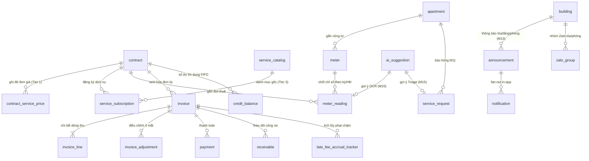

# BÁO CÁO KỸ THUẬT & NGHIỆM THU GIAI ĐOẠN 2 (TUẦN 5 – TUẦN 8)
**LÀM CHỦ BUSINESS LOGIC & TÍCH HỢP AI (TƯƠNG ĐƯƠNG S3, S4, S5 TRONG PRD v2.0)**

- **Dự án:** ResiHub — Hệ thống Quản lý Căn hộ & Nhà cho thuê
- **Phạm vi Giai đoạn 2:** Module M07 (Đồng hồ Điện/Nước), M08 (Dịch vụ & Định giá), M09 (Hóa đơn & Động cơ tính tiền), M10 (Thanh toán, Công nợ & Số dư tín dụng), M11 (Yêu cầu sửa chữa / Báo hỏng), M13 (Thông báo & Nhóm Zalo), M14 (Dashboard Chart.js & Báo cáo), M15 (AI Gateway — Gemini API) & Hoàn thiện UI/UX Mobile-First Cổng Cư Dân.
- **Ngày lập báo cáo:** 07/11/2026
- **Kết quả kiểm thử tự động (Unit Tests):** **470 / 470 test cases PASS (100%)** trên 10 bộ test chuyên sâu (`node --test`).

---

## PHẦN 1. RÀ SOÁT CHI TIẾT KẾT QUẢ THỰC HIỆN THEO LỘ TRÌNH TUẦN 5 – TUẦN 8

### 1.1. Tuần 5: Engine Tính tiền & Hóa đơn (M07, M08, M09, M10)

| Hạng mục yêu cầu | Trạng thái | Chi tiết triển khai & Dẫn chứng trong Source Code |
| :--- | :---: | :--- |
| **1. Tính tiền thuê & dịch vụ Pro-rata (chia theo số ngày thực tế)** | **Đạt 100%** | - Công thức chuẩn PRD 10.3: `ROUND(monthlyPrice * quantity * activeDays / daysInMonth, -3)`, làm tròn đến hàng nghìn gần nhất qua hàm `roundVND()` (`api/src/services/pricing.js:7-30`). - Tính tiền thuê theo kỳ hợp đồng (`computeContractRentPeriodCharge` tại `api/src/services/serviceBilling.js:461-571`), xử lý chính xác ngày vào ở giữa tháng, ngày chấm dứt hợp đồng, ngày hết hạn tự nhiên (`[start_date, end_date)`) và ngày cắt chuyển phòng (`resolveContractLastActiveDay`). - Tính phí dịch vụ cố định/theo số lượng (`computeSubscriptionPeriodCharge` tại `api/src/services/serviceBilling.js:264-397`) và dự phóng lịch thu tiền toàn kỳ hợp đồng (`buildExpectedInvoiceSchedule` tại `api/src/services/invoiceSchedule.js:21-188`). |
| **2. Thứ tự ưu tiên giá dịch vụ & điện/nước (FR-065)** | **Đạt 100%** | - **Dịch vụ định kỳ (`resolveServiceUnitPrice` — `serviceBilling.js:140-217`):**   1. `CONTRACT_OVERRIDE`: Giá thỏa thuận riêng trong `contract_service_price` có `effective_from <= periodEndYmd` (hỗ trợ đối chiếu bí danh hai chiều như `ELECTRICITY`/`ELEC`, `WATER`/`DOMESTIC_WATER`).   2. `SUBSCRIPTION_LOCKED`: Giá khóa cố định trên `service_subscription` khi `is_price_locked = true`.   3. `BUILDING_CATALOG` → `DEFAULT_CATALOG`: Giá cấu hình riêng theo tòa nhà (`service_catalog.building_id = contract.building_id`), nếu không có thì lấy giá mặc định toàn tổ chức (`building_id IS NULL`). - **Điện / Nước (`resolveUtilityUnitPrice` — `serviceBilling.js:577-653`):** Ưu tiên `CONTRACT_OVERRIDE` → `BUILDING_CATALOG` → `METER_CONFIG` (`meter.unit_price`) → `DEFAULT_CATALOG`. |
| **3. Cron job chạy hằng ngày sinh hóa đơn nháp theo `billing_day` (FR-066)** | **Đạt 100%** | - Tiến trình `startDailyJobs()` và `runDailyJobs()` (`api/src/jobs/daily.js:1056-1703`) tự động chạy lúc **00:05 giờ Việt Nam (`Asia/Ho_Chi_Minh`)** và có cơ chế catch-up khi khởi động server. - **Cơ chế chống chạy trùng & chịu lỗi (PRD 14.5):** Sử dụng khóa phân tán PostgreSQL `pg_try_advisory_lock(73918205)`, tự động retry tối đa 3 lần với backoff (`1000ms, 2000ms, 4000ms`), ghi lịch sử vào bảng `cron_job_run` và gửi thông báo `CRON_JOB_FAILED` cho `SYS_ADMIN` nếu thất bại. - **Xử lý ngày cuối tháng ngắn (`resolveBillingDaysForDate` — `serviceBilling.js:659-673`):** Vào ngày cuối cùng của tháng có 28, 29 hoặc 30 ngày, hệ thống tự động gom toàn bộ các hợp đồng có `billing_day` từ ngày đó đến `31` để sinh hóa đơn nháp (`DRAFT`) không bỏ sót. - **Kiểm soát chốt đồng hồ (AC-015.1):** Nếu hợp đồng đến `billing_day` nhưng chưa có chỉ số đồng hồ `CONFIRMED`, hệ thống tạm hoãn sinh hóa đơn căn đó và bắn thông báo `MISSING_METER_READING` cho `MANAGER` phụ trách tòa nhà (`daily.js:662-716`). |
| **4. Tính phí phạt chậm 100.000 ₫/ngày & Bất biến hóa đơn (FR-064)** | **Đạt 100%** | - Cấu hình mặc định trong `system_setting.billing_config`: `late_fee_grace_days = 5`, `late_fee_per_day = 100000`, hỗ trợ trần phạt `late_fee_cap` (`009_cron_jobs.sql:42-51`). - Hàm `computeLateFeeAccrual()` (`serviceBilling.js:701-785`) tính số ngày tính phạt `chargeableDays = Math.max(0, overdueDays - graceDays)`, ngừng tính phạt mới ngay khi nợ gốc (`principalAmount`) đã được thanh toán đủ (`paidAmount + creditOffsetAmount >= principalAmount`). - **Đảm bảo tính bất biến của hóa đơn đã phát hành (`IMMUTABLE_AFTER_ISSUED`):** Thay vì sửa trực tiếp `total_amount` trên hóa đơn đã `ISSUED`/`OVERDUE`, tiến trình hằng ngày khóa dòng `FOR UPDATE` và tích lũy tiền phạt vào bảng `late_fee_accrual_tracker` (`daily.js:418-623`). Khi sinh hóa đơn kỳ kế tiếp, khoản phạt này tự động được kết chuyển (`carry_forward_amount`) thành dòng `LATE_FEE` trên hóa đơn mới; hoặc nếu hợp đồng đã kết thúc (`EXPIRED`/`TERMINATED`), hệ thống tự động sinh hóa đơn tất toán phí phạt `LATE_FEE_SETTLEMENT` (`daily.js:725-843`). |
| **5. Vibe Coding: Bộ Unit Test chặt chẽ cho logic tính tiền (NFR-001/014)** | **Đạt 100%** | - Xây dựng **10 file kiểm thử tự động** tại `api/test/*.test.js` với tổng cộng **470 kịch bản kiểm thử (test assertions)** chạy bằng Node.js native test runner (`npm test`). - Riêng mảng định giá, biên tính tiền, đồng hồ và phân quyền 4 mắt chiếm hơn 280 test cases (`bugs_pricing_edge_cases.test.js`, `bugs_billing_engine_boundary.test.js`, `bugs_meter_readings.test.js`, `bugs_four_eyes_rbac.test.js`), bao phủ toàn bộ các biên: năm nhuận (`2024-02` có 29 ngày vs `2023-02` có 28 ngày), làm tròn số âm/dương, sai số dấu phẩy động IEEE-754 (`0.3 - 0.1`), chuyển phòng giữa tháng (nhiều hợp đồng nối tiếp trên cùng 1 đồng hồ trong 1 kỳ), bù trừ tín dụng FIFO (`credit_balance`) và miễn giảm phí phạt có duyệt 4 mắt. |

---

### 1.2. Tuần 6: Quản lý Yêu cầu sửa chữa (M11) & Thông báo / Zalo (M13)

| Hạng mục yêu cầu | Trạng thái | Chi tiết triển khai & Dẫn chứng trong Source Code |
| :--- | :---: | :--- |
| **1. Luồng báo hỏng cho cư dân & Xử lý SLA cho BQL (M11)** | **Đạt 100%** | - **Cổng Cư Dân (`routes/resident.js:840-1425`, `MaintenanceTab.jsx`):** Cư dân gửi yêu cầu báo hỏng kèm ảnh chụp hiện trường (tối đa 5 ảnh), vị trí chi tiết (`location_detail`), khung giờ mong muốn (`MORNING_08_12`, `AFTERNOON_13_17`, `EVENING_18_21`, `ANYTIME`). Hệ thống cấp mã phiếu duy nhất theo múi giờ VN `SR-YYYYMMDD-XXXX` (`serviceRequestRules.js:37-40`). - **Cảnh báo trùng lặp 24h (AC-004.2):** Hàm `isWithinDuplicateWindow()` (`serviceRequestRules.js:78-101`) phát hiện yêu cầu trùng căn hộ + hạng mục đang mở trong vòng 24 giờ. - **Vòng đời trạng thái & Nghiệm thu (`validateServiceRequestTransition` — `serviceRequestRules.js:106-219`):**   - `MANAGER`: Điều phối qua các trạng thái `NEW` → `ASSIGNED` → `IN_PROGRESS` → `ON_HOLD` (bắt buộc nhập `hold_reason`) → `RESOLVED` (kèm ghi chú & ảnh nghiệm thu).   - `RESIDENT`: Được tự hủy (`CANCELLED`) khi phiếu còn `NEW`; khi phiếu `RESOLVED`, cư dân được nghiệm thu đóng phiếu (`CLOSED`) kèm đánh giá 1–5 sao, hoặc yêu cầu xử lý lại (`REOPENED`) trong vòng 3 ngày. - **Cam kết SLA & Leo thang tự động (FR-044):** Tự động tính hạn phản hồi (`sla_response_due_at`, mặc định 2h) và hạn xử lý (`sla_due_at`, mặc định 4h với `URGENT` / 24h với `NORMAL`). Cron job `escalateOverdueServiceRequests()` (`daily.js:1413-1509`) tự động gắn cờ quá hạn SLA và bắn cảnh báo `SERVICE_REQUEST_SLA_BREACH` cho cả `MANAGER` và `OWNER`. |
| **2. Thông báo & Tính năng Copy nội dung chuẩn bị sẵn dán sang nhóm Zalo (M13 — FR-069)** | **Đạt 100%** | - **Quản lý danh mục nhóm Zalo (`routes/zalo-groups.js`):** Quản lý link nhóm Zalo theo 2 cấp phạm vi `BUILDING` (toàn tòa nhà) và `APARTMENT` (từng phòng), kiểm tra chặt chẽ định dạng URL `https://zalo.me/...` hoặc `https://chat.zalo.me/...` (`validateZaloInviteLink` — `zaloFormatter.js:115-134`). - **5 Mẫu thông báo dựng sẵn (`ZALO_ANNOUNCEMENT_TEMPLATES` — `zaloFormatter.js:1-42`):** Cắt điện/nước tạm thời (`UTILITY_INTERRUPTION`), Bảo trì thang máy/PCCC (`MAINTENANCE_NOTICE`), Nhắc nhở nội quy (`HOUSE_RULES`), Cảnh báo an ninh (`SECURITY_ALERT`), Thông báo chung BQL (`GENERAL_ANNOUNCEMENT`). - **Bộ định dạng Zalo Rich Text (`formatAnnouncementForZalo` & `formatServiceRequestForRoomZalo` — `zaloFormatter.js:145-264`):** Tự động sinh nội dung chuẩn mực tiếng Việt theo từng phạm vi (`BUILDING`, `FLOOR`, `APARTMENT`) kèm lời chào, phân loại, thời gian phát hành, hotline BQL và đánh dấu in đậm `**...**`. Phát hiện và cảnh báo nếu còn sót placeholder `[...]` chưa điền. - **Copy Rich Text sang Zalo PC/Web (`frontend/src/utils/zaloFormat.js`, `NotificationsPage.jsx`, `ServiceRequestsPage.jsx`):** Chuyển đổi cú pháp `**text**` sang clipboard đa định dạng (`text/html` với thẻ `<b>` + `text/plain`) giúp khi dán vào Zalo giữ nguyên chữ in đậm và xuống dòng, đồng thời hỗ trợ nút mở nhanh nhóm Zalo và ghi nhận trạng thái `POST /api/v1/announcements/:id/mark-zalo-sent`. |

---

### 1.3. Tuần 7: Tích hợp AI Gateway (M15)

| Hạng mục yêu cầu | Trạng thái | Chi tiết triển khai & Dẫn chứng trong Source Code |
| :--- | :---: | :--- |
| **1. Tích hợp Gemini API từ Backend & Quản trị Ngân sách / Bảo mật** | **Đạt 100%** | - **Tầng kết nối (`api/src/services/geminiClient.js`):** Gọi trực tiếp từ Backend qua chuẩn Structured Outputs (`response_format: application/json` kèm JSON Schema chặt chẽ), tuyệt đối không lộ `GEMINI_API_KEY` xuống Frontend (ẩn khóa qua `scrubSecrets`). Hỗ trợ cơ chế chuỗi model dự phòng (`buildCandidateModelChain`) và tự động cooldown 45s khi gặp lỗi quá tải 429/503. - **Kiểm soát ngân sách & Kill Switch (`evaluateBudgetGate` — `aiRules.js:217-263`):** Kiểm tra cờ bật/tắt toàn cục (`enabled`) và từng tác vụ riêng lẻ; theo dõi chi phí VND ước tính (`estimateGeminiCostVnd`) và tổng token tiêu thụ trong tháng. Tự động gửi cảnh báo `AI_BUDGET_WARNING` cho `SYS_ADMIN` khi đạt ngưỡng 80% và chặn cứng (`429 AI_BUDGET_EXCEEDED`) khi chạm 100% ngân sách. - **Bảo vệ PII & An toàn tệp (`aiRules.js:265-401`):** Kiểm tra chữ ký byte thực tế (magic bytes `0xFFD8FF` cho JPEG, `0x89504E47` cho PNG, `RIFF..WEBP`, `%PDF-`), yêu cầu xác nhận quyền riêng tư (`privacy_acknowledged = true`), và che số CCCD/SĐT (`maskIdNumber`, `maskPhone`) kèm băm SHA-256 (`field_hashes`) trước khi lưu vào bảng `ai_suggestion`. |
| **2. Tác vụ MVP 1: Trích xuất dữ liệu CCCD / Hợp đồng (`CCCD_EXTRACT`, `CONTRACT_EXTRACT`)** | **Đạt 100%** | - Endpoint `POST /api/v1/ai/extract` (`routes/ai.js:41-130`, `aiGateway.js:218-425`). - Với **CCCD**: Trích xuất `full_name`, `id_number`, `dob`, `issue_date`, `permanent_address` kèm độ tự tin từng trường (`field_confidences`). - Với **Hợp đồng**: Trích xuất `tenant_full_name`, `tenant_phone`, `tenant_id_number`, `apartment_code`, `start_date`, `end_date`, `rent_amount`, `deposit_amount`, `billing_day`, `payment_due_days`, `terms_note`. - Nếu `confidence < confidence_threshold` (mặc định `0.75`), gắn cảnh báo `LOW_CONFIDENCE_EXTRACTION` và bật `needs_human_review = true`. |
| **3. Tác vụ MVP 2: Đọc chỉ số đồng hồ điện/nước từ ảnh (`METER_OCR`)** | **Đạt 100%** | - Endpoint `POST /api/v1/ai/meter-ocr` (`routes/ai.js:138-303`, `aiGateway.js:427-759`). - **Zero-PII Query:** Truy vấn ngữ cảnh công tơ chỉ lấy mã phòng, loại đồng hồ và lịch sử tiêu thụ, tuyệt đối không JOIN bảng `person`/`tenant`. - **Hậu kiểm thông minh (`postValidateMeterOcr` — `aiRules.js:429-525`):**   - Tự động nhận diện loại đồng hồ trên mặt số (`detected_meter_type`: `ELECTRICITY` / `WATER`) và cảnh báo `METER_TYPE_MISMATCH` nếu chụp nhầm loại.   - Nếu ảnh mờ/lóa hoặc `confidence < 0.8`, trả `reading = null` và gắn `LOW_CONFIDENCE_OR_UNREADABLE` (không đoán mò số).   - Đối chiếu chỉ số kỳ trước: gắn cảnh báo `READING_LOWER_THAN_PREVIOUS` nếu số mới nhỏ hơn số cũ, và `CONSUMPTION_ANOMALY_HIGH` nếu sản lượng tăng đột biến > 30% so với trung bình 3 kỳ gần nhất. - Hỗ trợ **nhập ảnh hàng loạt theo tên file (`meterBatchPhotoHelpers.js`)** trên giao diện `MeterReadingsPage.jsx`. |
| **4. Tác vụ MVP 3: Phân loại yêu cầu báo hỏng (`TICKET_TRIAGE`)** | **Đạt 100%** | - Endpoint `POST /api/v1/ai/classify` (`routes/ai.js:310-374`) và cơ chế chạy ngầm `triggerAsyncTicketTriage()` ngay sau khi cư dân tạo yêu cầu (`aiGateway.js:789-1074`). - **Danh mục đóng & Hậu kiểm an toàn (`postValidateTicketTriage` — `aiRules.js:527-591`):**   - Chỉ chấp nhận phân loại thuộc `CLOSED_TICKET_CATEGORIES` (`ELECTRICAL`, `PLUMBING`, `HVAC`, `FURNITURE`, `APPLIANCE`, `CLEANING`, `SECURITY`, `OTHER`) và `CLOSED_TICKET_PRIORITIES` (`LOW`, `NORMAL`, `HIGH`, `URGENT`); chặn mọi nhãn AI tự bịa ngoài danh mục (`OUT_OF_TAXONOMY_*`).   - Chỉ gợi ý nhân sự phụ trách (`suggested_assignee_id`) nằm trong danh sách `MANAGER` đang hoạt động của đúng tòa nhà đó.   - **Lưới an toàn sinh mạng (`SAFETY_HAZARD_RE`):** Nếu tiêu đề/mô tả chứa từ khóa nguy hiểm (*rò điện, giật điện, phóng tia lửa, chập cháy, bốc khói, cháy nổ, vỡ ống, ngập nước, rò gas, mùi gas, kẹt thang máy, kẹt khóa cửa ngoài*), hệ thống **cưỡng bức nâng độ ưu tiên lên `URGENT`** và gắn cờ `SAFETY_HAZARD_ESCALATED` kể cả khi độ tự tin của AI thấp. |
| **5. Nguyên tắc cốt lõi: "AI đề xuất, người quyết định"** | **Đạt 100%** | - Toàn bộ 3 tác vụ AI chỉ tạo bản ghi nháp trong bảng `ai_suggestion` với `status = 'PENDING'` (tự động hết hạn sang `EXPIRED` sau 72h qua cron job `expireStaleAiSuggestions`). - Người dùng kiểm tra trên UI, có thể chỉnh sửa rồi mới bấm xác nhận qua `POST /api/v1/ai/suggestions/:id/review` (`ACCEPT`, `EDITED_ACCEPTED`, `REJECTED`) hoặc `POST /api/v1/service-requests/:id/apply-triage`. - Hệ thống tự động đối chiếu hash từng trường (`computeFieldAcceptanceDiff`) để đo lường chính xác **KPI G6**: Tỷ lệ chấp nhận trường trích xuất không cần sửa (mục tiêu ≥ 70%) và Tỷ lệ giữ nguyên phân loại báo hỏng (mục tiêu ≥ 80%) tại endpoint `GET /api/v1/ai/usage`. |

---

### 1.4. Tuần 8: Dashboard Chart.js (M14) & Hoàn thiện UI/UX Mobile-First

| Hạng mục yêu cầu | Trạng thái | Chi tiết triển khai & Dẫn chứng trong Source Code |
| :--- | :---: | :--- |
| **1. Biểu đồ Doanh thu, Công nợ, Lấp đầy bằng Chart.js (M14)** | **Đạt 100%** | - Sử dụng thư viện chuẩn `chart.js` v4.5 và `react-chartjs-2` v5.3 (`frontend/src/pages/admin/dashboard/DashboardPage.jsx`, `frontend/src/utils/chartHelpers.js`, `api/src/services/dashboardMetrics.js`, `api/src/routes/reports.js`):   1. **Biểu đồ Doanh thu (`Line` & `Stacked Bar`):** Chuyển đổi linh hoạt giữa 2 chế độ: *Xu hướng Phát hành vs Thực thu* (`buildRevenueTrendChartData`) và *Cơ cấu Doanh thu theo nguồn* (`buildRevenueBySourceChartData`: Tiền thuê phòng, Điện, Nước, Dịch vụ, Khác). Thuật toán `aggregateInvoiceLinesBySource()` xử lý phân bổ giảm trừ và đối soát tổng các cột chồng khớp 100% với tổng phát hành.   2. **Biểu đồ Tuổi nợ (`Receivables Aging` — `Bar` chart):** Phân nhóm công nợ thành 5 nhóm (`Chưa đến hạn`, `1–15 ngày`, `16–30 ngày`, `31–60 ngày`, `>60 ngày`) qua `normalizeReceivablesAging()`. Hỗ trợ **click trực tiếp vào từng cột tuổi nợ** để điều hướng (drill-down) sang danh sách công nợ tương ứng (`/admin/payments?tab=aging&bucket=...`).   3. **Biểu đồ Tỷ lệ lấp đầy (`Occupancy Trend` — `Line` chart):** Hiển thị biến động tỷ lệ % căn hộ đang khai thác (`occupied / exploitable`) qua 6/12/24 tháng (`buildMonthlyOccupancySeries`). - Bộ lọc thời gian linh hoạt (6 tháng, 12 tháng, 24 tháng) và lọc theo từng Tòa nhà trong phạm vi phân quyền (`OWNER` / `MANAGER` / `SYS_ADMIN`), kèm cache truy vấn thông minh (`queryCache.js`) giúp phản hồi tức thì. |
| **2. Responsive & Thiết kế Mobile-First cho Cổng Cư Dân** | **Đạt 100%** | - **Bố cục thích ứng đa thiết bị (`ResidentLayout.jsx`, `ResidentPortalPage.jsx`, `residentNavHelpers.js`):**   - **Trên Mobile (`< 768px`):** Thiết kế thanh điều hướng cố định dưới đáy màn hình 5 ô (**5-Slot Bottom Navigation Bar**: *Tổng quan, Hóa đơn, Báo hỏng, Dịch vụ, Thêm*) kết hợp ngăn kéo Bottom-Sheet (`Modal` "Tiện ích & Hồ sơ cư dân") cho các mục phụ (*Hợp đồng, Thông báo, Liên hệ BQL, Hồ sơ cá nhân*). Tự động hiển thị nhãn mục phụ đang mở và gom tổng badge thông báo chưa đọc lên nút *Thêm*.   - **Trên Tablet & Màn hình thu nhỏ (`< 1024px`):** Có thanh **Sticky Sub-Header Tab Bar** cuộn ngang tự động căn giữa tab đang chọn (`scrollIntoView({ inline: 'center' })`), đảm bảo không bao giờ bị mất thanh điều hướng khi thu hẹp cửa sổ.   - **Trên Desktop (`>= 1024px`):** Sidebar dọc cố định bên trái kết hợp vùng nội dung rộng rãi. - **Chuẩn khả năng tiếp cận & thao tác chạm (Touch Targets):** Tất cả nút bấm điều hướng, nút quay lại, chọn hợp đồng/căn hộ trên mobile đều có kích thước tối thiểu `min-h-[44px]` đến `min-h-[48px]`, hỗ trợ `pb-safe` cho màn hình tai thỏ/thanh điều hướng iOS/Android. |

---

### 1.5. Đánh giá Tiêu chí Nghiệm thu Giai đoạn 2

1. **Tiêu chí 1: "Sinh thành công hóa đơn kỳ cho 50 căn hộ tự động và chính xác"** → **ĐẠT VƯỢT MỨC**
   - Hệ thống đã được kiểm thử với bộ dữ liệu thực tế `api/src/db/seed_vinhomes.js` quy mô **3 tòa nhà, 240 căn hộ (80 căn/tòa), ~260 hợp đồng** (vượt gần 5 lần quy mô mục tiêu 50 căn hộ).
   - Động cơ sinh hóa đơn hàng loạt (`generateInvoicesCore` qua Cron job hằng ngày hoặc API `POST /api/v1/invoices/generate-batch`) xử lý trong 1 transaction an toàn, tự động tính tiền thuê pro-rata, điện/nước theo chỉ số `CONFIRMED`, dịch vụ cố định theo ưu tiên giá 3 tầng, bù trừ `credit_balance` theo FIFO và kết chuyển phí phạt chậm từ `late_fee_accrual_tracker`.
2. **Tiêu chí 2: "AI đọc được ảnh đồng hồ và phân loại được text báo hỏng"** → **ĐẠT 100%**
   - `POST /api/v1/ai/meter-ocr` đọc chính xác chỉ số công tơ điện/nước từ ảnh chụp, tự động phát hiện loại đồng hồ, tính sản lượng tiêu thụ dự kiến và cảnh báo khi ảnh mờ hoặc chỉ số bất thường.
   - `POST /api/v1/ai/classify` (và luồng chạy ngầm khi cư dân tạo phiếu) phân loại chính xác yêu cầu báo hỏng vào danh mục đóng, gợi ý độ ưu tiên + nhân sự kỹ thuật phụ trách và tự động kích hoạt mức `URGENT` khi phát hiện từ khóa mất an toàn.

---

## PHẦN 2. CẤU TRÚC CƠ SỞ DỮ LIỆU (DATABASE SCHEMA) ĐÃ CHỐT

Toàn bộ lược đồ CSDL PostgreSQL được hợp nhất sạch sẽ vào 9 file migration chuẩn hóa tại `api/src/db/migrations/` (`001_extensions_and_roles.sql` → `009_cron_jobs.sql`), bao gồm **29 bảng nghiệp vụ**, đầy đủ khóa ngoại, `CHECK` constraints, `EXCLUDE USING gist`, Partial Unique Indexes, Triggers bất biến và Row Level Security (`FORCE ROW LEVEL SECURITY`).

### 2.1. Sơ đồ quan hệ thực thể (ERD) các phân hệ trọng tâm Giai đoạn 2

### 2.2. Danh mục các bảng CSDL Giai đoạn 2 (M07 – M15)

| Nhóm phân hệ | Tên bảng | Các cột & Ràng buộc (Constraints / Indexes) cốt lõi |
| :--- | :--- | :--- |
| **M07 — Đồng hồ Điện/Nước** | `meter` | `id`, `org_id`, `building_id`, `apartment_id`, `meter_type` (`ELECTRICITY`, `WATER`), `meter_code`, `unit`, `unit_price`, `initial_reading`, `status` (`ACTIVE`, `INACTIVE`). • Unique: `(building_id, meter_code)` và `(apartment_id, meter_type)`. |
| | `meter_reading` | `id`, `meter_id`, `apartment_id`, `contract_id`, `period` (`YYYY-MM`), `previous_reading`, `current_reading`, `consumption`, `is_abnormal`, `baseline_avg_consumption`, `status` (`DRAFT`, `CONFIRMED`, `FLAGGED`), `source` (`MANUAL`, `AI`, `IOT`), `ai_suggestion_id`. • Check: `current_reading >= previous_reading`. • Partial Unique: `(meter_id, period, contract_id)` hỗ trợ nhiều đợt khách thuê chuyển phòng trong cùng 1 tháng (`ux_meter_reading_period_contract`). |
| **M08 — Dịch vụ & Định giá** | `service_catalog` | `id`, `org_id`, `building_id` (NULL = giá mặc định toàn org, NOT NULL = giá riêng tòa nhà), `code`, `name`, `category`, `billing_type` (`FIXED`, `METERED`, `QUANTITY`, `ONE_TIME`), `unit`, `unit_price`, `status`. • Partial Unique: `idx_service_catalog_org_default_code` & `idx_service_catalog_building_code`. |
| | `service_subscription` | `id`, `org_id`, `building_id`, `apartment_id`, `contract_id`, `service_id`, `quantity`, `unit_price`, `vehicle_plates` (`TEXT[]`), `start_date`, `end_date`, `status` (`PENDING_APPROVAL`, `ACTIVE`, `CANCELLATION_PENDING`, `TERMINATED`, `REJECTED`), `is_price_locked` (`BOOLEAN`). |
| | `contract_service_price` | `id`, `contract_id`, `service_code`, `unit_price`, `effective_from`. • Unique: `(contract_id, service_code, effective_from)` — Tầng ưu tiên số 1 khi tính phí dịch vụ/điện/nước. |
| **M09 — Hóa đơn & Phạt chậm** | `invoice` | `id`, `org_id`, `building_id`, `apartment_id`, `contract_id`, `tenant_id`, `invoice_code` (`UNIQUE`), `period`, `issue_date`, `due_date`, `subtotal_amount`, `adjustment_amount`, `credit_offset_amount`, `late_fee_amount`, `carry_forward_amount`, `total_amount`, `paid_amount`, `invoice_type` (`REGULAR`, `LATE_FEE_SETTLEMENT`), `status` (`DRAFT`, `ISSUED`, `PARTIALLY_PAID`, `PAID`, `OVERDUE`, `VOID`), `immutable_at`. • Check: `paid_amount <= total_amount`. • Partial Unique: 1 hóa đơn `REGULAR` đang hiệu lực trên mỗi `(contract_id, period)`. |
| | `invoice_line` | `id`, `invoice_id`, `subscription_id`, `credit_id`, `adjustment_id`, `item_type` (`RENT`, `ELECTRICITY`, `WATER`, `SERVICE`, `ADJUSTMENT`, `LATE_FEE`, `OTHER`), `description`, `quantity`, `unit`, `unit_price`, `amount`, `formula_meta` (`JSONB` lưu vết công thức pro-rata & nguồn giá). |
| | `invoice_adjustment` | `id`, `invoice_id`, `subscription_id`, `adjustment_target` (`SERVICE`, `RENT`, `LATE_FEE`, `MANUAL`), `action_type` (`ADJUST`, `VOID`), `delta_amount`, `reason`, `status` (`PENDING_APPROVAL`, `APPROVED`, `REJECTED`), `created_by`, `approved_by`. |
| | `late_fee_accrual_tracker` | `id`, `org_id`, `contract_id`, `invoice_id`, `accrued_total`, `chargeable_days`, `as_of_date`, `carried_to_invoice_id`, `carried_at`. • Partial Unique: `uq_lf_tracker_open_invoice` trên `(invoice_id) WHERE carried_to_invoice_id IS NULL`. |
| **M10 — Thanh toán, Công nợ & Tín dụng** | `payment` | `id`, `org_id`, `building_id`, `invoice_id`, `contract_id`, `tenant_id`, `payment_code` (`UNIQUE`), `amount` (`> 0`), `overpayment_amount`, `method` (`BANK_TRANSFER`, `CASH`, `CARD`, `EWALLET`, `QR_CODE`, `OTHER`), `reference_code`, `proof_images`, `status` (`PENDING_CONFIRMATION`, `CONFIRMED`, `REJECTED`). |
| | `credit_balance` | `id`, `org_id`, `building_id`, `contract_id`, `tenant_id`, `source_invoice_id`, `source_adjustment_id`, `source_payment_id`, `reason_type` (`SERVICE_TERMINATION`, `CONTRACT_TERMINATION_RENT`, `INVOICE_ADJUSTMENT`, `OVERPAYMENT`, `TRANSFERRED_IN`), `amount`, `applied_amount`, `settlement_refund_amount`, `status` (`AVAILABLE`, `PARTIALLY_APPLIED`, `APPLIED`, `PENDING_DIRECT_REFUND`, `REFUNDED_DIRECT`, `PENDING_SETTLEMENT_PAYOUT`, `REFUNDED_IN_SETTLEMENT`, `TRANSFERRED`, `VOID`). |
| | `receivable` | `id`, `org_id`, `building_id`, `contract_id`, `tenant_id`, `invoice_id`, `deposit_id`, `type` (`INVOICE_DEBT`, `RECEIVABLE_AFTER_MOVE_OUT`, `OTHER`), `amount`, `paid_amount`, `due_date`, `status` (`OPEN`, `PARTIALLY_PAID`, `PAID`, `WRITTEN_OFF`). |
| **M11 — Yêu cầu Sửa chữa (Báo hỏng)** | `service_request` | `id`, `org_id`, `building_id`, `apartment_id`, `tenant_id`, `tracking_code` (`UNIQUE`), `title`, `description`, `category`, `priority` (`LOW`, `NORMAL`, `HIGH`, `URGENT`), `status` (`NEW`, `ASSIGNED`, `IN_PROGRESS`, `ON_HOLD`, `RESOLVED`, `REOPENED`, `CLOSED`, `CANCELLED`), `photos`, `assigned_to`, `sla_response_due_at`, `sla_due_at`, `first_responded_at`, `sla_breached_at`, `hold_reason`, `resolution_note`, `resolution_images`, `resident_rating` (`1..5`), `reopen_count`, `ai_suggestion_id`, `ai_triage_status` (`SUGGESTED`, `ACCEPTED`, `OVERRIDDEN`), `ai_summary`, `ai_suggested_category`, `ai_suggested_priority`, `ai_suggested_assignee_id`, `ai_confidence`. |
| **M13 — Thông báo & Zalo** | `announcement` | `id`, `org_id`, `building_id`, `target_scope` (`BUILDING`, `FLOOR`, `APARTMENT`), `floor_id`, `apartment_id`, `type` (`ANNOUNCEMENT`, `MAINTENANCE_NOTICE`, `SECURITY_ALERT`, `UTILITY_INTERRUPTION`, `HOUSE_RULES`, `SYSTEM`), `title`, `body`, `zalo_content`, `channels`, `status` (`DRAFT`, `SCHEDULED`, `SENT`, `CANCELLED`), `scheduled_at`, `sent_at`, `manual_sent_at`, `manual_sent_by`, `manual_sent_groups`, `recipient_count`. |
| | `notification` | `id`, `org_id`, `user_id`, `announcement_id`, `title`, `content`, `type`, `payload` (`JSONB` chứa `link` điều hướng sâu), `read_at`, `created_at`. |
| | `zalo_group` | `id`, `org_id`, `building_id`, `apartment_id`, `scope` (`BUILDING`, `APARTMENT`), `name`, `invite_link`, `note`, `is_active`. • Check: `chk_zalo_group_scope_target` đảm bảo nhóm `BUILDING` không gắn `apartment_id` và nhóm `APARTMENT` bắt buộc có `apartment_id`. |
| **M15 — AI Gateway** | `ai_suggestion` | `id`, `org_id`, `building_id`, `task_type` (`CCCD_EXTRACT`, `CONTRACT_EXTRACT`, `METER_OCR`, `TICKET_TRIAGE`), `target_entity` (`tenant`, `contract`, `meter_reading`, `service_request`), `target_entity_id`, `input_ref` (`JSONB` lưu SHA-256 file), `output` (`JSONB` đã che PII + `field_hashes`), `edited_output`, `warnings`, `confidence` (`0..1`), `needs_human_review`, `accepted_fields_count`, `total_fields_count`, `model`, `prompt_version`, `input_tokens`, `output_tokens`, `estimated_cost_vnd`, `latency_ms`, `status` (`PENDING`, `ACCEPTED`, `EDITED_ACCEPTED`, `REJECTED`, `EXPIRED`, `FAILED`), `reviewed_by`, `reviewed_at`, `expires_at` (`+72 hours`). |
| **Hạ tầng Cron & Idempotency** | `system_setting`, `cron_job_run`, `idempotency_key` | - `system_setting`: Lưu cấu hình `billing_config`, `sla_config`, `approval_config`, `ai_config`, `contact_config` theo từng `org_id`. - `cron_job_run`: Lưu nhật ký chạy job định kỳ (`job_name`, `run_date`, `status`, `attempt_count`, `duration_ms`, `summary`, `error_message`). - `idempotency_key`: Chống gửi trùng request (`Idempotency-Key` header) trên toàn bộ các API tạo/cập nhật nhạy cảm. |

*(Cùng 9 bảng nền tảng từ Giai đoạn 1: `organization`, `person`, `app_user`, `owner`, `role`, `user_role`, `building`, `floor`, `zone`, `apartment`, `tenant`, `reservation`, `contract`, `contract_version`, `contract_occupant`, `contract_request`, `deposit`, `deposit_transaction`, `audit_log`, `attachment`).*

---

## PHẦN 3. DANH SÁCH API ENDPOINTS ĐÃ CHỐT

Hệ thống cung cấp tổng cộng **126 RESTful API Endpoints** (đăng ký tại `api/src/server.js`), bảo vệ bởi JWT (`authenticateToken`), phân quyền vai trò (`requireRole`), giới hạn tần suất (`generalLimiter`, `otpRequestLimiter`, `aiRateLimiter`), chống trùng lặp thao tác (`idempotencyGuard`) và cô lập dữ liệu PostgreSQL RLS (`getUserClient`).

Dưới đây là danh sách các API Endpoints trọng tâm của Giai đoạn 2 (và bảng tổng hợp toàn hệ thống):

### 3.1. Nhóm Đồng hồ Điện/Nước — M07 (`/api/v1/meters`)

| Method | Endpoint | Phân quyền (Roles) | Mô tả nghiệp vụ |
| :---: | :--- | :--- | :--- |
| `GET` | `/api/v1/meters` | `SYS_ADMIN`, `OWNER`, `MANAGER` | Danh sách đồng hồ điện/nước theo tòa nhà, căn hộ, loại đồng hồ (tự động khởi tạo đồng hồ mặc định cho căn hộ đang hoạt động nếu chưa có). |
| `POST` | `/api/v1/meters` | `MANAGER` | Tạo mới hoặc cập nhật cấu hình đồng hồ điện/nước (`unit_price`, `initial_reading`, `status`). |
| `GET` | `/api/v1/meters/readings` | `SYS_ADMIN`, `OWNER`, `MANAGER` | Bảng chốt chỉ số theo kỳ `YYYY-MM`, hỗ trợ nhiều đợt hợp đồng (`slot`) trong cùng kỳ khi chuyển phòng/thay khách giữa tháng. |
| `POST` | `/api/v1/meters/readings/batch` | `MANAGER` | Ghi nhận hàng loạt chỉ số điện/nước trong kỳ; tự động kiểm tra tính đơn điệu (`current >= previous`) và gắn cờ `FLAGGED` nếu biến động > 30%. |
| `POST` | `/api/v1/meters/readings/confirm-batch` | `MANAGER` | Xác nhận hàng loạt chỉ số (`CONFIRMED`) để đủ điều kiện đưa vào hóa đơn kỳ. |
| `POST` | `/api/v1/meters/readings/:readingId/confirm` | `MANAGER` | Duyệt / xác nhận một bản ghi chỉ số (bao gồm các chỉ số `FLAGGED` có ghi chú giải trình). |
| `GET` | `/api/v1/meters/:id/readings` | `SYS_ADMIN`, `OWNER`, `MANAGER` | Lịch sử chỉ số của một đồng hồ cụ thể qua các kỳ. |
| `POST` | `/api/v1/meters/:id/readings` | `MANAGER` | Nhập chỉ số cho một đồng hồ đơn lẻ (kèm ảnh minh chứng hoặc `ai_suggestion_id`). |

### 3.2. Nhóm Dịch vụ & Gói đăng ký — M08 (`/api/v1/service-catalog`, `/api/v1/service-subscriptions`)

| Method | Endpoint | Phân quyền (Roles) | Mô tả nghiệp vụ |
| :---: | :--- | :--- | :--- |
| `GET` | `/api/v1/service-catalog` | Tất cả vai trò đã đăng nhập | Danh mục dịch vụ toàn tổ chức và dịch vụ riêng theo từng tòa nhà. |
| `POST` | `/api/v1/service-catalog` | `MANAGER` | Thêm mới dịch vụ vào danh mục (`FIXED`, `METERED`, `QUANTITY`, `ONE_TIME`). |
| `PATCH` | `/api/v1/service-catalog/:id` | `MANAGER` | Cập nhật đơn giá, trạng thái dịch vụ trong danh mục. |
| `GET` | `/api/v1/service-subscriptions` | `SYS_ADMIN`, `OWNER`, `MANAGER` | Danh sách gói đăng ký dịch vụ của các căn hộ/hợp đồng (lọc theo tòa nhà, trạng thái). |
| `POST` | `/api/v1/service-subscriptions` | `MANAGER` | Đăng ký dịch vụ mới cho hợp đồng (hỗ trợ khóa giá `is_price_locked`, biển số xe `vehicle_plates` và tự động đồng bộ vào hóa đơn `DRAFT`). |
| `PATCH` | `/api/v1/service-subscriptions/:id` | `MANAGER` | Duyệt yêu cầu đăng ký/hủy dịch vụ của cư dân, cập nhật số lượng hoặc chấm dứt dịch vụ giữa kỳ (tự động tính lại pro-rata hoặc sinh `credit_balance` / `invoice_adjustment`). |

### 3.3. Nhóm Hóa đơn & Động cơ tính tiền — M09 (`/api/v1/invoices`)

| Method | Endpoint | Phân quyền (Roles) | Mô tả nghiệp vụ |
| :---: | :--- | :--- | :--- |
| `GET` | `/api/v1/invoices` | `SYS_ADMIN`, `OWNER`, `MANAGER` | Danh sách hóa đơn theo tòa nhà, kỳ thu phí, trạng thái, loại hóa đơn (`REGULAR`, `LATE_FEE_SETTLEMENT`). |
| `GET` | `/api/v1/invoices/adjustments` | `SYS_ADMIN`, `OWNER`, `MANAGER` | Danh sách phiếu đề nghị điều chỉnh / hủy hóa đơn chờ duyệt 4 mắt. |
| `POST` | `/api/v1/invoices/generate-batch` | `MANAGER` | Sinh hóa đơn hàng loạt cho kỳ `YYYY-MM` (tính pro-rata tiền phòng + dịch vụ + điện/nước `CONFIRMED` + bù trừ `credit_balance` FIFO + kết chuyển phạt chậm từ `late_fee_accrual_tracker`). |
| `GET` | `/api/v1/invoices/:id` | `SYS_ADMIN`, `OWNER`, `MANAGER`, `RESIDENT` | Chi tiết hóa đơn kèm danh sách dòng thu (`invoice_line`), lịch sử thanh toán, phiếu điều chỉnh và thông tin VietQR. |
| `POST` | `/api/v1/invoices/:id/lines` | `MANAGER` | Thêm dòng thu/giảm trừ thủ công vào hóa đơn đang ở trạng thái `DRAFT`. |
| `PATCH` | `/api/v1/invoices/:id/lines/:lineId` | `MANAGER` | Sửa dòng chi tiết trên hóa đơn `DRAFT` và tính lại tổng tiền. |
| `DELETE` | `/api/v1/invoices/:id/lines/:lineId` | `MANAGER` | Xóa dòng chi tiết thủ công trên hóa đơn `DRAFT`. |
| `POST` | `/api/v1/invoices/:id/issue` | `MANAGER` | Phát hành hóa đơn (`DRAFT` → `ISSUED`), khóa bất biến (`immutable_at`), tạo bản ghi `receivable` và gửi thông báo cho cư dân. |
| `PATCH` | `/api/v1/invoices/:id/status` | `MANAGER` | Cập nhật trạng thái hóa đơn theo quy tắc vòng đời. |
| `POST` | `/api/v1/invoices/:id/adjust` | `MANAGER` | Tạo phiếu đề nghị điều chỉnh (`ADJUST`) hoặc hủy (`VOID`) cho hóa đơn đã phát hành (`PENDING_APPROVAL`). |
| `POST` | `/api/v1/invoices/:id/adjustments/:adjId/approve` | `OWNER`, `MANAGER`, `SYS_ADMIN` | Phê duyệt phiếu điều chỉnh/hủy hóa đơn theo nguyên tắc 4 mắt (`checkFourEyesOrWarn`), tự động sinh `credit_balance` nếu phát sinh thu thừa. |
| `POST` | `/api/v1/invoices/:id/adjustments/:adjId/reject` | `OWNER`, `MANAGER`, `SYS_ADMIN` | Từ chối phiếu điều chỉnh/hủy hóa đơn kèm lý do. |
| `GET` | `/api/v1/invoices/:id/audit-logs` | `SYS_ADMIN`, `OWNER`, `MANAGER` | Lịch sử kiểm toán (audit trail) của hóa đơn. |

### 3.4. Nhóm Thanh toán, Công nợ & Số dư tín dụng — M10 (`/api/v1/payments`, `/api/v1/receivables`)

| Method | Endpoint | Phân quyền (Roles) | Mô tả nghiệp vụ |
| :---: | :--- | :--- | :--- |
| `GET` | `/api/v1/payments` | `SYS_ADMIN`, `OWNER`, `MANAGER` | Danh sách giao dịch thanh toán hóa đơn (lọc theo tòa nhà, trạng thái xác nhận, phương thức). |
| `POST` | `/api/v1/payments` | `MANAGER` | Ghi nhận thu tiền trực tiếp từ BQL; nếu số tiền thu vượt số còn phải trả trên hóa đơn, phần dư tự động ghi nhận vào `credit_balance` (`OVERPAYMENT`). |
| `PATCH` | `/api/v1/payments/:id/confirm` | `MANAGER` | Xác nhận khoản thanh toán do cư dân báo chuyển khoản (`PENDING_CONFIRMATION` → `CONFIRMED`), cập nhật `paid_amount` và trạng thái hóa đơn (`PARTIALLY_PAID` / `PAID`). |
| `PATCH` | `/api/v1/payments/:id/reject` | `MANAGER` | Từ chối báo thanh toán không hợp lệ kèm lý do và gửi thông báo cho cư dân. |
| `GET` | `/api/v1/receivables` | `SYS_ADMIN`, `OWNER`, `MANAGER` | Danh sách các khoản phải thu / công nợ và phân tích tuổi nợ (`aging`). |
| `GET` | `/api/v1/payments/credits` | `SYS_ADMIN`, `OWNER`, `MANAGER` | Danh sách số dư tín dụng (`credit_balance`) của các hợp đồng. |
| `POST` | `/api/v1/payments/credits/:id/refund` | `MANAGER` | Lập đề nghị hoàn tiền trực tiếp từ số dư tín dụng khả dụng cho cư dân. |
| `POST` | `/api/v1/payments/credits/:id/refund/approve` | `OWNER`, `MANAGER`, `SYS_ADMIN` | Phê duyệt chi hoàn số dư tín dụng (kiểm soát 4 mắt). |
| `POST` | `/api/v1/payments/credits/:id/refund/reject` | `OWNER`, `MANAGER`, `SYS_ADMIN` | Từ chối đề nghị hoàn số dư tín dụng. |

### 3.5. Nhóm Yêu cầu Sửa chữa / Báo hỏng — M11 (`/api/v1/service-requests`)

| Method | Endpoint | Phân quyền (Roles) | Mô tả nghiệp vụ |
| :---: | :--- | :--- | :--- |
| `GET` | `/api/v1/service-requests` | `SYS_ADMIN`, `OWNER`, `MANAGER` | Danh sách phiếu báo hỏng theo tòa nhà, trạng thái, hạng mục, mức độ ưu tiên, trạng thái SLA và trạng thái AI Triage. |
| `POST` | `/api/v1/service-requests` | `MANAGER` | BQL tạo phiếu yêu cầu sửa chữa hộ cư dân hoặc cho khu vực căn hộ. |
| `GET` | `/api/v1/service-requests/:id` | `SYS_ADMIN`, `OWNER`, `MANAGER` | Xem chi tiết phiếu báo hỏng kèm nội dung định dạng sẵn cho nhóm Zalo phòng (`zalo_room_message`) và gợi ý từ AI (`ai_suggestion`). |
| `PATCH` | `/api/v1/service-requests/:id/status` | `MANAGER` | Chuyển trạng thái xử lý (`ASSIGNED`, `IN_PROGRESS`, `ON_HOLD`, `RESOLVED`, `CLOSED`, `CANCELLED`), phân công nhân sự, ghi nhận thời점 phản hồi đầu tiên (`first_responded_at`) và bắn thông báo cho cư dân. |
| `POST` | `/api/v1/service-requests/:id/apply-triage` | `MANAGER` | Duyệt áp dụng gợi ý phân loại của AI (`ACCEPT` hoặc chỉnh sửa `OVERRIDE` hạng mục, mức ưu tiên, người phụ trách) theo nguyên tắc "AI đề xuất, người quyết định". |
| `POST` | `/api/v1/service-requests/:id/rating` | Đã đăng nhập | Cư dân đánh giá chất lượng xử lý (1–5 sao) và nghiệm thu đóng phiếu (`CLOSED`). |

### 3.6. Nhóm Thông báo & Nhóm Zalo — M13 (`/api/v1/announcements`, `/api/v1/notifications`, `/api/v1/zalo-groups`)

| Method | Endpoint | Phân quyền (Roles) | Mô tả nghiệp vụ |
| :---: | :--- | :--- | :--- |
| `GET` | `/api/v1/announcements/templates` | Đã đăng nhập | Lấy 5 mẫu thông báo chuẩn bị sẵn (`ZALO_ANNOUNCEMENT_TEMPLATES`). |
| `GET` | `/api/v1/announcements` | `SYS_ADMIN`, `OWNER`, `MANAGER` | Danh sách bản tin thông báo BQL (`DRAFT`, `SCHEDULED`, `SENT`) kèm nội dung `zalo_content` và danh sách nhóm Zalo đích. |
| `POST` | `/api/v1/announcements` | `MANAGER` | Tạo thông báo mới (lưu nháp `DRAFT`, hẹn giờ `SCHEDULED` hoặc phát hành ngay `SENT` tới `BUILDING` / `FLOOR` / `APARTMENT`). |
| `PUT` | `/api/v1/announcements/:id` | `MANAGER` | Chỉnh sửa thông báo đang ở trạng thái `DRAFT` hoặc `SCHEDULED`, hoặc hủy lịch (`CANCELLED`). |
| `POST` | `/api/v1/announcements/:id/send` | `MANAGER` | Phát hành ngay một thông báo nháp/hẹn giờ, fan-out vào hộp thư `notification` của toàn bộ cư dân thuộc phạm vi đích. |
| `POST` | `/api/v1/announcements/:id/mark-zalo-sent` | `MANAGER` | Ghi nhận BQL đã sao chép và gửi thông báo sang các nhóm Zalo (`manual_sent_at`, `manual_sent_groups`). |
| `GET` | `/api/v1/zalo-groups` | `SYS_ADMIN`, `OWNER`, `MANAGER` | Danh sách nhóm Zalo cấp Tòa nhà (`BUILDING`) và cấp Phòng (`APARTMENT`). |
| `POST` | `/api/v1/zalo-groups` | `MANAGER` | Tạo mới liên kết nhóm Zalo (`https://zalo.me/...` hoặc `https://chat.zalo.me/...`). |
| `PUT` | `/api/v1/zalo-groups/:id` | `MANAGER` | Cập nhật tên, link mời hoặc trạng thái hoạt động của nhóm Zalo. |
| `GET` | `/api/v1/notifications` | Đã đăng nhập | Hộp thư thông báo in-app của người dùng hiện tại (kèm `unread_count`). |
| `POST` | `/api/v1/notifications` | `MANAGER` | Gửi thông báo trực tiếp cho người dùng/cư dân. |
| `PATCH` | `/api/v1/notifications/:id/read` | Đã đăng nhập | Đánh dấu đã đọc 1 thông báo. |
| `POST` | `/api/v1/notifications/read-all` | Đã đăng nhập | Đánh dấu đã đọc toàn bộ thông báo của người dùng. |

### 3.7. Nhóm AI Gateway — M15 (`/api/v1/ai`)

| Method | Endpoint | Phân quyền (Roles) | Mô tả nghiệp vụ |
| :---: | :--- | :--- | :--- |
| `POST` | `/api/v1/ai/extract` | `SYS_ADMIN`, `MANAGER` | **AI-01:** Trích xuất dữ liệu có cấu trúc từ ảnh CCCD (1–2 ảnh) hoặc ảnh/PDF Hợp đồng thuê (1–3 tệp); lưu bản nháp `ai_suggestion` (`PENDING`). |
| `POST` | `/api/v1/ai/meter-ocr` | `MANAGER` | **AI-02:** Đọc chỉ số công tơ điện/nước từ ảnh chụp thực địa, nhận diện loại công tơ, đối chiếu chỉ số cũ và cảnh báo bất thường > 30%. |
| `POST` | `/api/v1/ai/classify` | `MANAGER` | **AI-03:** Phân loại yêu cầu báo hỏng theo danh mục đóng, gợi ý độ ưu tiên (`LOW`..`URGENT`), tóm tắt sự cố và đề xuất nhân sự phụ trách. |
| `POST` | `/api/v1/ai/suggestions/:id/review` | `SYS_ADMIN`, `MANAGER` | Duyệt (`ACCEPT` / `EDITED_ACCEPTED`) hoặc từ chối (`REJECT`) gợi ý của AI, cập nhật thống kê độ chính xác cấp trường (KPI G6) và ghi `audit_log`. |
| `GET` | `/api/v1/ai/usage` | `SYS_ADMIN`, `OWNER`, `MANAGER` | Thống kê mức tiêu thụ token, chi phí VND trong tháng so với hạn mức ngân sách và chỉ số chất lượng KPI G6. |

### 3.8. Nhóm Dashboard, Báo cáo, Cổng Cư Dân & Cấu hình Cron (`/api/v1/reports`, `/api/v1/resident`, `/api/v1/settings`)

| Method | Endpoint | Phân quyền (Roles) | Mô tả nghiệp vụ |
| :---: | :--- | :--- | :--- |
| `GET` | `/api/v1/reports/dashboard` | `SYS_ADMIN`, `OWNER`, `MANAGER` | Dữ liệu tổng hợp cho Dashboard Chart.js: KPIs, Doanh thu 6/12/24 tháng (`revenue_12m`), Doanh thu theo nguồn (`revenue_by_source`), Tuổi nợ (`receivables_aging`), Tỷ lệ lấp đầy (`occupancy_12m`), HĐ sắp hết hạn, Yêu cầu báo hỏng mới. |
| `GET` | `/api/v1/reports/deposit-ledger` | `SYS_ADMIN`, `OWNER`, `MANAGER` | Báo cáo Sổ cọc độc lập (hỗ trợ xuất file CSV UTF-8 BOM & Excel `.xlsx`). |
| `GET` | `/api/v1/reports/summary` | `SYS_ADMIN`, `OWNER`, `MANAGER` | Báo cáo tổng hợp tài chính & vận hành theo khoảng thời gian (hỗ trợ xuất CSV/XLSX). |
| `GET` | `/api/v1/resident/overview` | `RESIDENT` | Tổng quan Cổng Cư Dân (hỗ trợ khách có nhiều hợp đồng đang hiệu lực, hợp đồng tương lai hoặc khách mới đang giữ chỗ). |
| `GET` | `/api/v1/resident/invoices` | `RESIDENT` | Danh sách hóa đơn của cư dân kèm mã QR thanh toán VietQR và chi tiết dòng thu. |
| `POST` | `/api/v1/resident/payments/report` | `RESIDENT` | Cư dân gửi xác nhận đã chuyển khoản thanh toán hóa đơn kèm ảnh ủy nhiệm chi (`proof_images`). |
| `GET` | `/api/v1/resident/services` | `RESIDENT` | Danh mục dịch vụ tòa nhà và các gói dịch vụ cư dân đang đăng ký. |
| `POST` | `/api/v1/resident/services` | `RESIDENT` | Cư dân gửi yêu cầu đăng ký thêm dịch vụ (`PENDING_APPROVAL`). |
| `PATCH` | `/api/v1/resident/services/:id/cancel` | `RESIDENT` | Cư dân gửi yêu cầu hủy gói dịch vụ (`CANCELLATION_PENDING`). |
| `PATCH` | `/api/v1/resident/services/:id/withdraw-cancel` | `RESIDENT` | Cư dân rút lại yêu cầu hủy dịch vụ khi BQL chưa duyệt. |
| `GET` | `/api/v1/resident/service-requests` | `RESIDENT` | Danh sách phiếu báo hỏng của cư dân. |
| `POST` | `/api/v1/resident/service-requests` | `RESIDENT` | Cư dân gửi phiếu báo hỏng mới (tự động kích hoạt AI Triage chạy ngầm). |
| `POST` | `/api/v1/resident/service-requests/:id/cancel` | `RESIDENT` | Cư dân hủy phiếu báo hỏng khi đang ở trạng thái `NEW`. |
| `POST` | `/api/v1/resident/service-requests/:id/reopen` | `RESIDENT` | Cư dân yêu cầu xử lý lại (`REOPENED`) trong vòng 3 ngày kể từ khi phiếu `RESOLVED`. |
| `POST` | `/api/v1/resident/service-requests/:id/rating` | `RESIDENT` | Cư dân đánh giá sao và nghiệm thu đóng phiếu báo hỏng (`CLOSED`). |
| `GET` | `/api/v1/settings` | Đã đăng nhập | Xem cấu hình hệ thống (`billing_config`, `sla_config`, `ai_config`, `approval_config`). |
| `PUT` | `/api/v1/settings` | `SYS_ADMIN` | Cập nhật cấu hình hệ thống (bao gồm hạn mức AI, Kill Switch, đơn giá phạt chậm, SLA). |
| `GET` | `/api/v1/settings/cron-runs` | `SYS_ADMIN` | Xem lịch sử chạy Cron job hằng ngày (`cron_job_run`). |
| `POST` | `/api/v1/settings/cron-runs/trigger` | `SYS_ADMIN` | Kích hoạt chạy đồng bộ Cron job thủ công phục vụ kiểm thử / vận hành. |

*(Các nhóm API từ Giai đoạn 1 vẫn được duy trì đầy đủ và nâng cấp gồm: `/api/v1/auth` [11 endpoints], `/api/v1/buildings` [19 endpoints], `/api/v1/apartments` [7 endpoints gồm cả `POST /bulk`], `/api/v1/tenants` [10 endpoints], `/api/v1/contracts` [28 endpoints], `/api/v1/deposits` [14 endpoints], `/api/v1/reservations` [13 endpoints], `/api/v1/public` [3 endpoints], `/api/v1/admin/users` [4 endpoints], `/api/v1/audit-logs` [1 endpoint], `/api/v1/attachments` [1 endpoint]).*

---

## PHẦN 4. RÚT KINH NGHIỆM VIBE CODING: CÁC LỖI AI THƯỜNG GẶP & CÁCH KHẮC PHỤC

Trong quá trình áp dụng Vibe Coding và viết 470 Unit Tests để rà soát Giai đoạn 2, dưới đây là 6 lỗi điển hình mà mô hình AI sinh code dễ mắc phải nhất và giải pháp kỹ thuật đã áp dụng trong source code:

1. **Lỗi sai số dấu phẩy động (Floating-Point Precision) khi tính sản lượng điện/nước và ngưỡng bất thường 30%:**
   - *Biểu hiện:* Trong JavaScript, `100.3 - 100.1 = 0.19999999999999432` hoặc tỷ lệ biến động `Math.abs(consumption - avg) / avg` tại đúng biên `30%` bị thành `0.30000000000000004`, dẫn đến gắn cờ `is_abnormal = true` sai tại biên.
   - *Giải pháp:* Chuẩn hóa hàm `roundReadingValue()` làm tròn 2 chữ số thập phân với `Number.EPSILON`, dùng `.toFixed(4)` trong `calcUtility()` (`pricing.js:43`) và cộng biên an toàn `effThreshold + 1e-9` khi so sánh tỷ lệ biến động (`serviceBilling.js:839`).
2. **Lỗi lệch múi giờ UTC vs `Asia/Ho_Chi_Minh` khi chạy Cron job và tính ngày quá hạn:**
   - *Biểu hiện:* Dùng `new Date().toISOString().slice(0, 10)` trên server chạy giờ UTC sẽ bị lùi 1 ngày trong khoảng từ `00:00` đến `07:00` sáng giờ Việt Nam, làm Cron job lúc `00:05` sinh nhầm hóa đơn của ngày hôm trước.
   - *Giải pháp:* Xây dựng hàm chuẩn `todayVietnamYmd()` sử dụng `Intl.DateTimeFormat('en-CA', { timeZone: 'Asia/Ho_Chi_Minh' })` và tính toán số ngày bằng UTC thuần trên chuỗi `YYYY-MM-DD` (`diffDaysYmd`, `addDaysYmd` trong `serviceBilling.js:6-66`).
3. **Lỗi bỏ sót hợp đồng có `billing_day = 29, 30, 31` vào các tháng ngắn (như tháng 2):**
   - *Biểu hiện:* Nếu câu lệnh SQL trong Cron job chỉ so sánh `WHERE billing_day = EXTRACT(DAY FROM CURRENT_DATE)`, các hợp đồng có `billing_day = 31` sẽ không bao giờ được sinh hóa đơn trong các tháng 30 ngày hoặc tháng 2 (28/29 ngày).
   - *Giải pháp:* Viết hàm `resolveBillingDaysForDate(asOfDateYmd)` (`serviceBilling.js:659-673`): nếu ngày hiện tại là ngày cuối cùng của tháng (`day === daysInMonth`), hàm trả về mảng `[daysInMonth..31]` (ví dụ ngày `2026-02-28` trả về `[28, 29, 30, 31]`).
4. **Lỗi sửa trực tiếp hóa đơn đã phát hành khi cộng phí phạt chậm hàng ngày:**
   - *Biểu hiện:* Cộng trực tiếp `100.000 ₫/ngày` vào cột `total_amount` của hóa đơn đang `OVERDUE` làm vi phạm nguyên tắc bất biến của chứng từ kế toán sau khi đã phát hành (`IMMUTABLE_AFTER_ISSUED`) và làm sai lệch đối chiếu công nợ kỳ trước.
   - *Giải pháp:* Tách riêng bảng `late_fee_accrual_tracker` (`002_core_tables.sql:708-720`). Cron job hằng ngày chỉ cập nhật số tiền phạt lũy kế vào tracker, sau đó tự động kết chuyển (`carry_forward_amount`) sang hóa đơn kỳ kế tiếp hoặc tạo hóa đơn `LATE_FEE_SETTLEMENT` riêng khi hợp đồng kết thúc.
5. **Lỗi đụng độ Unique Index chỉ số đồng hồ khi căn hộ có khách chuyển đi và khách mới chuyển vào trong cùng 1 tháng:**
   - *Biểu hiện:* Ràng buộc `UNIQUE(meter_id, period)` cổ điển không cho phép chốt chỉ số bàn giao cho hợp đồng cũ kết thúc ngày 15 và chốt chỉ số cuối tháng cho hợp đồng mới bắt đầu ngày 16 trong cùng kỳ `YYYY-MM`.
   - *Giải pháp:* Thay bằng Partial Unique Index theo từng hợp đồng `ux_meter_reading_period_contract ON meter_reading(meter_id, period, contract_id)` (`003_constraints_and_indexes.sql:95-101`) kết hợp thuật toán chuỗi chỉ số nối tiếp `resolveChainedReadingBounds()` (`serviceBilling.js:986-1064`), lấy chỉ số cuối của hợp đồng trước làm chỉ số đầu của hợp đồng kế tiếp trong cùng kỳ.
6. **Lỗi AI tự bịa nhãn phân loại (Hallucination) hoặc đánh giá thấp sự cố nguy hiểm trong `TICKET_TRIAGE`:**
   - *Biểu hiện:* Mô hình LLM có thể trả về category ngoài danh mục (như `"MECHANICAL"`) hoặc trả `priority = "NORMAL"` kèm confidence thấp khi mô tả ngắn gọn kiểu *"ổ cắm có mùi khét, đánh tia lửa"*.
   - *Giải pháp:* Kết hợp JSON Schema `enum` cứng với hàm hậu kiểm `postValidateTicketTriage()` (`aiRules.js:527-591`): loại bỏ mọi nhãn ngoài `CLOSED_TICKET_CATEGORIES` và áp dụng bộ lọc biểu thức chính quy `SAFETY_HAZARD_RE` để luôn ép `priority = 'URGENT'` khi xuất hiện từ khóa mất an toàn điện, cháy nổ, khí gas, ngập nước hoặc kẹt thang máy.
