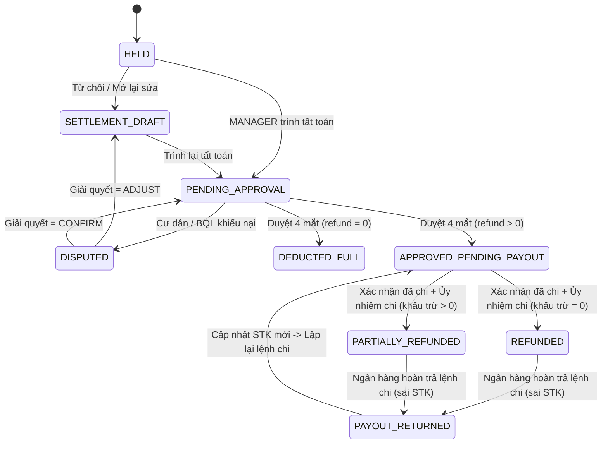

# BÁO CÁO RÀ SOÁT CHI TIẾT, HƯỚNG DẪN TEST GIAO DIỆN & PHƯƠNG ÁN XỬ LÝ PHÂN HỆ THU / HOÀN CỌC & GIỮ CHỖ (MODULE M06)

- **Dự án:** ResiHub — Hệ thống Quản lý Căn hộ & Nhà cho thuê
- **Tài liệu đối chiếu:** `PRD - Quan ly Can ho va Nha cho thue v2.0.md` (Module M06: `FR-022`, `FR-023`, `FR-024`, `FR-025`, `FR-067`, `FR-068`, `US-017`, `AC-017.1..3`, Mục 6.2, 13.2, 13.6, 14.3, 15.1, 15.2, `NFR-008`, `NFR-010`, `NFR-016`)
- **Phạm vi Source Code đã kiểm toán:**
  - **Database Migrations:** `004_tenants_reservations.sql`, `006_deposits.sql`, `010_rls_policies.sql`, `018_m05_m06_fixes.sql`, `035_reservation_hold_from.sql`, `036_simplify_roles.sql`, `037_deposit_txn_immutable.sql`, `038_audit_log_deposit_owner_scope.sql`, `042_idempotency_and_draft_services_rls.sql`
  - **Backend API & Jobs:** `api/src/routes/deposits.js`, `api/src/routes/reservations.js`, `api/src/routes/contracts.js`, `api/src/routes/apartments.js`, `api/src/routes/reports.js`, `api/src/services/depositSettlement.js`, `api/src/services/deadlines.js`, `api/src/middleware/idempotency.js`, `api/src/jobs/daily.js`
  - **Frontend UI & Services:** `frontend/src/pages/admin/deposits/DepositsPage.jsx`, `frontend/src/pages/resident/tabs/ContractTab.jsx`, `frontend/src/pages/admin/buildings/FloorPlanPage.jsx`, `frontend/src/pages/admin/apartments/ApartmentDetailPage.jsx`, `frontend/src/pages/admin/reports/ReportsPage.jsx`, `frontend/src/constants/statuses.js`, `frontend/src/hooks/usePermission.js`, `frontend/src/services/deposits.service.js`, `frontend/src/services/buildings.service.js`, `frontend/src/services/api.js`
  - **Automated Tests:** `api/test/depositRules.test.js`, `api/test/depositCollectAndRefund.test.js`

---

## 1. Tổng quan & Chuẩn bị môi trường Kiểm thử Giao diện

### 1.1. Danh sách 8 điểm SAI SÓT trong code hiện tại (`BUG-01` → `BUG-08`)

| Mã | Mức ưu tiên | Mức độ rủi ro | Tên lỗi / Lỗ hổng logic | File chính bị ảnh hưởng |
| :--- | :---: | :---: | :--- | :--- |
| **BUG-01** | **P0** | Cao (Tài chính) | Cho phép thu bổ sung vượt mức cọc hợp đồng, thu cọc cả khi đang `SETTLEMENT_DRAFT` và bơm giao dịch `type = 'transfer'` khống qua API | `api/src/routes/deposits.js`, `DepositsPage.jsx` |
| **BUG-02** | **P0** | Cao (Four-Eyes) | Bước phê duyệt (`settlement/approve`) âm thầm tính lại công nợ mới làm lệch số tiền thực chi so với số tiền Người duyệt vừa xác nhận trên màn hình | `api/src/routes/deposits.js`, `DepositsPage.jsx` |
| **BUG-03** | **P0** | Trung bình - Cao | Cho phép trình & phê duyệt hoàn cọc bằng chuyển khoản (`BANK_TRANSFER`) với `refund > 0` ngay cả khi để trống Số tài khoản / Ngân hàng nhận tiền | `api/src/routes/deposits.js`, `DepositsPage.jsx` |
| **BUG-04** | **P0** | Trung bình | Gắn sai trạng thái `REFUNDED` (*"Đã tất toán / Hoàn đủ"*) khi khách bị khấu trừ sạch 100% cọc (`refund = 0 ₫`, kể cả khi âm `shortfall`) | `depositSettlement.js`, `statuses.js`, `006_deposits.sql` |
| **BUG-05** | **P1** | Trung bình | Cho phép khiếu nại (`POST /:id/dispute`) vô thời hạn sau khi đã tất toán xong (`amount_held = 0`), gây treo trạng thái `DISPUTED` không thể điều chỉnh | `api/src/routes/deposits.js`, `ContractTab.jsx` |
| **BUG-06** | **P0** | Cao (Nghiệp vụ) | Cụm 4 lỗi ở `reservations.js`: (a) không chặn `hold_amount <= 0`, (b) API `PATCH /:id/convert` làm mất kết chuyển tiền cọc, (c) `forfeit` thiếu 4 mắt & lý do, (d) lệch múi giờ UTC | `api/src/routes/reservations.js`, `FloorPlanPage.jsx`, `ApartmentDetailPage.jsx` |
| **BUG-07** | **P1** | Trung bình (Bảo mật) | Sử dụng `adminPool` làm vô hiệu hóa Row-Level Security (RLS) trong `GET /:id/settlement` và `POST /:id/dispute` | `api/src/routes/deposits.js`, RLS migrations |
| **BUG-08** | **P1** | Cao (Vận hành) | Khóa cứng `OWNER` 100% Read-Only gây tắc nghẽn phê duyệt 4 mắt tại các tòa nhà chỉ có 1 `MANAGER`, đồng thời bỏ sót cảnh báo quá hạn 5 ngày cho `OWNER` | `deposits.js`, `daily.js`, `usePermission.js`, RLS |

### 1.2. Danh sách 7 chức năng CÒN THIẾU so với PRD v2.0 (`GAP-01` → `GAP-07`)

| Mã | Mức ưu tiên | Tham chiếu PRD | Chức năng còn thiếu | Thành phần cần bổ sung |
| :--- | :---: | :---: | :--- | :--- |
| **GAP-01** | **P1** | `FR-024` (dòng 510) | Thiếu bước xác nhận chi tiền tách biệt & luồng ngoại lệ `RETURNED` khi chuyển khoản hoàn cọc bị ngân hàng trả lại do sai STK | DB Migration, `deposits.js`, `DepositsPage.jsx` |
| **GAP-02** | **P1** | `FR-024`, `NFR-016` | Thiếu đính kèm ảnh chứng từ Ủy nhiệm chi / Biên lai chuyển tiền và mã tham chiếu giao dịch khi chi hoàn cọc (`refund`) | `deposits.js`, `DepositsPage.jsx`, `ContractTab.jsx` |
| **GAP-03** | **P1** | `FR-024` (dòng 508) | `checkSettlementPreconditions` chưa kiểm tra trạng thái Biên bản nghiệm thu bàn giao căn hộ (`handover` / ảnh nghiệm thu phòng) | `deposits.js`, `apartments.js`, `DepositsPage.jsx` |
| **GAP-04** | **P0** | Mục 14.3 (dòng 990) | Chưa gắn middleware `idempotencyGuard` và header `Idempotency-Key` cho toàn bộ API thay đổi tiền ở `deposits` & `reservations` | `deposits.js`, `reservations.js`, Frontend services |
| **GAP-05** | **P2** | Mục 15.1, 15.2 (`RP-07`) | Thiếu Báo cáo `RP-07 — Sổ cọc`, thiếu xuất Excel/CSV sổ cọc, thiếu KPI *"Hoàn cọc chờ duyệt"* trên Dashboard chung & báo cáo tháng cho `OWNER` | `reports.js`, `daily.js`, `ReportsPage.jsx`, `DepositsPage.jsx` |
| **GAP-06** | **P2** | `FR-067`, Mục 8.1 | Thiếu cổng công khai cho `PROSPECT` tự đặt giữ chỗ, thiếu cột `method`/`evidence` trên `reservation`, thiếu cấu hình tỷ lệ phạt hủy giữ chỗ | DB Migration, Public API/Page, `reservations.js` |
| **GAP-07** | **P2** | Mục 8.2 (dòng 316) | Thiếu Tab Nhật ký kiểm toán (`Audit Log`) hiển thị trực tiếp ngay trong modal chi tiết hồ sơ cọc | `deposits.js`, `DepositsPage.jsx` |

### 1.3. Chuẩn bị Môi trường & Tài khoản Demo để Test trên Giao diện

1. **Đường dẫn truy cập Frontend:** Mở trình duyệt tại `http://localhost:5173/login` (hoặc cổng cấu hình của dự án).
2. **Mẹo mở song song nhiều vai trò:** Khi test quy trình duyệt 4 mắt (`MANAGER` trình → `SYS_ADMIN`/`OWNER` duyệt → `RESIDENT` khiếu nại), hãy mở:
   - **Cửa sổ thường:** Đăng nhập `MANAGER` (`manager.vop.a@resihub.vn`).
   - **Cửa sổ Ẩn danh (Incognito):** Đăng nhập `SYS_ADMIN` (`admin@resihub.vn`), `OWNER` (`owner.vop@resihub.vn`), hoặc `RESIDENT`.
3. **Danh sách tài khoản có sẵn nút điền nhanh (Quick-fill) ngay dưới form `/login`:**

| Vai trò | Nhãn nút Quick-fill trên `/login` | Email đăng nhập | Mật khẩu | Phạm vi dữ liệu |
| :--- | :--- | :--- | :--- | :--- |
| **`SYS_ADMIN`** | `Quản trị (SYS_ADMIN)` | `admin@resihub.vn` | `Admin@123456` | Toàn bộ tổ chức & mọi tòa nhà |
| **`OWNER`** | `Chủ đầu tư Ocean Park` | `owner.vop@resihub.vn` | `Demo@123456` | Cụm tòa Ocean Park (`VOP-A`, ...) |
| **`MANAGER`** | `Quản lý Tòa VOP-A` | `manager.vop.a@resihub.vn` | `Demo@123456` | Tòa `VOP-A` |
| **`RESIDENT`** | `Cư dân mẫu` | `tenant1@resihub.vn` | `Demo@123456` | Cổng cư dân `/resident` |

4. **Cách chuẩn bị nhanh 1 hồ sơ đủ điều kiện tất toán cọc (dùng cho `BUG-02`, `BUG-03`, `BUG-04`, `BUG-05`, `BUG-08`):**
   - Đăng nhập `manager.vop.a@resihub.vn` → vào **Hợp đồng (`/admin/contracts`)** → mở chi tiết một hợp đồng đang **Đang hiệu lực (`ACTIVE`)** của tòa `VOP-A`.
   - Đảm bảo sổ cọc của hợp đồng đó đã thu tiền (vào `/admin/deposits` → bấm **`Thu bổ sung`** nếu số dư đang là `0 ₫`).
   - Vào **Điện & Nước (`/admin/meters`)** chốt chỉ số kỳ hiện tại cho căn hộ đó (nếu căn hộ có gắn đồng hồ) và đảm bảo không còn hóa đơn nháp (`DRAFT`) ở `/admin/invoices`.
   - Quay lại trang chi tiết Hợp đồng → thực hiện **Thanh lý / Chấm dứt hợp đồng** để trạng thái hợp đồng chuyển sang **`Đã thanh lý (TERMINATED)`**.

---

## 2. Phân tích chi tiết từng điểm SAI SÓT, Cách Test trên Giao diện & Phương án xử lý (`BUG-01` → `BUG-08`)

---

### BUG-01 [P0] — Lỗ hổng thu cọc: Thu vượt mức cọc hợp đồng, thu thêm khi đang `SETTLEMENT_DRAFT` và bơm giao dịch `transfer` khống

#### 1. Vị trí code hiện tại
- `api/src/routes/deposits.js` (dòng `324–441`, endpoint `POST /api/v1/deposits/:id/transactions`)
- `frontend/src/pages/admin/deposits/DepositsPage.jsx` (dòng `788–797` & `1034–1107`)

#### 2. Hiện trạng & Cơ chế lỗi
- **Lỗi 1a (Thu vượt trần hợp đồng):** Nút **`+ Thu bổ sung`** luôn hiển thị trên mọi sổ cọc `HELD` kể cả khi đã thu đủ `100%` tiền cọc quy định trên hợp đồng. Backend cộng dồn `amount_held + amount` mà không chặn trần `contract.deposit_amount`. Do trigger bất biến `trg_deposit_txn_immutable` chặn xóa dòng `APPROVED`, giao dịch thu thừa không thể xóa.
- **Lỗi 1b (Thu thêm cọc sau khi đã thanh lý HĐ / đang `SETTLEMENT_DRAFT`):** Khi hợp đồng đã kết thúc và biên bản tất toán bị từ chối về trạng thái **`Nháp tất toán (SETTLEMENT_DRAFT)`**, cả UI lẫn API vẫn cho bấm **`+ Thu bổ sung`** để thu thêm cọc.
- **Lỗi 1c (Bơm giao dịch `type = 'transfer'` khống qua API):** Endpoint `POST /:id/transactions` chấp nhận `type = 'transfer'` từ client mà không yêu cầu `method` và không kiểm tra nguồn tiền giữ chỗ hay hợp đồng gốc.

#### 3. Các bước kiểm tra / tái hiện trên giao diện (UI Test Steps)
- **Kịch bản A — Tái hiện thu vượt trần hợp đồng ngay trên UI:**
  1. Đăng nhập tài khoản **`manager.vop.a@resihub.vn`** → trên thanh menu trái, chọn **Tiền cọc (`/admin/deposits`)**.
  2. Ở tab **Đang giữ cọc**, tìm một dòng sổ cọc đã thu đủ tiền (ví dụ cột **Số dư cọc** hiển thị `10.000.000 ₫` và dòng phụ bên dưới ghi `Cọc HĐ: 10.000.000 ₫`, không còn dòng *Còn phải thu*).
  3. Tại cột **Thao tác**, quan sát thấy nút **`+ Thu bổ sung`** vẫn hiển thị → bấm vào **`+ Thu bổ sung`**.
  4. Trong modal *Sổ giao dịch tiền cọc*, tại ô **Số tiền thu thêm (VND)** nhập `5.000.000`, chọn Phương thức thanh toán `Chuyển khoản ngân hàng` → bấm **`Xác nhận thu cọc`**.
  5. **Kết quả thực tế (Lỗi):** Hệ thống báo xanh *"Ghi nhận giao dịch cọc thành công"*, nâng **Số dư cọc đang bảo lưu thực tế** vọt lên **`15.000.000 ₫`** (lớn hơn `Cọc HĐ: 10.000.000 ₫`) và không có nút nào thu hồi/hủy bút toán nhầm.
  6. **Kết quả mong đợi:** Ẩn/khóa nút `Thu bổ sung` khi đã thu đủ mức cọc HĐ; nếu cố gửi API phải trả lỗi `422 DEPOSIT_EXCEEDS_CONTRACT_AMOUNT`.

- **Kịch bản B — Tái hiện thu thêm cọc khi hợp đồng đã thanh lý (`Nháp tất toán`):**
  1. Lấy một hồ sơ đang ở tab **Chờ duyệt hoàn cọc**, dùng tài khoản `admin@resihub.vn` bấm **`Xem & Duyệt hoàn cọc`** → bấm **`Từ chối biên bản`** → nhập lý do → hồ sơ quay về tab **Đang giữ cọc** với badge **`Nháp tất toán`**.
  2. Quay lại tài khoản `manager.vop.a@resihub.vn` tại tab **Đang giữ cọc**, nhìn cột **Thao tác** của dòng `Nháp tất toán` đó: nút **`+ Thu bổ sung`** vẫn xuất hiện và bấm thu thêm tiền thành công dù hợp đồng đã thanh lý!

- **Kịch bản C — Kiểm tra lỗ hổng `type = 'transfer'` khống (DevTools Console trên trình duyệt):**
  1. Đang ở trang `/admin/deposits` với tài khoản `manager.vop.a@resihub.vn`, nhấn `F12` → tab **Console**, lấy `id` một sổ cọc đang `HELD` và chạy:
     ```js
     await fetch('/api/v1/deposits/<DEPOSIT_ID>/transactions', {
       method: 'POST',
       headers: {
         'Content-Type': 'application/json',
         Authorization: `Bearer ${localStorage.getItem('accessToken')}`,
       },
       body: JSON.stringify({ type: 'transfer', amount: 9000000, description: 'Kết chuyển ảo' }),
     }).then((r) => r.json());
     ```
  2. Bấm nút **`Làm mới dữ liệu`** trên giao diện → mở **`Sổ giao dịch`**: xuất hiện bút toán **`Kết chuyển cọc +9.000.000 ₫`** dù không hề có phiếu giữ chỗ hay hợp đồng cũ nào chuyển sang.

#### 4. Phương án xử lý
1. **Backend (`api/src/routes/deposits.js`):**
   - Chỉ chấp nhận duy nhất `type === 'collect'` tại `POST /api/v1/deposits/:id/transactions` (trả `409 TRANSFER_INTERNAL_ONLY` nếu truyền `type === 'transfer'`).
   - Chỉ cho phép thu khi `currentDeposit.status === 'HELD'` và hợp đồng đang hiệu lực (`ACTIVE`, `RENEWAL_PENDING`, `TERMINATION_PENDING`).
   - Kiểm tra trần `newAmount <= BigInt(contract.deposit_amount)`, nếu vượt trả `422 DEPOSIT_EXCEEDS_CONTRACT_AMOUNT`.
2. **Frontend (`DepositsPage.jsx`):**
   - Chỉ hiển thị nút **`Thu bổ sung`** khi `row.status === 'HELD'`, hợp đồng chưa kết thúc và `Number(row.amount_held) < Number(row.deposit_amount)`; giới hạn giá trị tối đa ô nhập bằng đúng số tiền còn thiếu (`shortage`).

---

### BUG-02 [P0] — Tự động tính lại công nợ ngầm lúc Phê duyệt làm lệch số tiền Người duyệt vừa xác nhận

#### 1. Vị trí code hiện tại
- `api/src/routes/deposits.js` (dòng `1019–1031`, endpoint `POST /api/v1/deposits/:id/settlement/approve`)
- `frontend/src/pages/admin/deposits/DepositsPage.jsx` (dòng `1900–1917`, `ConfirmDialog`)

#### 2. Hiện trạng & Cơ chế lỗi
- Lúc trình tất toán, biên bản lưu số tiền hoàn dự kiến (ví dụ `10.000.000 ₫`). Hộp thoại xác nhận của Người duyệt hỏi rõ con số `10.000.000 ₫`. Nhưng khi bấm nút xác nhận, backend tự gọi lại `calculateContractOpenDebts()` lấy nợ mới nhất và ghi đè số tiền thực hoàn mà không chặn báo biến động số liệu.

#### 3. Các bước kiểm tra / tái hiện trên giao diện (UI Test Steps)
1. Chuẩn bị 2 cửa sổ trình duyệt:
   - **Cửa sổ 1:** Đăng nhập `manager.vop.a@resihub.vn`.
   - **Cửa sổ 2 (Ẩn danh):** Đăng nhập `admin@resihub.vn`.
2. Trên **Cửa sổ 1 (`MANAGER`)**: Vào `/admin/deposits` → chọn một sổ cọc có hợp đồng đã `Đã thanh lý` (giả sử đang giữ `10.000.000 ₫`, nợ dịch vụ = `0 ₫`) → bấm **`Tất toán cọc`** → chọn phương thức `Tiền mặt (CASH)` → kiểm tra dòng **Dự kiến hoàn trả khách thuê: `10.000.000 ₫`** → bấm **`Gửi phê duyệt tất toán (Four-Eyes)`**.
3. Sang **Cửa sổ 2 (`SYS_ADMIN`)**: Vào `/admin/deposits` → chuyển sang tab **Chờ duyệt hoàn cọc** → bấm **`Xem & Duyệt hoàn cọc`** → bấm nút xanh **`Phê duyệt hoàn cọc`**. Hộp thoại xác nhận hiện lên dòng chữ:
   > *"Xác nhận phê duyệt biên bản tất toán cọc cho căn hộ ... với số tiền hoàn trả là **10.000.000 ₫**?"*
   *(Giữ nguyên hộp thoại này trên màn hình, chưa bấm nút Xác nhận).*
4. Quay lại **Cửa sổ 1 (`MANAGER`)**: Vào menu **Hóa đơn (`/admin/invoices`)** → tạo mới và **Phát hành (`ISSUED`)** 1 hóa đơn phí dịch vụ/điện nước trị giá `2.000.000 ₫` gắn với hợp đồng vừa nêu.
5. Quay sang **Cửa sổ 2 (`SYS_ADMIN`)**: Bấm nút **`Xác nhận phê duyệt`** trên hộp thoại đang hiển thị `10.000.000 ₫`.
6. **Kết quả thực tế (Lỗi):** Hệ thống báo duyệt thành công mà không cảnh báo! Mở tab **Đã hoàn / Hoàn một phần** → bấm **`Biên bản tất toán`** sẽ thấy **Số tiền hoàn trả thực tế bị đổi thành `8.000.000 ₫`**, lệch `2.000.000 ₫` so với con số Người duyệt vừa bấm xác nhận.
7. **Kết quả mong đợi:** Backend phải trả lỗi `409 SETTLEMENT_SNAPSHOT_STALE` báo công nợ vừa thay đổi, yêu cầu từ chối về nháp để lập lại biên bản đúng số mới rồi mới duyệt.

#### 4. Phương án xử lý
- Trong `POST /:id/settlement/approve`, khóa `FOR UPDATE` các hóa đơn mở của hợp đồng và so khớp `liveDebts.serviceDebt === Number(settlement.outstanding_debt || 0)` cùng `heldBefore === Number(settlement.deposit_held_before_settlement)`. Nếu lệch, rollback và trả `409 SETTLEMENT_SNAPSHOT_STALE`; đồng thời trên `DepositsPage.jsx` hiển thị cảnh báo nếu `calculated_service_debt !== readonlySettlementData.outstanding_debt`.

---

### BUG-03 [P0] — Trình & duyệt hoàn cọc chuyển khoản (`BANK_TRANSFER`) không bắt buộc thông tin tài khoản nhận tiền

#### 1. Vị trí code hiện tại
- `api/src/routes/deposits.js` (dòng `790–898`, endpoint `POST /api/v1/deposits/:id/settlement`)
- `frontend/src/pages/admin/deposits/DepositsPage.jsx` (dòng `440–499` & `1543–1583`)

#### 2. Hiện trạng & Cơ chế lỗi
- Trên cả giao diện `DepositsPage.jsx` lẫn backend `deposits.js`, khi phương thức hoàn trả là `Chuyển khoản ngân hàng (BANK_TRANSFER)` và số tiền hoàn `> 0`, cả 3 ô *Ngân hàng thụ hưởng*, *Số tài khoản*, *Chủ tài khoản* đều không gắn `required` và không có kiểm tra dữ liệu đầu vào.

#### 3. Các bước kiểm tra / tái hiện trên giao diện (UI Test Steps)
1. Đăng nhập **`manager.vop.a@resihub.vn`** → vào **Tiền cọc (`/admin/deposits`)** → bấm **`Tất toán cọc`** trên một sổ cọc đủ điều kiện tất toán và còn tiền hoàn trả (`Dự kiến hoàn trả khách thuê > 0 ₫`).
2. Ở mục **2. Công nợ tự động từ hệ thống & Phương thức hoàn**:
   - Giữ nguyên **Phương thức hoàn trả tiền cọc** là **`Chuyển khoản ngân hàng (BANK_TRANSFER)`**.
   - **Không chọn** ô *Ngân hàng thụ hưởng của cư dân (VietQR)*.
   - **Để trống** ô *Số tài khoản*.
   - **Xóa trắng** ô *Chủ tài khoản* (vốn được điền sẵn tên khách thuê).
3. Bấm **`Gửi phê duyệt tất toán (Four-Eyes)`**.
4. Đăng nhập **`admin@resihub.vn`** → vào tab **Chờ duyệt hoàn cọc** → bấm **`Xem & Duyệt hoàn cọc`** → bấm **`Phê duyệt hoàn cọc`** → **`Xác nhận phê duyệt`**.
5. Bấm tiếp nút **`In bảng kê A4`** để xem biên bản in ra.
6. **Kết quả thực tế (Lỗi):** Trình duyệt và phê duyệt thành công 100%, sổ cọc đóng lại ở trạng thái đã hoàn dù trên biên bản tất toán hoàn toàn **không có tên ngân hàng và không có số tài khoản nhận tiền** của khách!
7. **Kết quả mong đợi:** Khi `refundAmount > 0` và `refund_method === 'BANK_TRANSFER'`, cả Frontend và Backend phải chặn báo lỗi bắt buộc chọn Ngân hàng, nhập Số tài khoản và Chủ tài khoản.

#### 4. Phương án xử lý
- Thêm validate bắt buộc `bank_info.bank_name`, `bank_info.account_number` (`4–25` ký tự chữ/số), `bank_info.account_holder` tại `POST /:id/settlement` khi `refund > 0n && refund_method === 'BANK_TRANSFER'` (trả `422 BANK_INFO_REQUIRED`), và gắn `required` + kiểm tra trước khi submit trên `DepositsPage.jsx`.

---

### BUG-04 [P0] — Nhãn trạng thái `REFUNDED` hiển thị "Đã tất toán / Hoàn đủ" ngay cả khi khách bị khấu trừ sạch 100% cọc (`refund = 0 ₫`)

#### 1. Vị trí code hiện tại
- `api/src/services/depositSettlement.js` (dòng `92–103`, hàm `resolvePostSettlementStatus`)
- `frontend/src/constants/statuses.js` (dòng `52–60`, `DEPOSIT_STATUS`)

#### 2. Hiện trạng & Cơ chế lỗi
- Khi tổng tiền phạt hư hỏng + nợ dịch vụ **lớn hơn hoặc bằng** tiền cọc đang giữ (`refund = 0 ₫`), hàm `resolvePostSettlementStatus` trả về `'REFUNDED'`, được UI dịch thành badge xanh lá **`Đã tất toán / Hoàn đủ`**.

#### 3. Các bước kiểm tra / tái hiện trên giao diện (UI Test Steps)
1. Đăng nhập **`manager.vop.a@resihub.vn`** → vào **Tiền cọc (`/admin/deposits`)** → bấm **`Tất toán cọc`** trên một sổ cọc đang giữ (ví dụ đang giữ `10.000.000 ₫`).
2. Tại mục **1. Các khoản khấu trừ biên bản bàn giao**, bấm **`+ Thêm khoản khấu trừ`**:
   - **Danh mục khấu trừ:** `Hư hỏng tài sản / nội thất (DAMAGE)`
   - **Số tiền khấu trừ (VND):** Nhập `12.000.000` (lớn hơn hoặc bằng số cọc đang giữ)
   - **Mô tả hiện trạng:** Nhập `"Hỏng điều hòa và tủ lạnh khi trả phòng"`
   - **Hình ảnh bằng chứng:** Tải lên 1 file ảnh bất kỳ từ máy tính.
3. Quan sát bảng bên phải hiển thị: **Dự kiến hoàn trả khách thuê: `0 ₫`** và hộp cảnh báo đỏ **Shortfall: `2.000.000 ₫`** → bấm **`Gửi phê duyệt tất toán (Four-Eyes)`**.
4. Sang cửa sổ **`admin@resihub.vn`** → vào tab **Chờ duyệt hoàn cọc** → bấm **`Xem & Duyệt hoàn cọc`** → **`Phê duyệt hoàn cọc`** → **`Xác nhận phê duyệt`**.
5. Chuyển sang tab **`Đã hoàn / Hoàn một phần`** trên `/admin/deposits` và quan sát dòng vừa duyệt.
6. **Kết quả thực tế (Lỗi):**
   - Cột **Số dư cọc** ghi: `0 ₫` / `Đã hoàn trả: 0 ₫`.
   - Nhưng cột **Trạng thái** bên cạnh lại hiện badge màu xanh lá cây: **`Đã tất toán / Hoàn đủ`**! (Đăng nhập cổng Cư dân `/resident` → tab **Hợp đồng** cũng thấy badge xanh **`Đã tất toán / Hoàn đủ`** dù bị trừ sạch cọc và còn bị đòi thêm `2.000.000 ₫`).
7. **Kết quả mong đợi:** Phải hiển thị trạng thái riêng **`Đã khấu trừ hết cọc (DEDUCTED_FULL)`** (màu vàng/hổ phách), chỉ hiện **`Đã hoàn đủ 100%`** khi không bị trừ đồng nào.

#### 4. Phương án xử lý
- Bổ sung trạng thái `'DEDUCTED_FULL'` vào CHECK constraint `deposit.status`, cập nhật `resolvePostSettlementStatus` trả `'DEDUCTED_FULL'` khi `refund === 0n && (totalDeductions > 0n || sf > 0n)`, và thêm nhãn tương ứng trong `statuses.js`.

---

### BUG-05 [P1] — Cho phép Cư dân bấm khiếu nại vô thời hạn sau khi đã hoàn cọc xong, làm khóa nút sửa của BQL

#### 1. Vị trí code hiện tại
- `api/src/routes/deposits.js` (dòng `1404–1438` & `1555–1580`)
- `frontend/src/pages/resident/tabs/ContractTab.jsx` (dòng `821–830`)
- `frontend/src/pages/admin/deposits/DepositsPage.jsx` (dòng `2017–2101`)

#### 2. Hiện trạng & Cơ chế lỗi
- Sau khi hồ sơ đã được phê duyệt hoàn cọc xong (`REFUNDED` hoặc `PARTIALLY_REFUNDED`, `amount_held = 0`), cổng Cư dân vẫn hiện nút **`Không đồng ý / Khiếu nại`** không giới hạn thời gian. Khi Cư dân bấm nút này, sổ cọc nhảy sang `DISPUTED`, nhưng bên Admin nút **`Mở lại sửa bảng kê`** bị vô hiệu hóa cứng do `amount_held = 0`.

#### 3. Các bước kiểm tra / tái hiện trên giao diện (UI Test Steps)
1. Lấy một hợp đồng đã hoàn tất phê duyệt tất toán cọc (đang nằm ở tab **Đã hoàn / Hoàn một phần**, số dư cọc = `0 ₫`).
2. Mở cửa sổ ẩn danh → đăng nhập bằng tài khoản **Cư dân** đứng tên hợp đồng đó → hệ thống vào cổng `/resident`.
3. Chuyển sang tab **`Hợp đồng`** trên thanh điều hướng của Cư dân → cuộn xuống phần **Bảng kê tất toán tiền cọc**.
4. Quan sát thấy nút màu đỏ **`Không đồng ý / Khiếu nại`** vẫn hiển thị → bấm vào nút đó → nhập lý do *"Tôi muốn khiếu nại lại khoản trừ vệ sinh"* → bấm **`Gửi khiếu nại tới BQL`**.
5. Quay lại cửa sổ Admin (`manager.vop.a@resihub.vn`) → vào `/admin/deposits` → bấm **`Làm mới dữ liệu`** → chuyển sang tab **`Tranh chấp`**.
6. Bấm nút **`Giải quyết khiếu nại`** trên dòng hồ sơ đó.
7. **Kết quả thực tế (Lỗi):**
   - Trong modal *Giải quyết khiếu nại*, nút **`Mở lại sửa bảng kê`** bị làm mờ không bấm được (`disabled`) kèm thông báo vàng: *"Sổ cọc này đã được chi hoàn hết (số dư đang giữ = 0 ₫), nên nút Mở lại sửa bảng kê bị vô hiệu hóa"*.
   - Quản lý bị ép chỉ có 1 lựa chọn duy nhất là bấm **`Xác nhận kết quả`**. Ngay sau khi Quản lý bấm *Xác nhận kết quả*, bên màn hình Cư dân nút **`Không đồng ý / Khiếu nại`** lại hiện lên và Cư dân có thể bấm lặp lại vòng lặp này vô hạn lần!
8. **Kết quả mong đợi:** Cư dân khiếu nại chính ở bước **`Chờ duyệt hoàn cọc (PENDING_APPROVAL)`** (trước khi chi tiền); sau khi đã thực chi hoàn tất chỉ cho phép gửi phản hồi hậu kiểm trong thời hạn ngắn (ví dụ 7 ngày) hoặc khóa chuyển trạng thái `DISPUTED` sau khi đã đóng kỳ.

#### 4. Phương án xử lý
- Giới hạn thời hạn gọi `POST /:id/dispute` sau khi đã chi tiền (hoặc chỉ cho khiếu nại khóa sổ khi chưa thực chi `amount_held > 0`), đồng thời áp dụng kiểm soát 4 mắt khi chọn `CONFIRM` bác bỏ khiếu nại của cư dân.

---

### BUG-06 [P0] — Cụm 4 lỗi nghiệp vụ trên Đặt cọc giữ chỗ (`FloorPlanPage` & `ApartmentDetailPage`)

#### 1. Vị trí code hiện tại
- `api/src/routes/reservations.js` (dòng `105–512`)
- `frontend/src/pages/admin/buildings/FloorPlanPage.jsx` (dòng `828–905`)
- `frontend/src/pages/admin/apartments/ApartmentDetailPage.jsx` (dòng `410–468`)

#### 2. Các bước kiểm tra / tái hiện trên giao diện (UI Test Steps)

- **Kịch bản 6A — Tạo phiếu đặt cọc giữ chỗ với số tiền `0 ₫` ngay trên Sơ đồ tầng:**
  1. Đăng nhập **`manager.vop.a@resihub.vn`** → vào menu **Bất động sản (`/admin/buildings`)** → chọn tòa **`VOP-A`** → vào **Sơ đồ tầng**.
  2. Bấm vào một ô căn hộ màu xanh lá (**`Còn trống`**) → trong ngăn kéo (drawer) bên phải, bấm nút màu vàng **`Đặt cọc giữ chỗ`**.
  3. Nhập *Họ tên khách đặt giữ chỗ*: `"Nguyễn Văn Test"`, *Số điện thoại*: `"0988111222"`.
  4. Tại ô **Tiền cọc giữ chỗ (VND)**: xóa giá trị mặc định `2.000.000` và gõ số **`0`**.
  5. Bấm **`Xác nhận giữ chỗ`**.
  6. **Kết quả thực tế (Lỗi):** Hệ thống báo tạo thành công phiếu giữ chỗ với số tiền **`0 ₫`** và đổi màu căn hộ trên sơ đồ tầng sang màu cam **`Đã giữ chỗ (RESERVED)`**!
  7. **Kết quả mong đợi:** Chặn báo lỗi *"Số tiền đặt cọc giữ chỗ phải lớn hơn 0 ₫"*.

- **Kịch bản 6B — Chính người tạo phiếu tự bấm `Tịch thu` tiền cọc khách mà không bị chặn 4 mắt & không cần lý do:**
  1. Vẫn dùng tài khoản **`manager.vop.a@resihub.vn`** trên Sơ đồ tầng tòa `VOP-A`, tạo 1 phiếu đặt cọc giữ chỗ hợp lệ với số tiền **`3.000.000 ₫`** trên một căn trống.
  2. Bấm lại vào ô căn hộ vừa đặt cọc → bấm nút **`Mở trang chi tiết căn hộ`** ở chân ngăn kéo (chuyển tới `/admin/apartments/:id`).
  3. Cuộn xuống bảng **Hồ sơ Đặt cọc Giữ chỗ** ở góc dưới bên phải, tìm dòng phiếu `3.000.000 ₫` đang ở trạng thái **`Đang giữ chỗ`**:
     - **Bước thử 1:** Bấm nút **`Hoàn cọc`** → xác nhận → hệ thống báo lỗi đỏ chặn lại vì **Quy tắc 4 mắt (Four-eyes)** *(đúng)*.
     - **Bước thử 2:** Bấm ngay nút màu đỏ **`Tịch thu`** bên cạnh → xác nhận.
  4. **Kết quả thực tế (Lỗi):** Không hề có ô bắt nhập lý do tịch thu cọc, và hệ thống cho phép **chính người vừa tạo phiếu giữ chỗ tự tịch thu luôn `3.000.000 ₫`** thành công (`Thu giữ cọc (Bỏ cọc)`), không cần người thứ hai phê duyệt!
  5. **Kết quả mong đợi:** Phải bắt buộc nhập lý do hủy/tịch thu và kiểm tra 4 mắt giống như `Hoàn cọc`.

- **Kịch bản 6C — API `PATCH /api/v1/reservations/:id/convert` làm rơi mất tiền cọc khi lên Hợp đồng (Test qua Console):**
  1. Tạo 1 phiếu giữ chỗ `2.000.000 ₫` cho căn `X`. Trước khi kích hoạt hợp đồng, mở `F12 -> Console` gọi `PATCH /api/v1/reservations/<RESERVATION_ID>/convert` (hàm có sẵn trong `buildingsService.convertReservation`). Phiếu chuyển sang `Đã lên hợp đồng (CONVERTED)`.
  2. Tiếp tục tạo và kích hoạt Hợp đồng thuê cho căn `X` (mức cọc HĐ `10.000.000 ₫`).
  3. Vào `/admin/deposits` kiểm tra sổ cọc của căn `X`: **Số dư cọc đang giữ mở ra bằng `0 ₫`** thay vì `2.000.000 ₫` (khoản `2.000.000 ₫` giữ chỗ bị bỏ rơi không được kết chuyển vào sổ cọc!).

- **Kịch bản 6D — Lệch múi giờ UTC (00:00 – 06:59 sáng giờ Việt Nam):**
  1. Nếu test tạo giữ chỗ trong khung giờ `00:00` – `06:59` sáng giờ VN (hoặc chỉnh giờ máy chủ), `todayStr` ở backend dùng `toISOString()` (UTC+0) vẫn đang là ngày hôm qua, cho phép gửi `hold_from` lùi về ngày hôm qua.

#### 3. Phương án xử lý
- Bắt buộc `hold_amount > 0` ở cả UI, API và DB (`CHECK (hold_amount > 0)`); khóa endpoint rời `PATCH /:id/convert`; thêm bắt buộc `reason` + kiểm tra 4 mắt cho `PATCH /:id/forfeit`; chuẩn hóa ngày theo múi giờ `Asia/Ho_Chi_Minh`.

---

### BUG-07 [P1] — Sử dụng `adminPool` làm vô hiệu hóa lớp bảo vệ Row-Level Security (RLS)

#### 1. Vị trí code hiện tại
- `api/src/routes/deposits.js` (`GET /:id/settlement` dòng `452–508`; `GET /:id/settlement/pdf` dòng `561`; `POST /:id/dispute` dòng `1359–1485`)

#### 2. Cách kiểm tra / xác minh
- Đây là lỗ hổng kiến trúc bảo mật chiều sâu (`Defense-in-Depth` theo `NFR-008`): trên giao diện hiện tại các câu `if` kiểm tra quyền bằng JavaScript vẫn đang chặn đúng khác tòa nhà, nhưng khi đọc code tại `deposits.js` dòng `452` sẽ thấy biến `client` từ `getUserClient(req)` được khởi tạo rồi bỏ không, toàn bộ câu SQL bên dưới gọi qua `adminPool` (tài khoản superuser bỏ qua hoàn toàn RLS của PostgreSQL).

#### 3. Phương án xử lý
- Chuyển các truy vấn đọc của `GET /:id/settlement` và `GET /:id/settlement/pdf` sang dùng `client` của `getUserClient(req)`; với `POST /:id/dispute`, đóng gói thao tác cập nhật trạng thái khiếu nại của cư dân vào hàm PostgreSQL `SECURITY DEFINER` kiểm tra chặt `get_current_user_id()` thay vì mở `adminPool` ở tầng route.

---

### BUG-08 [P1] — Khóa cứng `OWNER` 100% Read-Only gây tắc nghẽn phê duyệt 4 mắt tại tòa nhà có 1 `MANAGER` & bỏ sót cảnh báo quá hạn

#### 1. Vị trí code hiện tại
- `api/src/routes/deposits.js` (dòng `934`, `1249`), `api/src/jobs/daily.js` (dòng `408–418`)
- `frontend/src/hooks/usePermission.js` (dòng `40`), `frontend/src/pages/admin/deposits/DepositsPage.jsx` (dòng `1255–1284`, `1899–1920`)

#### 2. Các bước kiểm tra / tái hiện trên giao diện (UI Test Steps)
1. **Bước 1 (`MANAGER` trình biên bản):**
   - Đăng nhập **`manager.vop.a@resihub.vn`** → vào `/admin/deposits` → trình phê duyệt tất toán cho 1 căn thuộc tòa `VOP-A`.
   - Sau khi trình xong, vẫn ở tài khoản `manager.vop.a@resihub.vn`, mở lại biên bản đó ở tab **Chờ duyệt hoàn cọc**: góc dưới phải hiện dòng chữ vàng *"Chờ Quản lý khác / SYS_ADMIN duyệt (Four-Eyes)"* (vì tòa `VOP-A` chỉ có 1 Quản lý này nên không tự duyệt được).
2. **Bước 2 (`OWNER` của tòa nhà vào duyệt nhưng bị khóa):**
   - Đăng xuất (hoặc mở cửa sổ ẩn danh) → đăng nhập bằng tài khoản **Chủ đầu tư Ocean Park** (**`owner.vop@resihub.vn`** / `Demo@123456` — chủ sở hữu tòa `VOP-A`).
   - Vào menu **Tiền cọc (`/admin/deposits`)** → chuyển sang tab **`Chờ duyệt hoàn cọc`**.
   - Quan sát cột **Thao tác**: chỉ hiện nút xám **`Xem biên bản`** (thay vì nút xanh *Xem & Duyệt hoàn cọc*).
   - Bấm vào **`Xem biên bản`**: ở góc dưới bên phải modal chỉ có duy nhất nút **`Đóng`**, **hoàn toàn không có nút `Phê duyệt hoàn cọc` hay `Từ chối biên bản`**!
3. **Kết quả thực tế (Lỗi):** Hồ sơ tất toán của tòa nhà bị kẹt cứng giữa Quản lý tòa nhà và Chủ đầu tư tòa nhà (trái với PRD Mục 6.2 & `FR-024` quy định `OWNER` là cấp phê duyệt `R + A`). Ngoài ra khi quá hạn hoàn cọc 5 ngày, bấm biểu tượng **Chuông thông báo** trên góc phải trên của tài khoản `owner.vop@resihub.vn` cũng không nhận được thông báo quá hạn `DEPOSIT_OVERDUE_5D`.

#### 3. Phương án xử lý
- Mở quyền `Approve` / `Reject` hoàn cọc (và `refund`/`forfeit` giữ chỗ) cho `OWNER` trên các tòa nhà thuộc sở hữu của mình (cập nhật RLS + middleware `requireRole` + `canApproveDepositRefund` trong `usePermission.js`), và bổ sung `OWNER` vào danh sách nhận thông báo quá hạn 5 ngày tại `api/src/jobs/daily.js`.

---

## 3. Phân tích chi tiết các chức năng CÒN THIẾU, Cách Kiểm tra trên Giao diện & Phương án thiết kế (`GAP-01` → `GAP-07`)

---

### GAP-01 & GAP-02 [P1] — Thiếu bước xác nhận chi tiền đính kèm Ủy nhiệm chi & Luồng ngoại lệ `RETURNED` khi chuyển khoản sai STK (`FR-024`, `NFR-016`)

#### 1. Các bước kiểm tra trên giao diện hiện tại (UI Test Steps)
1. Đăng nhập **`admin@resihub.vn`** → vào **Tiền cọc (`/admin/deposits`)** → tab **Chờ duyệt hoàn cọc**.
2. Bấm **`Xem & Duyệt hoàn cọc`** trên một hồ sơ có hoàn tiền chuyển khoản → bấm **`Phê duyệt hoàn cọc`**.
3. **Quan sát điểm thiếu 1 (`GAP-02`):** Hộp thoại hiện ra chỉ là `ConfirmDialog` hỏi Có/Không, **không có ô tải ảnh Ủy nhiệm chi / Biên lai chuyển tiền** và **không có ô nhập mã giao dịch ngân hàng**. Khi bấm xác nhận xong, mở **`Sổ giao dịch`** xem dòng `Hoàn trả cọc`: không có bất kỳ ảnh chứng từ chi tiền nào.
4. **Quan sát điểm thiếu 2 (`GAP-01`):** Chuyển sang tab **`Đã hoàn / Hoàn một phần`**, nhìn cột **Thao tác** của hồ sơ vừa duyệt: chỉ có 3 nút (`Sổ giao dịch`, `Biên bản tất toán`, `In bảng kê A4`). Giả sử kế toán chuyển khoản ra ngân hàng bị trả lại tiền do khách đọc nhầm 1 chữ số tài khoản, trên giao diện **hoàn toàn không có nút đánh dấu `RETURNED` (Chuyển khoản hoàn trả) hay sửa lại STK để lập lại lệnh chi**.

#### 2. Phương án thiết kế & xử lý

- Mở rộng trạng thái `APPROVED_PENDING_PAYOUT`, `PAYOUT_RETURNED` trên `deposit` và loại bút toán đảo `'refund_reversal'` + cột `reference_code` trên `deposit_transaction` (giữ nguyên tính bất biến của dòng `refund` cũ).
- Thêm API & Modal **`Xác nhận chi hoàn cọc`** (`POST /:id/payout`, bắt buộc đính kèm ảnh Ủy nhiệm chi khi chuyển khoản) và **`Báo chuyển khoản hoàn trả / Sai STK`** (`POST /:id/payout-returned`).

---

### GAP-03 [P1] — Chưa kiểm tra điều kiện "Biên bản nghiệm thu bàn giao căn hộ" trước khi tất toán (`FR-024`)

#### 1. Các bước kiểm tra trên giao diện hiện tại (UI Test Steps)
1. Đăng nhập **`manager.vop.a@resihub.vn`** → thanh lý (`TERMINATED`) một hợp đồng đang thuê.
2. Vào **Sơ đồ tầng** tòa nhà của căn hộ đó: thấy ô căn hộ tự động chuyển sang màu xám **`Đang bảo trì (MAINTENANCE)`** chờ nghiệm thu bàn giao phòng (chưa bấm nút *Nghiệm thu & Bàn giao*).
3. Không cần nghiệm thu phòng, đi thẳng sang menu **Tiền cọc (`/admin/deposits`)** → bấm **`Tất toán cọc`** cho căn hộ đó (để trống danh sách khấu trừ — hoàn 100%).
4. **Kết quả thực tế (Thiếu sót):** Khung kiểm tra điều kiện tiên quyết (`preconditions`) báo đủ điều kiện cho phép bấm **`Gửi phê duyệt tất toán (Four-Eyes)`** ngay lập tức mà **không kiểm tra căn hộ đã nghiệm thu bàn giao hay chưa** và cũng **không có ô đính kèm ảnh Biên bản bàn giao phòng**.

#### 2. Phương án xử lý
- Bổ sung kiểm tra nghiệm thu bàn giao căn hộ vào `checkSettlementPreconditions` hoặc bắt buộc đính kèm tối thiểu 01 ảnh/file **Biên bản kiểm tra & bàn giao căn hộ (`inspection_evidence`)** ngay trên form lập tất toán cọc của `DepositsPage.jsx`.

---

### GAP-04 [P0] — Thiếu `Idempotency-Key` chống ghi trùng giao dịch tiền tệ khi mạng chậm (Mục 14.3)

#### 1. Các bước kiểm tra trên giao diện hiện tại (UI Test Steps)
1. Đăng nhập **`manager.vop.a@resihub.vn`** → vào **Tiền cọc (`/admin/deposits`)**.
2. Nhấn `F12` mở công cụ nhà phát triển → chuyển sang tab **`Network`**.
3. Bấm **`+ Thu bổ sung`** trên một sổ cọc → nhập `1.000.000` → bấm **`Xác nhận thu cọc`**.
4. Trong tab **Network**, bấm vào dòng request `POST /api/v1/deposits/.../transactions` → xem mục **Request Headers**.
5. **Kết quả thực tế (Thiếu sót):** Không hề có header `Idempotency-Key` (khác với khi tạo/kích hoạt Hợp đồng ở `/admin/contracts` đã có `Idempotency-Key`). Nếu mạng chập chờn hoặc retry tự động gửi lặp gói tin, hệ thống sẽ cộng tiền cọc 2 lần liên tiếp và không thể xóa.

#### 2. Phương án xử lý
- Gắn middleware `idempotencyGuard({ required: true })` (đã có sẵn tại `api/src/middleware/idempotency.js`) vào tất cả các route `POST`/`PATCH` của `deposits.js` và `reservations.js`; trên Frontend sinh khóa `Idempotency-Key` gắn theo phiên mở Modal và đính kèm qua `depositsService` / `buildingsService`.

---

### GAP-05 [P2] — Thiếu Báo cáo `RP-07 — Sổ cọc`, nút Xuất Excel/CSV & KPI Dashboard chung (Mục 15.1 & 15.2)

#### 1. Các bước kiểm tra trên giao diện hiện tại (UI Test Steps)
1. Đăng nhập **`admin@resihub.vn`** hoặc **`owner.vop@resihub.vn`**.
2. **Kiểm tra Dashboard (`/admin/dashboard`):** Quan sát các thẻ KPI tổng quan trên đầu trang — chỉ có Doanh thu, Lấp đầy, Công nợ, Bảo trì, Hợp đồng sắp hết hạn; **chưa có thẻ KPI *"Hoàn cọc chờ duyệt / Quá hạn SLA"***.
3. **Kiểm tra trang Báo cáo (`/admin/reports`):** Nhìn thanh tab báo cáo — chỉ có 4 tab: `Doanh thu`, `Tỷ lệ lấp đầy`, `Tuổi nợ (Aging)`, `SLA Bảo trì`; **thiếu tab thứ 5 `Sổ cọc (RP-07)`**.
4. **Kiểm tra trang Tiền cọc (`/admin/deposits`):** Nhìn góc phải trên cùng cạnh nút *Làm mới dữ liệu* — **chưa có nút `Xuất Excel / CSV`**.

#### 2. Phương án xử lý
- Bổ sung API `GET /api/v1/reports/deposit-ledger` (hỗ trợ lọc theo tòa nhà/kỳ và xuất CSV UTF-8 BOM / Excel), thêm tab **`Sổ cọc (RP-07)`** trên `ReportsPage.jsx`, nút xuất file trên `DepositsPage.jsx`, chỉ số KPI trên `DashboardPage.jsx` và cron job thông báo tổng hợp hoàn cọc đầu tháng cho `OWNER`.

---

### GAP-06 [P2] — Thiếu Cổng công khai đặt giữ chỗ cho `PROSPECT`, chứng từ giữ chỗ & cấu hình tỷ lệ phạt hủy (`FR-067`)

#### 1. Các bước kiểm tra trên giao diện hiện tại (UI Test Steps)
1. **Kiểm tra cổng khách vãng lai (`PROSPECT`):** Mở một cửa sổ trình duyệt **Ẩn danh** mới (chưa đăng nhập) → truy cập `http://localhost:5173/`.
   - **Quan sát:** Trình duyệt tự động chuyển hướng thẳng về `/login`, khách tiềm năng không thể xem danh sách phòng trống công khai hay tự gửi yêu cầu đặt cọc giữ chỗ.
2. **Kiểm tra chứng từ phiếu giữ chỗ:** Đăng nhập `manager.vop.a@resihub.vn` → mở **Sơ đồ tầng** → bấm vào căn trống → bấm **`Đặt cọc giữ chỗ`**.
   - **Quan sát:** Trong form chỉ có Họ tên, SĐT, Tiền giữ chỗ, Từ ngày – Đến ngày, Ghi chú; **thiếu chọn Phương thức thanh toán** và **thiếu ô tải ảnh biên lai thu tiền giữ chỗ**. Khi hủy giữ chỗ ở trang chi tiết căn hộ cũng chỉ có 2 nút cứng (`Hoàn cọc` 100% hoặc `Tịch thu` 100%), chưa hỗ trợ hoàn một phần theo chính sách hủy.

#### 2. Phương án xử lý
- Mở rộng bảng `reservation` thêm `method`, `evidence`, `refund_amount`, `forfeit_amount`, `cancel_reason`; hỗ trợ cấu hình tỷ lệ phạt hủy trong `system_setting`; xây dựng trang công khai `/explore` + API public có rate-limit & OTP nếu triển khai đầy đủ luồng tự đặt chỗ cho `PROSPECT`.

---

### GAP-07 [P2] — Thiếu Tab Nhật ký kiểm toán (`Audit Log`) ngay trong modal chi tiết Sổ cọc (Mục 8.2)

#### 1. Các bước kiểm tra trên giao diện hiện tại (UI Test Steps)
1. Đăng nhập **`admin@resihub.vn`** → vào **Tiền cọc (`/admin/deposits`)**.
2. Bấm vào một dòng sổ cọc bất kỳ (mở modal *Sổ giao dịch tiền cọc*) hoặc bấm **`Biên bản tất toán`**.
3. **Quan sát:** Bên trong modal chỉ hiển thị danh sách bút toán tiền (`deposit_transaction`) hoặc thông tin biên bản hiện tại, **không có tab `Lịch sử kiểm toán (Audit Log)`** để tra cứu nhanh chuỗi sự kiện (ai lập lần 1, ai từ chối lúc mấy giờ, nội dung trước/sau khi sửa). Muốn xem phải copy ID sang menu **Nhật ký hệ thống (`/admin/audit-logs`)** để tìm thủ công.

#### 2. Phương án xử lý
- Thêm endpoint `GET /api/v1/deposits/:id/audit-logs` và nhúng thêm tab **`Lịch sử kiểm toán`** dạng timeline ngay trong Modal chi tiết trên `DepositsPage.jsx`.

---

## 4. Bảng Checklist Test Nhanh trên Giao diện (Dành cho Tester / Product Owner)

Bạn có thể dùng bảng dưới đây để tích kiểm tra lần lượt trên trình duyệt:

| STT | Mã | Thao tác kiểm tra nhanh trên UI | Kết quả lỗi hiện tại cần quan sát | Đã test |
| :-: | :--- | :--- | :--- | :-: |
| 1 | **BUG-01a** | Vào `/admin/deposits` bằng `MANAGER` → bấm **`+ Thu bổ sung`** trên sổ đã thu đủ cọc HĐ → nhập thêm `5.000.000` | Cho thu vượt mức cọc hợp đồng, không xóa được | [ ] |
| 2 | **BUG-01b** | Từ chối 1 biên bản về **`Nháp tất toán`** → dùng `MANAGER` xem cột Thao tác dòng đó | Vẫn hiện nút **`+ Thu bổ sung`** dù HĐ đã thanh lý | [ ] |
| 3 | **BUG-02** | `MANAGER` trình tất toán → `SYS_ADMIN` mở hộp xác nhận duyệt → `MANAGER` phát hành thêm HĐ điện nước → `SYS_ADMIN` bấm xác nhận | Số tiền hoàn thực tế bị tự động trừ bớt khác số vừa bấm duyệt | [ ] |
| 4 | **BUG-03** | `MANAGER` bấm **`Tất toán cọc`** → chọn `BANK_TRANSFER`, xóa trắng Ngân hàng / STK / Chủ TK → bấm gửi & duyệt | Trình và duyệt thành công dù trống hoàn toàn thông tin STK nhận tiền | [ ] |
| 5 | **BUG-04** | Lập khấu trừ hư hỏng `>=` số cọc đang giữ (`Dự kiến hoàn = 0 ₫`) → duyệt hoàn tất | Cột Trạng thái hiện badge xanh **`Đã tất toán / Hoàn đủ`** dù hoàn `0 ₫` | [ ] |
| 6 | **BUG-05** | Sau khi đã hoàn cọc xong (`0 ₫`), đăng nhập `RESIDENT` → tab **Hợp đồng** → bấm **`Không đồng ý / Khiếu nại`** | Hồ sơ nhảy về `DISPUTED`, bên Admin nút **`Mở lại sửa bảng kê`** bị khóa cứng | [ ] |
| 7 | **BUG-06a** | Vào **Sơ đồ tầng** bằng `MANAGER` → bấm căn trống → **`Đặt cọc giữ chỗ`** → nhập số tiền = `0` | Tạo giữ chỗ `0 ₫` thành công và khóa căn hộ sang màu cam `Đã giữ chỗ` | [ ] |
| 8 | **BUG-06b** | Ngay bằng tài khoản `MANAGER` vừa tạo giữ chỗ → mở Chi tiết căn hộ → bấm nút đỏ **`Tịch thu`** | Tự tịch thu thành công không bị chặn 4 mắt và không hỏi lý do | [ ] |
| 9 | **BUG-08** | `MANAGER` trình tất toán tòa `VOP-A` → đăng nhập `owner.vop@resihub.vn` vào tab **Chờ duyệt hoàn cọc** | `OWNER` chỉ có nút **`Xem biên bản`**, không có nút Phê duyệt / Từ chối | [ ] |
| 10 | **GAP-01/02** | Bấm **`Phê duyệt hoàn cọc`** rồi xem tab **Đã hoàn / Hoàn một phần** | Không có ô đính kèm Ủy nhiệm chi lúc chi; không có nút báo lỗi `RETURNED` (sai STK) | [ ] |
| 11 | **GAP-03** | Thanh lý HĐ (căn hộ đang xám `Đang bảo trì`, chưa nghiệm thu bàn giao) → vào `/admin/deposits` bấm **`Tất toán cọc`** | Cho lập tất toán hoàn 100% mà không đòi nghiệm thu phòng hay biên bản bàn giao | [ ] |
| 12 | **GAP-04** | Mở `F12 -> Network` → bấm **`Xác nhận thu cọc`** → xem Request Headers | Thiếu header `Idempotency-Key` chống ghi trùng khi mạng lag | [ ] |
| 13 | **GAP-05** | Xem `/admin/dashboard`, `/admin/reports` và góc phải trên của `/admin/deposits` | Thiếu KPI hoàn cọc trên Dashboard, thiếu tab **`RP-07 Sổ cọc`**, thiếu nút Xuất Excel/CSV | [ ] |
| 14 | **GAP-06** | Mở ẩn danh `http://localhost:5173/` và xem form **`Đặt cọc giữ chỗ`** trên Sơ đồ tầng | Khách ngoài bị đẩy về `/login`; form giữ chỗ thiếu phương thức TT & ảnh chứng từ | [ ] |
| 15 | **GAP-07** | Bấm mở modal **`Sổ giao dịch`** hoặc **`Biên bản tất toán`** tại `/admin/deposits` | Chưa có tab hiển thị lịch sử `Audit Log` của hồ sơ cọc ngay trong modal | [ ] |

---

## 5. Lộ trình triển khai khắc phục khuyến nghị (3 Giai đoạn)

### Giai đoạn 1 — Khắc phục khẩn cấp nhóm P0 (An toàn tài chính & toàn vẹn dữ liệu)
- [ ] **Bước 1.1:** Khóa `type = 'transfer'`, chặn thu vượt `contract.deposit_amount` và chặn thu khi khác `HELD` tại `POST /api/v1/deposits/:id/transactions` + ẩn nút thu trên UI khi đã thu đủ (**BUG-01**).
- [ ] **Bước 1.2:** Chặn lệch snapshot công nợ lúc duyệt (`409 SETTLEMENT_SNAPSHOT_STALE`) và bắt buộc `bank_info` khi `refund > 0` + `BANK_TRANSFER` (**BUG-02**, **BUG-03**).
- [ ] **Bước 1.3:** Bổ sung trạng thái `DEDUCTED_FULL` và sửa `resolvePostSettlementStatus` + nhãn UI khi `refund = 0` (**BUG-04**).
- [ ] **Bước 1.4:** Sửa bộ 4 lỗi `reservations.js` (`hold_amount > 0`, khóa endpoint `convert` rời, thêm 4 mắt + `reason` cho `forfeit`, sửa múi giờ `Asia/Ho_Chi_Minh`) (**BUG-06**).
- [ ] **Bước 1.5:** Gắn `idempotencyGuard` + truyền `Idempotency-Key` từ Frontend cho toàn bộ API ghi tiền của `deposits` & `reservations` (**GAP-04**).

### Giai đoạn 2 — Hoàn thiện quy trình nghiệp vụ cốt lõi nhóm P1 (Chuẩn hóa PRD)
- [ ] **Bước 2.1:** Mở quyền duyệt/từ chối 4 mắt trên cọc & giữ chỗ cho `OWNER` của tòa nhà + thêm `OWNER` vào danh sách nhận cảnh báo quá hạn 5 ngày (**BUG-08**).
- [ ] **Bước 2.2:** Tách bước Chi hoàn tiền (`POST /:id/payout` có đính kèm Ủy nhiệm chi) và bổ sung luồng ngoại lệ chuyển khoản trả về (`POST /:id/payout-returned` dùng bút toán đảo `refund_reversal`) (**GAP-01**, **GAP-02**).
- [ ] **Bước 2.3:** Bổ sung đính kèm/kiểm tra Biên bản nghiệm thu bàn giao phòng trước tất toán (**GAP-03**).
- [ ] **Bước 2.4:** Chuẩn hóa cửa sổ thời gian khiếu nại (`dispute`) và gỡ bỏ các truy vấn dùng `adminPool` trái nguyên tắc RLS (**BUG-05**, **BUG-07**).

### Giai đoạn 3 — Báo cáo quản trị & trải nghiệm nâng cao nhóm P2
- [ ] **Bước 3.1:** Xây dựng báo cáo `RP-07 — Sổ cọc`, nút xuất CSV/Excel, KPI Dashboard tổng và thông báo tổng hợp tháng cho `OWNER` (**GAP-05**).
- [ ] **Bước 3.2:** Nhúng Tab Timeline `Audit Log` trực tiếp vào modal chi tiết sổ cọc (**GAP-07**).
- [ ] **Bước 3.3:** Bổ sung chứng từ/chính sách hủy linh hoạt cho `reservation` và cổng tra cứu đặt giữ chỗ công khai cho `PROSPECT` (**GAP-06**).
