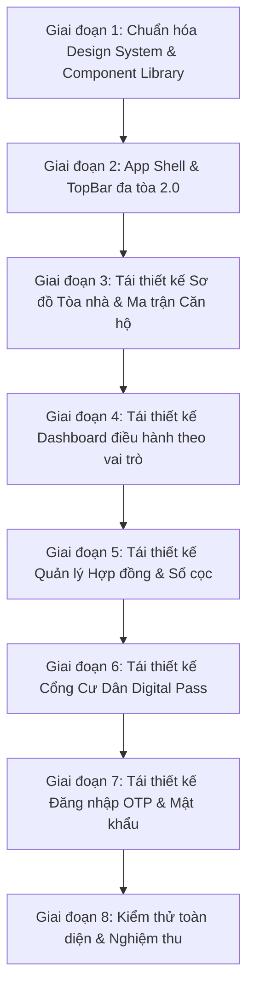

# 🏛️ KẾ HOẠCH TÁI THIẾT KẾ TOÀN DIỆN GIAO DIỆN RESIHUB THEO ĐẶC TẢ PRD v2.0

> **Căn cứ tài liệu gốc**: [PRD - Quan ly Can ho va Nha cho thue v2.0.md](file:///d:/resihub/PRD%20-%20Quan%20ly%20Can%20ho%20va%20Nha%20cho%20thue%20v2.0.md) (Phiên bản v0.2 cập nhật ngày 18/09/2026 sau phản hồi của chủ đầu tư).  
> **Mục tiêu**: Xóa bỏ giao diện bảng biểu thô sơ (table-heavy) hiện tại, xây dựng lại hệ thống giao diện chuẩn hóa, trực quan, chuyên nghiệp theo phong cách **Property Management System (PMS)** hiện đại, đáp ứng 100% các tiêu chí nghiệm thu (Acceptance Criteria), ma trận phân quyền (RBAC), và luồng trải nghiệm người dùng trong PRD.

---

## I. TỔNG HỢP NGUYÊN TẮC THIẾT KẾ CỐT LÕI TỪ PRD v2.0

### 1. Phân tách Không gian & Thiết bị (PRD Mục 8 & 16.1)
* **Cổng Cư Dân (`/`)**: Thiết kế **Mobile-first** (tối đa 2 thao tác để tới hóa đơn hoặc báo hỏng). Cư dân đăng nhập bằng **OTP 6 số qua SĐT** (FR-001), không cần mật khẩu.
* **Hệ thống Quản trị (`/admin`)**: Tối ưu cho **Desktop/Tablet màn hình rộng**. Điều hướng theo **Tòa nhà đang chọn (Building Switcher)** trên TopBar (FR-070: hỗ trợ quản lý 5–7 tòa thuê lại của nhiều chủ sở hữu).
* **Nhân viên kỹ thuật/hiện trường (`STAFF`)**: Giao diện work order thao tác được **bằng 1 tay trên di động**, nút bấm lớn tối thiểu 44×44px, chụp ảnh trực tiếp công tơ/hư hỏng, chịu được mất mạng (offline-tolerant).

### 2. Quy tắc Hiển thị Dữ liệu & Tài chính (PRD Mục 13.4, 16.1)
* **Số tiền**: Luôn định dạng số nguyên VND có phân tách hàng nghìn rõ ràng (ví dụ: `8.000.000 ₫`, tuyệt đối không viết tắt `8tr`).
* **Tiền cọc**: **1 tháng tiền thuê**. Bắt buộc theo nguyên tắc: **Không cấn trừ cọc vào tiền thuê**; hoàn cọc trong 3–5 ngày sau khi chấm dứt hợp đồng (FR-068).
* **Hạn thanh toán & Ngày chốt kỳ**: Linh hoạt theo **từng hợp đồng** (`billing_day` nằm ở hợp đồng, không cố định theo tòa - FR-066). Phạt chậm **100.000 ₫/ngày sau 5 ngày quá hạn** (FR-064).
* **Biểu giá dịch vụ**: Ưu tiên **Giá theo hợp đồng → Giá theo tòa → Giá mặc định** (FR-065).

### 3. Trạng thái Giao diện Bắt buộc (PRD Mục 16.2)
* **Empty State**: Không dùng dòng chữ cụt lủn "Không có dữ liệu". Phải giải thích lý do và có nút hành động tiếp theo (Ví dụ: *"Chưa có hóa đơn nào cho kỳ này. Ghi chỉ số điện nước trước khi sinh hóa đơn"* + nút bấm).
* **Loading State**: Sử dụng **Skeleton** dạng khối mờ theo khung thẻ/bảng, không dùng spinner chặn toàn trang.
* **Hành động nguy hiểm**: Bắt buộc có modal xác nhận 2 bước nêu rõ ngữ cảnh và số liệu cụ thể (Ví dụ: *"Phát hành 48 hóa đơn kỳ 10/2026, tổng 312.400.000 ₫. Sau khi phát hành không sửa trực tiếp được"*).
* **Panel chi tiết trượt phải (Slide-Over Drawer)**: Bấm vào bản ghi (căn hộ, hợp đồng, cư dân, sự cố) sẽ trượt ngăn kéo chi tiết từ mép phải màn hình, có tab Lịch sử/Audit log ngay trong drawer.

---

## II. PHÁC HỌA CHI TIẾT CÁC GIAO DIỆN MỚI (UI WIREFRAMES)

---

### MÀN HÌNH 1: ĐĂNG NHẬP & XÁC THỰC (AUTH & ONBOARDING)
> **Mã chức năng PRD**: FR-001 (Đăng nhập OTP SĐT), FR-002 (Rate limit & Chống brute-force), FR-003 (Đăng nhập Email nhân sự nội bộ).

#### 📐 Phác họa bố cục giao diện:
```text
+---------------------------------------------------------------------------------------------------+
|                                                                                                   |
|                                           [🏢 LOGO RESIHUB]                                       |
|                                  HỆ THỐNG QUẢN LÝ CĂN HỘ & CHO THUÊ                                |
|                                                                                                   |
|                     +-------------------------------------------------------+                     |
|                     |  [ 👤 Cư dân (OTP qua SĐT) ]   [ 💼 Ban Quản Trị (Email) ] |                     |
|                     +-------------------------------------------------------+                     |
|                     |                                                       |                     |
|                     |  === TAB 1: CƯ DÂN (OTP THEO SĐT) ===                 |                     |
|                     |  Số điện thoại cư dân:                                |                     |
|                     |  [ 📞 Nhập số điện thoại (vd: 0901234567)           ] |                     |
|                     |                                                       |                     |
|                     |  [ TIẾP TỤC / GỬI MÃ OTP ]                            |                     |
|                     |                                                       |                     |
|                     |  (Bước 2: Hiển thị 6 ô mã OTP + Đồng hồ đếm 05:00)    |                     |
|                     |  [ _ ] [ _ ] [ _ ] [ _ ] [ _ ] [ _ ]                  |                     |
|                     |  Gửi lại mã sau 60s  |  ← Đổi số điện thoại           |                     |
|                     |  (Khóa tạm 15 phút nếu nhập sai quá 5 lần - AC-001.2) |                     |
|                     |                                                       |                     |
|                     |  === TAB 2: BAN QUẢN TRỊ (EMAIL / MẬT KHẨU) ===       |                     |
|                     |  Email nhân sự:                                       |                     |
|                     |  [ ✉️ manager@resihub.vn                             ] |                     |
|                     |  Mật khẩu:                                            |                     |
|                     |  [ 🔒 •••••••••••••                               👁️ ] |                     |
|                     |  [ Quên mật khẩu? ]                                   |                     |
|                     |                                                       |                     |
|                     |  [ ĐĂNG NHẬP HỆ THỐNG ]                               |                     |
|                     |                                                       |                     |
|                     |  💡 Chuyển nhanh tài khoản kiểm thử (Dev Mode):       |                     |
|                     |  [ Chủ sở hữu (OWNER) ]     [ Quản lý tòa (MANAGER) ] |                     |
|                     |  [ Kế toán (ACCOUNTANT) ]   [ Cư dân (RESIDENT) ]     |                     |
|                     +-------------------------------------------------------+                     |
|                                                                                                   |
+---------------------------------------------------------------------------------------------------+
```

---

### MÀN HÌNH 2: KHUNG ĐIỀU HƯỚNG QUẢN TRỊ (APP SHELL & TOPBAR)
> **Mã chức năng PRD**: FR-004 (Phân quyền theo tòa), FR-070 (Đa tòa / đa chủ sở hữu), Mục 8.2 (Sitemap Admin).

#### 📐 Phác họa bố cục TopBar & Sidebar:
```text
+-------------------------------------------------------------------------------------------------------------------+
| [🏢 RESIHUB] | 🏢 Chọn Tòa: [ Skyline Thảo Điền (40 căn) ▼ ] | 🔍 Tìm căn, khách, HĐ... | 🔔 [3] | [👤 Nguyễn Minh (Manager) ▼]|
+-------------------------------------------------------------------------------------------------------------------+
| SIDEBAR              | KHÔNG GIAN NỘI DUNG CHÍNH (DYNAMIC CONTENT AREA)                                           |
|                      |                                                                                            |
| 📊 Tổng quan         | • Hiển thị breadcrumbs điều hướng: Trang chủ / Tòa nhà / Tầng 4                            |
| 🏢 Bất động sản      | • Tự động lọc toàn bộ dữ liệu nghiệp vụ theo Tòa nhà đang chọn trên TopBar                  |
|   • Tòa & Tầng       | • Người dùng chuyển đổi tòa nhà → Toàn bộ ma trận phòng, doanh thu, cư dân lập tức cập nhật|
|   • Sơ đồ căn hộ     |                                                                                            |
| 👥 Cư dân & Hợp đồng |                                                                                            |
|   • Hồ sơ cư dân     |                                                                                            |
|   • Hợp đồng thuê    |                                                                                            |
|   • Sổ tiền cọc      |                                                                                            |
| ⚡ Dịch vụ & Chỉ số  |                                                                                            |
|   • Ghi số điện nước |                                                                                            |
|   • Đăng ký gửi xe   |                                                                                            |
| 💰 Tài chính         |                                                                                            |
|   • Hóa đơn kỳ       |                                                                                            |
|   • Công nợ & nhắc nợ|                                                                                            |
| 🔧 Kỹ thuật & Sự cố  |                                                                                            |
| 📢 Thông báo tòa nhà |                                                                                            |
| ⚙️ Cài đặt hệ thống  |                                                                                            |
+----------------------+--------------------------------------------------------------------------------------------+
```

---

### MÀN HÌNH 3: EXECUTIVE COMMAND DASHBOARD (FR-057, MỤC 15)
> **Mục tiêu PRD**: Mỗi vai trò có Dashboard riêng; mọi con số đều bấm vào được để drill-down xem danh sách bản ghi nguồn.

#### 📐 Phác họa bố cục Dashboard:
```text
+-------------------------------------------------------------------------------------------------------------------+
| BẢNG ĐIỀU HÀNH TỔNG QUAN  •  Tòa Skyline Thảo Điền                         [📅 Tháng 10/2026 ▼] [+ Tạo Hợp Đồng]  |
+-------------------------------------------------------------------------------------------------------------------+
|                                                                                                                   |
|  +--------------------+ +--------------------+ +--------------------+ +-----------------------------------------+ |
|  | 🏢 TỶ LỆ LẤP ĐẦY   | | 💰 DOANH THU KỲ    | | 🟡 SỔ CỌC BẢO LƯU  | | ⚡ CÔNG VIỆC CẦN XỬ LÝ HÔM NAY (ACTION)  | |
|  | 92.5%              | | 312.400.000 ₫      | | 385.000.000 ₫      | | • 2 HĐ hết hạn trong 7 ngày (nhắc gia hạn)| |
|  | 37/40 căn đang thuê| | (Đã thu: 280.000k) | | (38 hợp đồng giữ)  | | • 1 Hồ sơ cọc cần hoàn trước 26/10     | |
|  | [Xem 3 căn trống →]| | [Xem công nợ →]    | | [Xem sổ cọc →]     | | • 1 Căn A201 cần bàn giao nghiệm thu  | |
|  +--------------------+ +--------------------+ +--------------------+ +-----------------------------------------+ |
|                                                                                                                   |
|  +------------------------------------------------------------------+ +-----------------------------------------+ |
|  | 🗺️ MA TRẬN TRẠNG THÁI NHANH CÁC CĂN HỘ (OCCUPANCY MATRIX GLANCE)   | | 📊 CƠ CẤU DOANH THU & DỊCH VỤ (CHART.JS) | |
|  | [Tất cả (40)] [🟢 Trống (3)] [🔵 Đang thuê (34)] [🟡 Giữ (2)] [🔴 B.trì]| |                                         | |
|  |                                                                  | |     [ Doughnut Chart ]                  | |
|  | TẦNG 4: [401 🔵] [402 🟢] [403 🟡] [404 🔵] [405 🔵]              | |     • Tiền phòng: 82% (256.000.000 ₫)   | |
|  | TẦNG 3: [301 🔵] [302 🔵] [303 🔵] [304 🔵] [305 🔵]              | |     • Điện nước:  12%  (38.000.000 ₫)   | |
|  | TẦNG 2: [201 🔴] [202 🔵] [203 🔵] [204 🟡] [205 🔵]              | |     • Gửi xe, wifi: 6% (18.400.000 ₫)   | |
|  | TẦNG 1: [101 🔵] [102 🟢] [103 🔵] [104 🟢] [105 🔵]              | |                                         | |
|  +------------------------------------------------------------------+ +-----------------------------------------+ |
+-------------------------------------------------------------------------------------------------------------------+
```

---

### MÀN HÌNH 4: QUẢN LÝ BẤT ĐỘNG SẢN & MA TRẬN CĂN HỘ (FR-007, FR-008, FR-010, FR-067)
> **Mục tiêu PRD**: Nguồn sự thật duy nhất về từng căn hộ. Trực quan hóa 5 trạng thái (`AVAILABLE`, `RESERVED`, `OCCUPIED`, `MAINTENANCE`, `INACTIVE`). Tích hợp Slide-over Drawer xử lý Giữ chỗ (NV-06) và Ký hợp đồng.

#### 📐 Phác họa bố cục Sơ đồ tầng & Ma trận Căn hộ:
```text
+-------------------------------------------------------------------------------------------------------------------+
| QUẢN LÝ TÒA NHÀ & SƠ ĐỒ CĂN HỘ                                           [+ Thêm Tầng] [+ Thêm Căn] [⚙️ Cài đặt tòa]|
+-------------------------------------------------------------------------------------------------------------------+
| Tòa nhà: [ Skyline Thảo Điền (40) ] [ ResiHub Riverside (24) ] [+ Thêm Tòa Nhà Mới]                               |
| Bộ lọc trạng thái: [Tất cả (40)] [🟢 Có sẵn (3)] [🔵 Đang thuê (34)] [🟡 Đã giữ chỗ (2)] [🔴 Bảo trì (1)] [⚫ Không KD]|
+-------------------------------------------------------------------------------------------------------------------+
|                                                                                                                   |
| 🏢 TẦNG 4 (Level 4 • 4 Căn hộ)                                                    [+ Thêm phòng tầng này] [Sửa tầng]|
| +--------------------+ +--------------------+ +--------------------+ +--------------------+                       |
| | CĂN 401    [🔵 THUÊ]| | CĂN 402   [🟢 CÓ SẴN]| | CĂN 403    [🟡 GIỮ]| | CĂN 404    [🔵 THUÊ]|                       |
| | Studio • 32m²      | | 1PN • 45m²         | | 2PN • 68m²         | | Studio • 32m²      |                       |
| | 👤 Nguyễn Văn An   | | 🏷️ 8.500.000 ₫/th  | | 👤 Trần Thảo Trang | | 👤 Hoàng Long      |                       |
| | Hạn HĐ: Còn 45 ngày| | 🛋️ Full nội thất   | | ⏳ Hạn giữ: 28/10  | | Hạn HĐ: Còn 180 ng |                       |
| | 8.000.000 ₫/tháng  | | [⚡ Đặt Giữ Chỗ]   | | Cọc giữ: 5.000.000₫| | 7.500.000 ₫/tháng  |                       |
| |                    | |                    | | [📝 Ký HĐ Ngay]    | |                    |                       |
| +--------------------+ +--------------------+ +--------------------+ +--------------------+                       |
|                                                                                                                   |
| 🏢 TẦNG 3 (Level 3 • 4 Căn hộ)                                                                                    |
| +--------------------+ +--------------------+ +--------------------+ +--------------------+                       |
| | CĂN 301    [🔴 B.TRÌ]| | CĂN 302    [🔵 THUÊ]| | CĂN 303    [🔵 THUÊ]| | CĂN 304    [🔵 THUÊ]|                       |
| | Vệ sinh sau trả phòng| 👤 Lê Quốc Bảo     | | 👤 Phạm Thu Hà     | | 👤 Đỗ Hoàng Nam    |                       |
| | [✅ Bàn giao xong]  | | Hạn HĐ: Còn 12 ngày| | Hạn HĐ: Còn 90 ngày| | Hạn HĐ: Còn 240 ng |                       |
| +--------------------+ +--------------------+ +--------------------+ +--------------------+                       |
+-------------------------------------------------------------------------------------------------------------------+
```

#### ✨ Slide-Over Drawer Chi tiết Căn hộ (Khi click vào 1 căn hộ bất kỳ):
Ngăn kéo trượt ra từ mép phải màn hình (rộng 480px) hiển thị đầy đủ ngữ cảnh:
* **Header**: Mã căn `Căn 403`, diện tích `68m²`, loại `2PN`, badge trạng thái nổi bật.
* **Tab 1 - Hợp đồng & Cư dân**: Tên khách đang thuê/giữ chỗ, SĐT, ngày bắt đầu - kết thúc, giá thuê, tiền cọc.
* **Tab 2 - Tiện ích & Tài sản**: Tủ lạnh, điều hòa, khóa từ, giường, tủ âm tường.
* **Tab 3 - Lịch sử cọc & Hóa đơn**: Lịch sử đặt cọc, các phiếu thu chi gần nhất.
* **Hành động nghiệp vụ (Action Buttons dưới chân Drawer)**:
  * Nếu phòng `AVAILABLE`: Nút *"Đặt cọc giữ chỗ (NV-06)"*.
  * Nếu phòng `RESERVED`: Nút *"Ký hợp đồng từ giữ chỗ này"* + *"Hủy mất cọc"* + *"Hoàn tiền cọc"*.
  * Nếu phòng `MAINTENANCE`: Nút *"Xác nhận nghiệm thu & bàn giao phòng"*.

---

### MÀN HÌNH 5: QUẢN LÝ HỢP ĐỒNG & SỔ CỌC (FR-014 ĐẾN FR-025, FR-065, FR-068)
> **Mục tiêu PRD**: Ràng buộc cư dân–căn hộ–giá–kỳ hạn–dịch vụ. Bảng giá dịch vụ theo hợp đồng (FR-065). Quy trình duyệt giá lệch khung (Owner Approval). Quản lý sổ cọc và tất toán cọc (AC-017).

#### 📐 Phác họa bố cục Trang Hợp Đồng & Sổ Cọc:
```text
+-------------------------------------------------------------------------------------------------------------------+
| QUẢN LÝ HỢP ĐỒNG THUÊ & SỔ TIỀN CỌC                               [+ Ký Hợp Đồng Mới] [📥 Xuất Báo Cáo Excel]     |
+-------------------------------------------------------------------------------------------------------------------+
| [Tab: Danh sách Hợp đồng (38)]  [Tab: Đề xuất cư dân gửi lên (2 mới 🔴)]  [Tab: Sổ cọc & Tất toán hoàn cọc]       |
|                                                                                                                   |
| 🔍 Tìm kiếm theo tên khách, SĐT, mã căn...    [Lọc tòa: Tất cả ▼]  [Trạng thái: ACTIVE ▼]  [Kỳ hạn: Sắp hết hạn ▼]|
|                                                                                                                   |
| +---------------------------------------------------------------------------------------------------------------+ |
| | CĂN HỘ & TÒA     | KHÁCH THUÊ CHÍNH      | THỜI HẠN & KỲ HẠN    | TIỀN THUÊ & SỔ CỌC  | TRẠNG THÁI | THAO TÁC | |
| |------------------+-----------------------+----------------------+---------------------+------------+----------| |
| | Căn 401          | 👤 Nguyễn Văn An      | 01/01/26 → 31/12/26  | Thuê: 8.000.000 ₫   | [🟢 ACTIVE]| [Phụ lục]| |
| | Skyline Thảo Điền| 📞 0901234567 • CCCD✓ | Còn 45 ngày          | Cọc:  8.000.000 ₫   |            | [Dịch vụ]| |
| |                  | 👥 2 người ở          | Chốt kỳ ngày 01      | Sổ cọc: ĐỦ 8.000k   |            | [In A4]  | |
| |------------------+-----------------------+----------------------+---------------------+------------+----------| |
| | Căn 204          | 👤 Lê Thị Hương Giang | 15/03/26 → 15/09/26  | Thuê: 6.800.000 ₫   | [🟡 CHỜ    | [Duyệt   | |
| | Skyline Thảo Điền| 📞 0988776655         | Mới tạo              | (Giảm 15% niêm yết) |   DUYỆT]   |   giá]   | |
| |                  | CCCD đã tải lên       | Cần OWNER duyệt giá  | Giữ chỗ: 2.000.000 ₫| (OWNER)    | [Hủy HĐ] | |
| +---------------------------------------------------------------------------------------------------------------+ |
+-------------------------------------------------------------------------------------------------------------------+
```

#### ✨ Modal Quyết toán & Hoàn cọc (Khớp AC-017 / FR-024):
* Bảng kê 4 cột: Cọc ban đầu (`amount_held`) − Khấu trừ hư hại vật chất (có ảnh đính kèm) − Cấn trừ công nợ dịch vụ (`outstanding_debt`) = Thực nhận hoàn (`refund_amount`).
* Nếu khấu trừ > cọc: Thực hoàn = 0, phát sinh khoản nộp bù (`shortfall`) thành công nợ sau trả phòng.
* Bắt buộc phê duyệt 4 mắt (`NON-SELF`): Kế toán lập, Giám đốc/Chủ sở hữu duyệt.

---

### MÀN HÌNH 6: CỔNG CƯ DÂN (RESIDENT SELF-SERVICE PORTAL - MỤC 8.1)
> **Mục tiêu PRD**: Cổng tự phục vụ của cư dân tối ưu cho điện thoại di động (Mobile-first). Hiển thị Thẻ căn hộ điện tử, hóa đơn điện nước minh bạch, gửi báo hỏng có đính kèm ảnh, và sổ cọc bảo lưu.

#### 📐 Phác họa bố cục Cổng Cư Dân:
```text
+---------------------------------------------------------------------------------------------------+
| [🏢 RESIHUB] Cổng Cư Dân               [📞 Hotline BQL: 0901.234.567]   [🔔 1]   [👤 Nguyễn Văn An] |
+---------------------------------------------------------------------------------------------------+
|                                                                                                   |
|  ========================= [ THẺ CĂN HỘ ĐIỆN TỬ (DIGITAL RESIDENT PASS) ] ========================= |
|  +---------------------------------------------------------------------------------------------+  |
|  | 🏢 SKYLINE RESIDENCE THẢO ĐIỀN                           TRẠNG THÁI: [🟢 HỢP ĐỒNG HIỆU LỰC]  |  |
|  | CĂN HỘ 401 • TẦNG 4 • LOẠI 1PN LUXURY (45m²)                                                 |  |
|  |                                                                                             |  |
|  | 👤 Cư dân: NGUYỄN VĂN AN          🔑 Mã thẻ: RH-401-VN         📅 Kỳ hạn: 01/01/26 → 31/12/26  |  |
|  | 📶 Wifi phòng: Skyline_401 (pass: 88889999)                    ⏳ Còn lại: 245 ngày thuê      |  |
|  +---------------------------------------------------------------------------------------------+  |
|                                                                                                   |
|  +------------------------------------------------+ +-------------------------------------------+  |
|  | 💰 TÀI CHÍNH & SỔ CỌC BẢO LƯU (AC-017)         | | ⚡ TIỆN ÍCH DỊCH VỤ 1 CHẠM (SELF-SERVICE) |  |
|  |                                                | |                                           |  |
|  | • Tiền cọc đang bảo lưu: 8.000.000 ₫ [ĐÃ NỘP]  | | [🔧 Báo Hỏng & Sửa Chữa (Kèm ảnh)]        |  |
|  | • Hóa đơn kỳ 10/2026:    8.850.000 ₫           | | [👥 Khai Báo Thêm Người Cùng Ở]           |  |
|  |   - Tiền thuê căn hộ:    8.000.000 ₫           | | [📋 Gửi Đề Nghị Gia Hạn Hợp Đồng]         |  |
|  |   - Điện (chỉ số 1240):    520.000 ₫           | | [📦 Đăng Ký Trả Phòng & Tất Toán Cọc]     |  |
|  |   - Nước + Rác + Xe máy:   330.000 ₫           | |                                           |  |
|  |                                                | | 🛵 DỊCH VỤ ĐANG DÙNG TRONG CĂN:           |  |
|  | [📱 Quét Mã QR Chuyển Khoản] [Tải Hóa Đơn PDF] | | • 01 Xe máy (120.000 ₫/tháng)             |  |
|  | [Báo đã chuyển khoản (Tải ảnh bill ủy nhiệm)]  | | • Mạng Internet cáp quang tốc độ cao      |  |
|  +------------------------------------------------+ +-------------------------------------------+  |
|                                                                                                   |
|  +---------------------------------------------------------------------------------------------+  |
|  | 🛠️ TIẾN ĐỘ YÊU CẦU BÁO HỎNG GẦN ĐÂY                                                         |  |
|  | • #RQ-104: Vòi nước bồn rửa chén rỉ nước ──→ [🟡 Đang xử lý: Kỹ thuật viên Tuấn đã nhận việc]|  |
|  | • #RQ-089: Thay bóng đèn ban công        ──→ [🟢 Đã hoàn thành • Đánh giá: ⭐⭐⭐⭐⭐]         |  |
|  +---------------------------------------------------------------------------------------------+  |
+---------------------------------------------------------------------------------------------------+
```

---

## III. LỘ TRÌNH TRIỂN KHAI THEO TỪNG GIAI ĐOẠN



### Chi tiết các Giai đoạn triển khai:

1. **Giai đoạn 1: Chuẩn hóa Design System & Bộ Component cốt lõi (Mục 16.5)**
   * Giữ nguyên font `Inter` chuẩn của PRD, thiết lập các utilities màu sắc cho 5 trạng thái phòng (`AVAILABLE`, `OCCUPIED`, `RESERVED`, `MAINTENANCE`, `INACTIVE`).
   * Xây dựng bộ component dùng chung: `StatusBadge.jsx`, `Money.jsx` (định dạng VND chuẩn), `SlideOverDrawer.jsx`, `EmptyState.jsx` (chuẩn PRD 16.2), `SkeletonLoader.jsx`.

2. **Giai đoạn 2: Nâng cấp App Shell & Khung điều hướng (`Sidebar.jsx` & `TopBar.jsx`)**
   * TopBar: Building Switcher đa tòa (`resihub_selected_building_id`), Chuông thông báo phân loại icon, Profile Modal.
   * Sidebar: Gom nhóm các module theo Sitemap PRD 8.2, phân quyền hiển thị theo vai trò (Owner R, Manager CRU, Accountant tài chính).

3. **Giai đoạn 3: Tái thiết kế Sơ đồ Tòa nhà & Ma trận Căn hộ (`BuildingsPage.jsx`)**
   * Bỏ danh sách table cũ, chuyển sang **Smart Interactive Unit Matrix**: hiển thị thẻ phòng trực quan theo tầng.
   * Tích hợp Slide-Over Drawer xử lý Giữ chỗ (NV-06 / FR-067), Chuyển cọc giữ chỗ sang HĐ, Bàn giao nghiệm thu phòng.

4. **Giai đoạn 4: Tái thiết kế Dashboard Điều hành (`DashboardPage.jsx`)**
   * 4 thẻ KPI cốt lõi, Occupancy Matrix Glance, đồ thị Chart.js cơ cấu doanh thu, danh sách cảnh báo việc cần làm hôm nay.

5. **Giai đoạn 5: Tái thiết kế Quản lý Hợp đồng, Cư dân & Sổ cọc (`ContractsPage.jsx`, `DepositsPage.jsx`, `TenantsPage.jsx`)**
   * Danh sách hợp đồng thẻ lai bảng; quản lý biểu giá dịch vụ theo hợp đồng (FR-065).
   * Modal duyệt giá giảm của Owner (`PENDING_APPROVAL`).
   * Bảng kê quyết toán cọc chuẩn AC-017 (không cấn trừ tiền thuê, hoàn trong 3–5 ngày).

6. **Giai đoạn 6: Tái thiết kế toàn diện Cổng Cư Dân (`ResidentPortalPage.jsx`)**
   * Thẻ căn hộ điện tử (Digital Pass), tra cứu hóa đơn chi tiết từng dòng, báo hỏng kèm ảnh, đăng ký dịch vụ, chuông thông báo.

7. **Giai đoạn 7: Tái thiết kế Đăng nhập & Quên mật khẩu (`LoginPage.jsx`, `ForgotPasswordPage.jsx`)**
   * Tab Cư dân OTP SĐT và Ban quản lý Email/Mật khẩu; bộ chuyển nhanh tài khoản test.

8. **Giai đoạn 8: Kiểm thử tự động & Nghiệm thu toàn diện**
   * Kiểm thử `npm test` đảm bảo 100% unit tests PASS, build Vite sạch sẽ, kiểm tra tương thích mobile/tablet.

---

## IV. NGUYÊN TẮC BẢO ĐẢM AN TOÀN KỸ THUẬT KHI TRIỂN KHAI
1. **Bảo toàn 100% Logic API & RLS Database**: Giữ nguyên toàn bộ endpoints, state store Zustand, các policy bảo mật Postgres đã hoàn thành ở Giai đoạn 1.
2. **Không Downtime / Zero-Regression**: Thay thế từng trang một cách tuần tự, build và test ngay sau mỗi trang trước khi chuyển sang trang tiếp theo.
3. **Tiêu chuẩn Accessibility WCAG 2.1 AA**: Tương phản màu sắc ≥ 4.5:1, hỗ trợ phím điều hướng, vùng bấm cảm ứng ≥ 44×44px.
