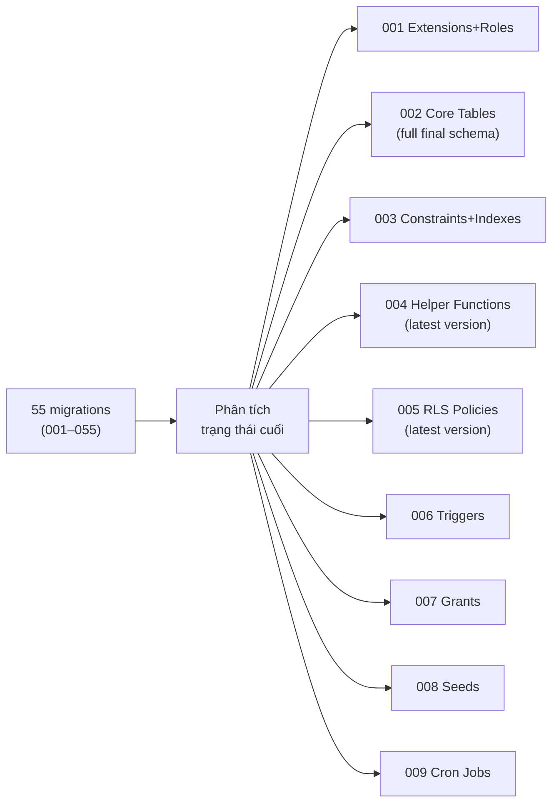

# Migration Consolidation Plan — ResiHub

> **For agentic workers:** REQUIRED SUB-SKILL: Use superpowers:subagent-driven-development (recommended) or superpowers:executing-plans to implement this plan task-by-task. Steps use checkbox (`- [ ]`) syntax for tracking.

**Goal:** Rút gọn 55 file migration thành ~10 file có cấu trúc rõ ràng theo domain, loại bỏ tất cả ALTER/DROP/ADD column trung gian và chỉ giữ trạng thái cuối cùng của schema.

**Architecture:** Squash toàn bộ 55 migrations thành một tập file "baseline" idempotent — mỗi file đại diện cho một domain rõ ràng (DDL, Indexes, Functions, RLS, Seeds). Các file sẽ dùng `IF NOT EXISTS`, `CREATE OR REPLACE`, `DROP POLICY IF EXISTS … CREATE POLICY` để có thể chạy lại an toàn.

**Tech Stack:** PostgreSQL 15+, Supabase RLS, pg_cron, pgcrypto, uuid-ossp, btree_gist

**Spec:** `d:\resihub\api\src\db\migrations\` (55 files hiện tại)

## Global Constraints

- Idempotent: mọi statement đều có `IF NOT EXISTS`, `CREATE OR REPLACE`, `DROP … IF EXISTS`.
- Không mất dữ liệu: backfill data và seed data phải được giữ nguyên.
- Thứ tự phụ thuộc: Extensions → Tables → Constraints/Indexes → Functions → RLS → Seeds.
- Giữ nguyên tên bảng, cột, constraint cuối cùng (không rename).
- Vai trò hệ thống cuối cùng: **SYS_ADMIN, OWNER, MANAGER, RESIDENT** (ACCOUNTANT, STAFF đã bị loại bỏ ở 036).

---

## Phân tích: Những gì bị xóa/thay thế qua các migrations

| Migration | Hành động | Giữ lại trong squash? |
|-----------|-----------|----------------------|
| 009 `allow_all_internal_service` | DROP ở 010 | ❌ Bỏ |
| 010 `rls_building_select` / `rls_building_modify` | Thay ở 013, 021, 031 | ❌ Chỉ dùng bản cuối |
| 013 helpers `is_org_admin`, `is_manager`, … | Thay ở 021, 031, 036 | ❌ Chỉ dùng bản cuối (036+) |
| 016 `zone.status` | DROP ở 017 | ❌ Bỏ cột status |
| 018 `contract.terminated_at`, `contract_status_check` | Thay ở 039 | ❌ Chỉ dùng bản cuối |
| 021 `is_org_admin` chỉ SYS_ADMIN | Thay ở 036 (thêm nhánh) | ❌ Chỉ dùng bản cuối |
| 031 ACCOUNTANT/STAFF helpers | Stub-out ở 036 | ❌ Giữ stub (hàm rỗng) |
| Nhiều DROP/CREATE POLICY | Mỗi lần là thay thế hoàn toàn | ❌ Chỉ giữ lần cuối |

---

## Cấu trúc 10 file sau khi rút gọn

```
001_extensions_and_roles.sql        — Extensions + DB role resihub_app
002_core_tables.sql                  — Tất cả CREATE TABLE (DDL cuối cùng)
003_constraints_and_indexes.sql      — Exclusion, Unique indexes, perf indexes
004_helper_functions.sql             — get_*, is_*, can_* (phiên bản cuối 036+)
005_rls_enable_and_policies.sql      — ENABLE RLS + tất cả policy (phiên bản cuối)
006_stored_procedures.sql            — fn_* business logic functions
007_triggers.sql                     — Triggers (audit log immutable, deposit txn immutable, …)
008_grants.sql                       — GRANT EXECUTE / GRANT PRIVILEGES
009_seeds.sql                        — INSERT dữ liệu mặc định (service_catalog, system_setting, …)
010_cron_jobs.sql                    — pg_cron jobs (billing engine, cron lock)
```

---

## Task 1: Tạo `001_extensions_and_roles.sql`

**Files squash:** `001_extensions.sql`, phần `CREATE ROLE resihub_app` trong `010_rls_policies.sql`

**Files:**
- Create: `api/src/db/migrations/consolidated/001_extensions_and_roles.sql`

- [ ] **Step 1: Tạo file**

```sql
-- 001_extensions_and_roles.sql
CREATE EXTENSION IF NOT EXISTS "uuid-ossp";
CREATE EXTENSION IF NOT EXISTS "btree_gist";
CREATE EXTENSION IF NOT EXISTS "pgcrypto";

DO $$
BEGIN
  IF NOT EXISTS (SELECT FROM pg_catalog.pg_roles WHERE rolname = 'resihub_app') THEN
    CREATE ROLE resihub_app WITH LOGIN PASSWORD 'resihub_app_secret';
  END IF;
  GRANT USAGE ON SCHEMA public TO resihub_app;
  GRANT ALL PRIVILEGES ON ALL TABLES IN SCHEMA public TO resihub_app;
  GRANT ALL PRIVILEGES ON ALL SEQUENCES IN SCHEMA public TO resihub_app;
  GRANT ALL PRIVILEGES ON ALL FUNCTIONS IN SCHEMA public TO resihub_app;
END $$;

ALTER DATABASE resihub SET jit = off;
```

- [ ] **Step 2: Verify** — Kiểm tra không còn GRANT nào trong 010 chưa được đưa vào.

---

## Task 2: Tạo `002_core_tables.sql`

**Files squash:** 002→007, 011, 016, 023→027, 040 (các ALTER TABLE ADD COLUMN cuối cùng)

**Nguyên tắc:** Viết `CREATE TABLE` với **tất cả cột đã được bổ sung** qua các ALTER, không viết riêng ALTER.

**Files:**
- Create: `api/src/db/migrations/consolidated/002_core_tables.sql`

**Danh sách bảng và cột cuối cùng (sau tất cả ALTER):**

<details>
<summary>organization</summary>

```sql
CREATE TABLE IF NOT EXISTS organization (
  id              UUID PRIMARY KEY DEFAULT gen_random_uuid(),
  name            TEXT NOT NULL,
  tax_code        TEXT,
  settings        JSONB DEFAULT '{}',
  payment_account JSONB DEFAULT '{}',
  created_at      TIMESTAMPTZ DEFAULT NOW(),
  updated_at      TIMESTAMPTZ DEFAULT NOW()
);
```
</details>

<details>
<summary>owner — thêm person_id (021)</summary>

```sql
CREATE TABLE IF NOT EXISTS owner (
  id          UUID PRIMARY KEY DEFAULT gen_random_uuid(),
  org_id      UUID REFERENCES organization(id) ON DELETE CASCADE,
  full_name   TEXT NOT NULL,
  phone       TEXT,
  email       TEXT,
  person_id   UUID REFERENCES person(id),   -- thêm ở 021
  created_at  TIMESTAMPTZ DEFAULT NOW()
);
```
</details>

<details>
<summary>person — thêm created_by (028, 030)</summary>

```sql
CREATE TABLE IF NOT EXISTS person (
  id           UUID PRIMARY KEY DEFAULT gen_random_uuid(),
  org_id       UUID REFERENCES organization(id) ON DELETE CASCADE,
  full_name    TEXT NOT NULL,
  phone        TEXT,
  email        TEXT,
  dob          DATE,
  id_number    TEXT,
  id_images    TEXT[] DEFAULT '{}',
  avatar_url   TEXT,            -- 028
  nationality  TEXT,            -- 028
  address      TEXT,            -- 028
  created_by   UUID REFERENCES app_user(id) ON DELETE SET NULL,  -- 030
  created_at   TIMESTAMPTZ DEFAULT NOW(),
  updated_at   TIMESTAMPTZ DEFAULT NOW(),
  UNIQUE (org_id, phone)
);
```
</details>

<details>
<summary>tenant — thêm desired_building_id, created_by, consent_*, onboarding_* (036, 040)</summary>

```sql
CREATE TABLE IF NOT EXISTS tenant (
  id                   UUID PRIMARY KEY DEFAULT gen_random_uuid(),
  person_id            UUID REFERENCES person(id) ON DELETE CASCADE,
  org_id               UUID REFERENCES organization(id) ON DELETE CASCADE,
  type                 TEXT NOT NULL CHECK (type IN ('primary','occupant')),
  status               TEXT NOT NULL DEFAULT 'PENDING'
                       CHECK (status IN ('PENDING','APPROVED','REJECTED','MOVED_OUT','MERGED')),
  desired_building_id  UUID REFERENCES building(id) ON DELETE SET NULL,  -- 036
  created_by           UUID REFERENCES app_user(id) ON DELETE SET NULL,  -- 030
  consent_given        BOOLEAN NOT NULL DEFAULT FALSE,                    -- 040
  consent_given_at     TIMESTAMPTZ,                                       -- 040
  onboarding_step      TEXT,                                              -- 040
  created_at           TIMESTAMPTZ DEFAULT NOW(),
  updated_at           TIMESTAMPTZ DEFAULT NOW()
);
```
</details>

<details>
<summary>contract — tất cả cột sau 018, 032, 039</summary>

```sql
CREATE TABLE IF NOT EXISTS contract (
  id                    UUID PRIMARY KEY DEFAULT gen_random_uuid(),
  apartment_id          UUID REFERENCES apartment(id) ON DELETE RESTRICT,
  building_id           UUID REFERENCES building(id) ON DELETE CASCADE,
  primary_tenant_id     UUID REFERENCES tenant(id) ON DELETE RESTRICT,
  start_date            DATE NOT NULL,
  end_date              DATE NOT NULL,
  rent_amount           BIGINT NOT NULL,
  billing_cycle         TEXT NOT NULL DEFAULT 'monthly',
  billing_day           INTEGER NOT NULL CHECK (billing_day BETWEEN 1 AND 31),
  payment_due_days      INTEGER NOT NULL DEFAULT 5,
  deposit_amount        BIGINT NOT NULL DEFAULT 0,
  status                TEXT NOT NULL DEFAULT 'DRAFT'
                        CHECK (status IN (
                          'DRAFT','PENDING_APPROVAL','ACTIVE',
                          'RENEWAL_PENDING','EXPIRED','TERMINATED',
                          'CANCELLED','TERMINATION_PENDING'  -- thêm ở 039
                        )),
  parent_contract_id    UUID REFERENCES contract(id) ON DELETE SET NULL,
  terminated_at         DATE,       -- 018
  termination_reason    TEXT,       -- 032
  note                  TEXT,
  created_by            UUID REFERENCES app_user(id) ON DELETE SET NULL,
  approved_by           UUID REFERENCES app_user(id) ON DELETE SET NULL,
  created_at            TIMESTAMPTZ DEFAULT NOW(),
  updated_at            TIMESTAMPTZ DEFAULT NOW(),
  CHECK (end_date > start_date)
);
```
</details>

<details>
<summary>reservation — tất cả cột sau 035, 046</summary>

```sql
CREATE TABLE IF NOT EXISTS reservation (
  id               UUID PRIMARY KEY DEFAULT gen_random_uuid(),
  org_id           UUID REFERENCES organization(id) ON DELETE CASCADE,
  building_id      UUID REFERENCES building(id) ON DELETE CASCADE,
  apartment_id     UUID REFERENCES apartment(id) ON DELETE CASCADE,
  prospect_name    TEXT NOT NULL,
  phone            TEXT NOT NULL,
  hold_amount      BIGINT DEFAULT 0,
  hold_from        DATE NOT NULL DEFAULT CURRENT_DATE,  -- 035
  hold_until       DATE,
  status           TEXT NOT NULL DEFAULT 'HELD'
                   CHECK (status IN (
                     'PENDING_CONFIRM','HELD','CONVERTED','FORFEITED',
                     'REFUNDED','PARTIALLY_REFUNDED','EXPIRED','REJECTED'  -- 046
                   )),
  source           TEXT NOT NULL DEFAULT 'INTERNAL'
                   CHECK (source IN ('INTERNAL','PUBLIC')),  -- 046
  method           TEXT DEFAULT 'BANK_TRANSFER',             -- 046
  evidence         TEXT[] NOT NULL DEFAULT '{}',             -- 046
  confirmed_by     UUID REFERENCES app_user(id) ON DELETE SET NULL,
  confirmed_at     TIMESTAMPTZ,
  rejected_reason  TEXT,
  refunded_amount  BIGINT NOT NULL DEFAULT 0 CHECK (refunded_amount >= 0),
  forfeited_amount BIGINT NOT NULL DEFAULT 0 CHECK (forfeited_amount >= 0),
  cancel_reason    TEXT,
  refund_method    TEXT CHECK (refund_method IS NULL OR refund_method IN ('BANK_TRANSFER','CASH')),
  refund_bank_info JSONB,
  refund_evidence  TEXT[] NOT NULL DEFAULT '{}',
  note             TEXT,
  created_by       UUID REFERENCES app_user(id) ON DELETE SET NULL,
  created_at       TIMESTAMPTZ DEFAULT NOW(),
  updated_at       TIMESTAMPTZ DEFAULT NOW()
);
```
</details>

<details>
<summary>deposit_transaction — thêm category (037, 046)</summary>

```sql
CREATE TABLE IF NOT EXISTS deposit_transaction (
  id          UUID PRIMARY KEY DEFAULT gen_random_uuid(),
  deposit_id  UUID REFERENCES deposit(id) ON DELETE CASCADE,
  type        TEXT NOT NULL CHECK (type IN ('collect','deduct','refund','transfer')),
  category    TEXT,     -- 037: TRANSFER_OUT | TRANSFER_IN
  amount      BIGINT NOT NULL,
  description TEXT,
  evidence    TEXT[] DEFAULT '{}',
  approved_by UUID REFERENCES app_user(id) ON DELETE SET NULL,
  approved_at TIMESTAMPTZ,
  created_by  UUID REFERENCES app_user(id) ON DELETE SET NULL,
  created_at  TIMESTAMPTZ DEFAULT NOW()
);
```
</details>

<details>
<summary>meter — thêm per_contract (052)</summary>

```sql
CREATE TABLE IF NOT EXISTS meter (
  id              UUID PRIMARY KEY DEFAULT gen_random_uuid(),
  org_id          UUID NOT NULL REFERENCES organization(id),
  building_id     UUID NOT NULL REFERENCES building(id) ON DELETE CASCADE,
  apartment_id    UUID REFERENCES apartment(id) ON DELETE SET NULL,
  contract_id     UUID REFERENCES contract(id) ON DELETE SET NULL,  -- 052
  code            TEXT NOT NULL,
  type            TEXT NOT NULL CHECK (type IN ('ELECTRICITY','WATER','GAS','OTHER')),
  unit            TEXT NOT NULL DEFAULT 'kWh',
  initial_reading NUMERIC(12,2) NOT NULL DEFAULT 0,
  status          TEXT NOT NULL DEFAULT 'ACTIVE' CHECK (status IN ('ACTIVE','INACTIVE')),
  note            TEXT,
  created_at      TIMESTAMPTZ NOT NULL DEFAULT NOW(),
  updated_at      TIMESTAMPTZ NOT NULL DEFAULT NOW(),
  UNIQUE (building_id, code)
);
```
</details>

<details>
<summary>meter_reading — thêm status/confirmed_by/baseline_avg (049, 052)</summary>

```sql
CREATE TABLE IF NOT EXISTS meter_reading (
  id                     UUID PRIMARY KEY DEFAULT gen_random_uuid(),
  org_id                 UUID NOT NULL REFERENCES organization(id),
  building_id            UUID NOT NULL REFERENCES building(id) ON DELETE CASCADE,
  apartment_id           UUID REFERENCES apartment(id) ON DELETE SET NULL,
  meter_id               UUID NOT NULL REFERENCES meter(id) ON DELETE CASCADE,
  contract_id            UUID REFERENCES contract(id) ON DELETE SET NULL,
  period                 TEXT NOT NULL,
  reading_value          NUMERIC(12,2) NOT NULL,
  previous_value         NUMERIC(12,2) NOT NULL DEFAULT 0,
  consumption            NUMERIC(12,2) GENERATED ALWAYS AS (reading_value - previous_value) STORED,
  status                 TEXT NOT NULL DEFAULT 'CONFIRMED'
                         CHECK (status IN ('DRAFT','CONFIRMED','FLAGGED')),  -- 049
  confirmed_by           UUID REFERENCES app_user(id) ON DELETE SET NULL,   -- 049
  confirmed_at           TIMESTAMPTZ,                                         -- 049
  baseline_avg_consumption NUMERIC(12,2),                                    -- 049
  recorded_by            UUID REFERENCES app_user(id) ON DELETE SET NULL,
  recorded_at            TIMESTAMPTZ NOT NULL DEFAULT NOW(),
  note                   TEXT,
  UNIQUE (meter_id, period)
);
```
</details>

<details>
<summary>invoice — thêm credit_offset_amount, immutable_at (048, 055)</summary>

```sql
CREATE TABLE IF NOT EXISTS invoice (
  id                    UUID PRIMARY KEY DEFAULT gen_random_uuid(),
  org_id                UUID NOT NULL REFERENCES organization(id) ON DELETE CASCADE,
  building_id           UUID NOT NULL REFERENCES building(id) ON DELETE CASCADE,
  apartment_id          UUID NOT NULL REFERENCES apartment(id) ON DELETE RESTRICT,
  contract_id           UUID REFERENCES contract(id) ON DELETE SET NULL,
  tenant_id             UUID REFERENCES tenant(id) ON DELETE SET NULL,
  invoice_code          TEXT NOT NULL UNIQUE,
  period                TEXT NOT NULL,
  issue_date            DATE NOT NULL DEFAULT CURRENT_DATE,
  due_date              DATE NOT NULL,
  subtotal_amount       BIGINT NOT NULL DEFAULT 0,
  adjustment_amount     BIGINT NOT NULL DEFAULT 0,
  credit_offset_amount  BIGINT NOT NULL DEFAULT 0,  -- 048
  total_amount          BIGINT NOT NULL DEFAULT 0,
  paid_amount           BIGINT NOT NULL DEFAULT 0,
  late_fee_amount       BIGINT NOT NULL DEFAULT 0,  -- 055
  carry_forward_amount  BIGINT NOT NULL DEFAULT 0,  -- 055
  status                TEXT NOT NULL DEFAULT 'DRAFT'
                        CHECK (status IN ('DRAFT','ISSUED','PARTIALLY_PAID','PAID','OVERDUE','CANCELLED')),
  immutable_at          TIMESTAMPTZ,  -- 055
  note                  TEXT,
  created_by            UUID REFERENCES app_user(id) ON DELETE SET NULL,
  issued_by             UUID REFERENCES app_user(id) ON DELETE SET NULL,
  issued_at             TIMESTAMPTZ,
  created_at            TIMESTAMPTZ NOT NULL DEFAULT NOW(),
  updated_at            TIMESTAMPTZ NOT NULL DEFAULT NOW()
);
```
</details>

**Các bảng mới hoàn toàn (cần CREATE TABLE đầy đủ):**

| Bảng | Migration gốc |
|------|--------------|
| `zone` | 016 (không có cột status) |
| `service_request` | 023 |
| `meter` | 024 |
| `meter_reading` | 024 |
| `service_catalog` | 025 |
| `service_subscription` | 025 (thêm vehicle_plates ở 043) |
| `invoice` | 026 |
| `invoice_line` | 026 (thêm LATE_FEE item_type ở 036) |
| `payment` | 026 (thêm E_WALLET, QR_CODE ở 036) |
| `receivable` | 026 |
| `system_setting` | 027 |
| `contract_request` | 031 |
| `cron_lock` | 049 |
| `invoice_adjustment` | 048 |
| `credit_balance` | 048 |
| `idempotency_key` | 042/046 |
| `ai_suggestion` | 051 |
| `ai_gateway_log` | 051 |
| `announcement` | 050 |
| `late_fee_config` | 055 |

- [ ] **Step 3: Viết toàn bộ CREATE TABLE với cột cuối cùng**
- [ ] **Step 4: Verify** — Mỗi bảng cross-check với migration gốc + mọi ALTER TABLE đã được áp dụng vào CREATE TABLE.

---

## Task 3: Tạo `003_constraints_and_indexes.sql`

**Files squash:** 008, 014, 015, 020, phần INDEX của 023–051, 054

**Files:**
- Create: `api/src/db/migrations/consolidated/003_constraints_and_indexes.sql`

- [ ] **Step 1: Viết Exclusion Constraint (014)**

```sql
ALTER TABLE contract DROP CONSTRAINT IF EXISTS contract_no_overlap;
ALTER TABLE contract ADD CONSTRAINT contract_no_overlap
  EXCLUDE USING gist (
    apartment_id WITH =,
    daterange(start_date, end_date, '[)') WITH &&
  )
  WHERE (status IN ('ACTIVE','RENEWAL_PENDING'));
```

- [ ] **Step 2: Viết Partial Unique Index (015)**

```sql
CREATE UNIQUE INDEX IF NOT EXISTS uq_person_id_number_per_org
  ON person (org_id, id_number)
  WHERE id_number IS NOT NULL AND id_number <> '';
```

- [ ] **Step 3: Viết tất cả performance indexes (008, 020, 023–055)**

Danh sách đầy đủ bao gồm (không trùng lặp):
```sql
-- Core
CREATE INDEX IF NOT EXISTS idx_apartment_building_status ON apartment(building_id, status);
CREATE INDEX IF NOT EXISTS idx_contract_apartment_status ON contract(apartment_id, status);
CREATE INDEX IF NOT EXISTS idx_contract_status_dates ON contract(status, start_date, end_date);
CREATE INDEX IF NOT EXISTS idx_deposit_contract ON deposit(contract_id, status);
CREATE INDEX IF NOT EXISTS idx_audit_log_entity ON audit_log(entity, entity_id);
CREATE INDEX IF NOT EXISTS idx_audit_log_actor ON audit_log(actor_id, at DESC);
CREATE INDEX IF NOT EXISTS idx_person_org_phone ON person(org_id, phone);
CREATE INDEX IF NOT EXISTS idx_floor_building ON floor(building_id, level);
CREATE INDEX IF NOT EXISTS idx_user_role_user ON user_role(user_id);
CREATE INDEX IF NOT EXISTS idx_reservation_apartment ON reservation(apartment_id, status);
-- Performance (020)
CREATE INDEX IF NOT EXISTS idx_contract_building_id ON contract(building_id);
CREATE INDEX IF NOT EXISTS idx_contract_primary_tenant_id ON contract(primary_tenant_id);
CREATE INDEX IF NOT EXISTS idx_contract_created_at ON contract(created_at DESC);
CREATE INDEX IF NOT EXISTS idx_tenant_person_id ON tenant(person_id);
CREATE INDEX IF NOT EXISTS idx_tenant_org_id ON tenant(org_id);
CREATE INDEX IF NOT EXISTS idx_deposit_contract_id ON deposit(contract_id);
CREATE INDEX IF NOT EXISTS idx_user_role_user_building ON user_role(user_id, building_id);
CREATE INDEX IF NOT EXISTS idx_reservation_phone ON reservation(phone);
CREATE INDEX IF NOT EXISTS idx_reservation_building_status ON reservation(building_id, status);
CREATE INDEX IF NOT EXISTS idx_building_org_id ON building(org_id);
CREATE INDEX IF NOT EXISTS idx_apartment_building_id ON apartment(building_id);
CREATE INDEX IF NOT EXISTS idx_owner_person_id ON owner(person_id);
CREATE INDEX IF NOT EXISTS idx_building_owner_id ON building(owner_id);
-- Notifications
CREATE INDEX IF NOT EXISTS idx_notification_user_read ON notification(user_id, read_at);
CREATE INDEX IF NOT EXISTS idx_notification_org ON notification(org_id, created_at DESC);
-- Invoice/Payment
CREATE INDEX IF NOT EXISTS idx_invoice_building_period ON invoice(building_id, period, status);
CREATE INDEX IF NOT EXISTS idx_invoice_contract ON invoice(contract_id, period);
CREATE INDEX IF NOT EXISTS idx_payment_building ON payment(building_id, status);
CREATE INDEX IF NOT EXISTS idx_receivable_building ON receivable(building_id, status, due_date);
-- Meter
CREATE INDEX IF NOT EXISTS idx_meter_reading_status_period ON meter_reading(building_id, period, status);
-- Service
CREATE INDEX IF NOT EXISTS idx_service_sub_contract ON service_subscription(contract_id, status);
-- RLS perf (054)
CREATE INDEX IF NOT EXISTS idx_user_role_role_building ON user_role(role_id, building_id);
CREATE INDEX IF NOT EXISTS idx_tenant_person_org ON tenant(person_id, org_id);
-- ... (thêm từ 054)
```

- [ ] **Step 4: Verify** — Chạy `\d+ <tablename>` để kiểm tra không có index nào bị bỏ sót.

---

## Task 4: Tạo `004_helper_functions.sql`

**Files squash:** Phiên bản cuối của tất cả `CREATE OR REPLACE FUNCTION` helper (từ 013, 019, 021, 022, 030, 031, 036, 040, 041, 044, 045, 046, 049)

> [!IMPORTANT]
> Chỉ lấy phiên bản **mới nhất** của mỗi function. Nếu function được định nghĩa lại nhiều lần, lấy lần cuối cùng.

**Files:**
- Create: `api/src/db/migrations/consolidated/004_helper_functions.sql`

**Danh sách functions và migration cuối cùng định nghĩa:**

| Function | Migration cuối |
|---------|---------------|
| `get_current_user_id()` | 009 |
| `get_current_user_org_id()` | 013 |
| `get_current_user_person_id()` | 013 |
| `is_org_admin()` | 036 (SYS_ADMIN only) |
| `is_org_member()` | 036 (OWNER + SYS_ADMIN) |
| `is_owner()` | 036 |
| `is_manager()` | 036 |
| `is_resident()` | 019 |
| `is_accountant()` | 036 (stub: returns FALSE) |
| `get_resident_tenant_ids()` | 019 |
| `get_resident_contract_ids()` | 019 |
| `get_resident_manager_user_ids()` | 030 |
| `get_user_assigned_buildings()` | 036 |
| `get_manager_building_ids()` | 022 |
| `get_owner_building_ids()` | 021 |
| `get_accountant_building_ids()` | 036 (stub: empty) |
| `get_staff_building_ids()` | 036 (alias to manager) |
| `get_non_staff_assigned_buildings()` | 036 (alias) |
| `building_has_active_owner()` | 041 |
| `can_select_person()` | 036 |
| `can_select_tenant()` | 036 |
| `can_select_attachment()` | 036 (mở rộng ở 040, 046) |
| `prevent_audit_log_modification()` | 007 |
| `fn_get_finance_resource_scope()` | 049 |
| `fn_get_deposit_access_meta()` | 044 |
| `fn_apply_deposit_settlement_accounting()` | 045 (mở rộng ở 047) |
| `fn_sync_apartment_status_after_reservation()` | 044 |
| `fn_submit_deposit_dispute()` | 044 |
| `fn_update_deposit_refund_bank_info()` | 044 (mở rộng ở 047) |
| `fn_notify_deposit_event()` | 045 |
| `fn_notify_reservation_prospect()` | 046 |
| `fn_restore_returned_settlement_credits()` | 047 |
| `fn_recommit_returned_settlement_credits()` | 047 |

- [ ] **Step 1: Copy phiên bản cuối mỗi function theo bảng trên**
- [ ] **Step 2: Verify** — Chạy `\df` và kiểm tra arity + return type không thay đổi.

---

## Task 5: Tạo `005_rls_enable_and_policies.sql`

**Files squash:** 009, 010, 013, 016, 017, 018, 019, 021, 022, 025, 026, 028, 030, 031, 033, 034, 036, 038, 039, 040, 041, 042, 043, 044, 045, 046, 049, 050, 054

> [!WARNING]
> Đây là file phức tạp nhất. Với mỗi bảng, chỉ lấy tập policy **cuối cùng** sau tất cả DROP/CREATE POLICY.

**Files:**
- Create: `api/src/db/migrations/consolidated/005_rls_enable_and_policies.sql`

**Cấu trúc:**

```sql
-- 1. ENABLE RLS (tất cả bảng nghiệp vụ)
ALTER TABLE organization ENABLE ROW LEVEL SECURITY;
ALTER TABLE organization FORCE ROW LEVEL SECURITY;
-- ... (tất cả bảng)

-- 2. POLICIES (mỗi bảng: DROP IF EXISTS rồi CREATE)

-- ORGANIZATION
DROP POLICY IF EXISTS rls_organization_select ON organization;
CREATE POLICY rls_organization_select ON organization FOR SELECT
  USING (id = get_current_user_org_id() OR is_org_admin());
-- ... (insert, update, delete)

-- BUILDING (phiên bản cuối ở 041)
-- APARTMENT (phiên bản cuối ở 041)
-- CONTRACT (phiên bản cuối ở 041)
-- DEPOSIT (phiên bản cuối ở 041, 045)
-- ... (tất cả bảng còn lại)
```

**Bảng tra cứu: Policy cuối cùng của mỗi bảng**

| Bảng | Migration cuối định nghĩa policy |
|------|----------------------------------|
| organization | 019 |
| owner | 019 |
| role | 019 |
| building | 041 |
| apartment | 041 |
| floor | 013 |
| zone | 016 |
| person | 036 (`can_select_person`) |
| app_user | 019 |
| user_role | 019 |
| tenant | 036 (`can_select_tenant`) |
| contract | 041 |
| contract_version | 041 |
| contract_occupant | 041 |
| contract_service_price | 041 |
| contract_request | 041 |
| reservation | 046 |
| deposit | 041, 045 |
| deposit_transaction | 041, 045 |
| audit_log | 046 |
| attachment | 036 |
| notification | 034 |
| service_request | 050 |
| meter | 049 |
| meter_reading | 049 |
| service_catalog | 025 |
| service_subscription | 043 |
| invoice | 033, 036 |
| invoice_line | 033 |
| payment | 033 |
| receivable | 033 |
| system_setting | 027 |
| credit_balance | 048 |
| invoice_adjustment | 048 |
| idempotency_key | 046 |
| announcement | 050 |
| ai_suggestion | 051 |
| ai_gateway_log | 051 |
| cron_lock | 049 |

- [ ] **Step 1: ENABLE RLS cho tất cả bảng**
- [ ] **Step 2: Viết policies theo thứ tự dependency (organization → building → contract → ...)**
- [ ] **Step 3: Verify** — `SELECT schemaname, tablename, policyname FROM pg_policies WHERE schemaname = 'public' ORDER BY tablename, policyname;`

---

## Task 6: Tạo `006_triggers.sql`

**Files squash:** 007 (audit_log immutable), 037 (deposit_txn immutable), phần trigger của 044, 055

**Files:**
- Create: `api/src/db/migrations/consolidated/006_triggers.sql`

- [ ] **Step 1: Audit log immutable trigger**

```sql
CREATE OR REPLACE FUNCTION prevent_audit_log_modification()
RETURNS TRIGGER AS $$
BEGIN
  RAISE EXCEPTION 'Audit log is append-only';
END;
$$ LANGUAGE plpgsql;

DROP TRIGGER IF EXISTS trg_audit_log_no_update_delete ON audit_log;
CREATE TRIGGER trg_audit_log_no_update_delete
BEFORE UPDATE OR DELETE ON audit_log
FOR EACH ROW EXECUTE FUNCTION prevent_audit_log_modification();
```

- [ ] **Step 2: Deposit transaction immutable trigger** (từ 037)
- [ ] **Step 3: Các trigger auto-status từ 044 (nếu có)**
- [ ] **Step 4: Invoice immutable trigger** (từ 055)

---

## Task 7: Tạo `007_grants.sql`

**Files squash:** Tất cả `GRANT` statements rải rác từ 010–055

**Files:**
- Create: `api/src/db/migrations/consolidated/007_grants.sql`

- [ ] **Step 1: Collect tất cả GRANT TABLE, SEQUENCE**

```sql
GRANT ALL PRIVILEGES ON ALL TABLES IN SCHEMA public TO resihub_app;
GRANT ALL PRIVILEGES ON ALL SEQUENCES IN SCHEMA public TO resihub_app;
GRANT EXECUTE ON ALL FUNCTIONS IN SCHEMA public TO resihub_app;
```

> [!TIP]
> Thay vì GRANT từng table/function, dùng `ALL TABLES / ALL FUNCTIONS` để idempotent và không bỏ sót.

- [ ] **Step 2: GRANT EXECUTE cho PUBLIC** (các fn_* cần gọi từ app layer)

---

## Task 8: Tạo `008_seeds.sql`

**Files squash:** 011 (notification seed), 025 (service_catalog seed + service_subscription seed), 027 (system_setting seed), 036 (approval_config seed), 046 (reservation_cancel_policy seed)

> [!NOTE]
> Dùng `ON CONFLICT DO NOTHING` hoặc `WHERE NOT EXISTS` để idempotent.

**Files:**
- Create: `api/src/db/migrations/consolidated/008_seeds.sql`

- [ ] **Step 1: Seed service_catalog** (từ 025 — 7 dịch vụ mặc định)
- [ ] **Step 2: Seed system_setting** (từ 027: payment_account, approval_config; từ 036: allow_self_approval; từ 046: reservation_cancel_policy)
- [ ] **Step 3: Seed notification mẫu** (từ 011 — 3 loại thông báo)
- [ ] **Step 4: Seed service_subscription mẫu** (từ 025 — INTERNET_FIBER + MANAGEMENT_FEE)

---

## Task 9: Tạo `009_cron_jobs.sql`

**Files squash:** 049 (pg_cron billing engine, cron lock jobs), 050 (SLA cron jobs)

**Files:**
- Create: `api/src/db/migrations/consolidated/009_cron_jobs.sql`

- [ ] **Step 1: Viết các cron job definitions** (từ 049, 050)
- [ ] **Step 2: Verify** — `SELECT * FROM cron.job;` trả về đúng các jobs.

---

## Task 10: Dọn dẹp và xác nhận

**Files:**
- Modify: Cập nhật `api/src/db/migrations/` — giữ folder `consolidated/` mới, archive 55 files cũ

- [ ] **Step 1: Tạo folder structure**

```
api/src/db/migrations/
  consolidated/          ← 10 files mới
  _archive/              ← 55 files cũ (di chuyển vào, không xóa)
```

- [ ] **Step 2: Test chạy lần 1 trên DB rỗng**

```bash
psql -U postgres -d resihub_test -f consolidated/001_extensions_and_roles.sql
psql -U postgres -d resihub_test -f consolidated/002_core_tables.sql
# ... tiếp theo đến 009
```

Expected: Không có ERROR.

- [ ] **Step 3: Test chạy lần 2 (idempotency)**

Chạy lại toàn bộ 9 file lần 2.
Expected: Không có ERROR (tất cả IF NOT EXISTS, OR REPLACE đều hoạt động).

- [ ] **Step 4: Kiểm tra số lượng bảng**

```sql
SELECT count(*) FROM information_schema.tables WHERE table_schema = 'public';
```

Expected: Bằng với số bảng hiện tại trên production.

- [ ] **Step 5: Commit**

```bash
git add api/src/db/migrations/consolidated/
git add api/src/db/migrations/_archive/
git commit -m "refactor: squash 55 migrations → 10 consolidated baseline files"
```

---

## Tóm tắt rút gọn



**Giảm từ 55 → 9 file chạy được** (không tính 010 cron nếu không dùng pg_cron).

| Loại thay đổi bị xóa | Số lượng (ước tính) |
|----------------------|---------------------|
| ALTER TABLE ADD COLUMN trung gian | ~35 |
| DROP POLICY + CREATE POLICY lặp lại | ~80+ |
| CREATE OR REPLACE FUNCTION bị override | ~20 |
| DROP CONSTRAINT + ADD CONSTRAINT lại | ~8 |
