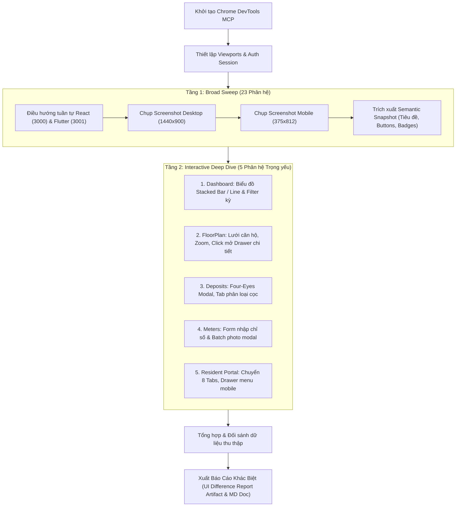

# Thiết kế: Đối Soát Toàn Diện Giao Diện ReactJS vs Flutter Web bằng Chrome DevTools

> **Dự án:** ResiHub v2.0  
> **Tài liệu:** Design Document (Thiết kế giải pháp đối soát & báo cáo khác biệt UI)  
> **Ngày:** 16/11/2026  
> **Tác giả:** Antigravity AI & Nhóm Phát triển ResiHub  
> **Trạng thái:** Sẵn sàng phê duyệt (Reviewed & Ready for Approval)

---

## 1. Mục Đích & Bối Cảnh (Intent & Why)

### 1.1. Bối cảnh
ResiHub đang thực hiện chuyển đổi/song hành frontend từ ReactJS (`frontend/`) sang Flutter Web (`flutter_resihub/`).
Trước đó, dự án đã hoàn thành rà soát mã nguồn (Code Audit) và đạt 100% độ phủ về mặt logic/component cùng 562/562 unit & widget tests vượt qua (theo `docs/flutter-ui-audit-report.md`).
Tuy nhiên, kiểm thử code tĩnh không thể phản ánh trọn vẹn:
- Sự khác biệt về render động trên trình duyệt thực tế giữa DOM HTML tiêu chuẩn (ReactJS) và CanvasKit/Wasm rendering (Flutter Web).
- Sai lệch căn chỉnh pixel, typography, khoảng cách padding/margin, icon alignment.
- Hành vi tương tác thực tế: mở Modal, trượt Drawer, tooltip, responsive scaling trên màn hình Desktop (1440×900) và Mobile (375×812).

### 1.2. Mục đích (Intent)
Xây dựng và thực thi kế hoạch tự động hóa Chrome DevTools để kiểm tra trực tiếp 2 ứng dụng đang chạy đồng thời trên trình duyệt:
- **ReactJS:** `http://localhost:3000`
- **Flutter Web:** `http://localhost:3001`
- **Backend API:** `http://localhost:5000`

Từ đó, thu thập bằng chứng trực quan (screenshots, semantic snapshots, console errors, network requests) và tổng hợp thành **Báo cáo Khác biệt Giao diện (UI Difference Report)** chi tiết, có phân loại mức độ ưu tiên và đề xuất khắc phục cụ thể.

---

## 2. Mục Tiêu, Phi Mục Tiêu & Chống Mục Tiêu (Goals, Non-Goals, Anti-Goals)

### 2.1. Mục tiêu (Goals)
1. **Kiểm tra trực quan toàn diện (Tier 1 - Broad Sweep):**
   - Chụp ảnh và so sánh trực quan đối ứng toàn bộ 23 phân hệ (bao gồm 27 trang giao diện quản trị + 8 tabs Resident Portal + trang công khai).
   - Đánh giá trên 2 kích thước viewport tiêu chuẩn: Desktop (1440×900) và Mobile (375×812).
2. **Kiểm tra tương tác chuyên sâu (Tier 2 - Deep Dive):**
   - Thao tác thực tế qua DevTools trên 5 phân hệ phức tạp nhất:
     - *Dashboard & Biểu đồ thống kê* (Line chart vs Bar chart, tooltip, thẻ chỉ số).
     - *Sơ đồ tầng tương tác FloorPlan* (Lưới phòng, màu sắc 6 trạng thái, click mở Drawer chi tiết phòng).
     - *Sổ cọc & Phê duyệt Four-Eyes* (Modal chi tiết cọc, các tab phân loại, xem timeline & chứng từ).
     - *Ghi chỉ số Điện / Nước* (Danh sách đồng hồ, lọc tòa/tầng, Modal nhập theo lô).
     - *Cổng cư dân (Resident Portal)* (Menu 8 tabs, Drawer responsive trên mobile).
3. **Báo cáo sai khác (UI Difference Report):**
   - Tổng hợp bảng ma trận đối soát 23 phân hệ.
   - Phân tích sâu các khía cạnh: Bố cục & Căn chỉnh (Layout), Định dạng dữ liệu (VND, ngày tháng), Đặc thù Engine (CanvasKit vs DOM), và Trải nghiệm tương tác (UX/Animations).
   - Đưa ra danh sách hành động (Actionable items) để tinh chỉnh Flutter Web đạt độ tương đồng tối đa với ReactJS.

### 2.2. Phi mục tiêu (Non-Goals)
- Không chỉnh sửa code backend API hoặc database schema trong quá trình audit.
- Không thực hiện các hành động làm thay đổi vĩnh viễn dữ liệu chia sẻ giữa React và Flutter (Non-destructive inspection).
- Không benchmark hiệu năng mạng/backend (load testing) - chỉ đo render client-side qua DevTools.

### 2.3. Chống mục tiêu (Anti-Goals)
- Không so sánh thô bằng text DOM diff (vì Flutter Web dùng CanvasKit không sinh ra thẻ HTML tương ứng với React, so sánh thô text DOM sẽ báo động giả 100%).
- Không bỏ qua chế độ xem trên thiết bị di động (Mobile viewport) vì Cổng cư dân và quản lý tại chỗ đòi hỏi độ tương thích cao trên màn hình hẹp.

---

## 3. Ràng Buộc & Quyết Định Kỹ Thuật Của Builder (Technical Constraints & Builder Decisions)

Dựa trên kết quả rà soát thiết kế và đặc thù hệ thống:

1. **Quy tắc Kiểm thử Tương tác Phi Phá Hủy (Non-Destructive UI Inspection):**
   - *Quyết định:* Do ReactJS (`:3000`) và Flutter Web (`:3001`) chạy chung một database PostgreSQL (`:5433`), các tương tác ở Tier 2 (như Four-Eyes duyệt cọc, nhập chỉ số điện nước) sẽ dừng lại ở bước: **Mở Modal/Drawer -> Kiểm tra Form/Validation -> Chụp ảnh đối soát -> Hủy (Cancel/Close)**.
   - *Lý do:* Tránh làm biến động trạng thái dữ liệu (state mutation) giữa 2 lần chạy, loại bỏ nhu cầu rollback/re-seed database phức tạp.
2. **Quy chuẩn Ánh Xạ 23 Phân Hệ (23-Subsystem Taxonomy):**
   - *Quyết định:* Tuân thủ danh mục 23 phân hệ chuẩn đã định hình trong `docs/flutter-ui-audit-report.md`. Trong đó, 19 nhóm route chính phủ trọn 27 màn hình chuyên biệt (gồm cả màn hình chi tiết Contract Detail, Invoice Detail, Tenant Detail, Apartment Detail) + 8 tabs Cổng Cư dân + 4 nhóm thành phần nền tảng (Shared UI, Navigation Layout, Format/Status, Test Suite).
3. **Phương Pháp Tính % Tương Đồng (Evaluation Rubric vs. Pixel Diff):**
   - *Quyết định:* Sử dụng **Thang điểm đối soát 4 trụ cột (4-Pillar Qualitative & Visual Rubric)** thay cho Pixel Diff tự động.
     - *Trụ cột 1: Bố cục & Tỷ lệ (Layout & Proportion - 30%):* Cấu trúc thẻ, grid, sidebar, khoảng cách padding/margin.
     - *Trụ cột 2: Nhãn & Định dạng dữ liệu (Copy & Data Formatting - 25%):* Tiếng Việt, tiền tệ VND, ngày tháng, mã ẩn.
     - *Trụ cột 3: Hệ màu sắc & Trạng thái (Colors & Status Badges - 25%):* Độ chuẩn xác so với bảng màu Tailwind.
     - *Trụ cột 4: Trải nghiệm & Tương tác (UX & Responsive - 20%):* Drawer, Modal, Tooltip, Mobile adaptation.
   - *Lý do:* Flutter Web CanvasKit render font bằng glyph canvas riêng, công cụ pixel diff tự động sẽ báo lệch 100% dù mắt thường nhìn hoàn toàn giống nhau.

---

## 4. Các Phương Án Tiếp Cận & Quyết Định (Approaches Considered)

| Phương án | Mô tả | Ưu điểm | Nhược điểm | Đánh giá |
|---|---|---|---|---|
| **Phương án 1: Broad Sweep tự động** | Dùng DevTools tự động điều hướng và chụp ảnh toàn bộ các URL tĩnh. | Nhanh, bao phủ 100% màn hình. | Bỏ sót các trạng thái động, popups, drawer và animation. | Không đủ sâu cho các luồng nghiệp vụ 4 mắt. |
| **Phương án 2: Interactive Deep Dive** | Thao tác tương tác kỹ lưỡng trên 5 luồng phức tạp. | Bắt được lỗi UX, animation, form validation và modal. | Bỏ qua các màn hình phụ ít dùng. | Thiếu tính toàn diện cho toàn dự án. |
| **Phương án 3: Hybrid 2-Tier (Đã chọn)** | **Tầng 1:** Sweep trực quan toàn bộ 23 phân hệ (Desktop & Mobile). **Tầng 2:** Deep Dive vào 5 phân hệ tương tác trọng yếu nhất. | Vừa bao phủ trọn vẹn 100% giao diện tĩnh, vừa kiểm chứng chi tiết các luồng tương tác cốt lõi. | Cần kịch bản điều phối DevTools chuẩn hóa. | **Tối ưu nhất - Đã được phê duyệt.** |

---

## 5. Thiết Kế Chi Tiết Chiến Lược Hybrid 2-Tier

### 5.1. Kế hoạch Tầng 1: Broad Sweep Toàn Diện
Duyệt qua danh sách các routes đối ứng giữa ReactJS và Flutter Web (kèm tài khoản test sẵn có: `admin@resihub.vn` / `Password123!` và `resident@resihub.vn`):
1. **Xác thực:** `/login`, `/forgot-password`
2. **Vận hành chung:** `/admin/dashboard`
3. **Quản lý BĐS:** `/admin/buildings`, `/admin/buildings/:id`, `/admin/buildings/floor-plan`, Chi tiết Căn hộ
4. **Hợp đồng & Cọc:** `/admin/contracts`, `/admin/contracts/:id`, `/admin/deposits`
5. **Tài chính & Hóa đơn:** `/admin/invoices`, `/admin/invoices/:id`, `/admin/payments`
6. **Vận hành Kỹ thuật:** `/admin/meters`, `/admin/maintenance`
7. **Cư dân & Dịch vụ:** `/admin/tenants`, `/admin/tenants/:id`, `/admin/services`, `/admin/subscriptions`
8. **Truyền thông & Báo cáo:** `/admin/notifications`, `/admin/reports`
9. **Hệ thống & Phân quyền:** `/admin/users`, `/admin/audit`, `/admin/settings`
10. **Trang cư dân & Khám phá:** `/resident` (8 tabs), `/explore`

Ở mỗi route, DevTools sẽ:
- Chờ nạp hoàn tất (`wait_for` hoặc ổn định network).
- Chụp ảnh màn hình Desktop (`1440×900`).
- Thay đổi kích thước sang Mobile (`375×812`) và chụp ảnh màn hình Mobile.
- Ghi nhận lỗi console hoặc cảnh báo render nếu có.

### 5.2. Kế hoạch Tầng 2: Interactive Deep Dive (Phi Phá Hủy)
1. **Module Dashboard & Charts:**
   - Kiểm tra hiển thị 4 KPI cards trên đỉnh.
   - Thử click nút chuyển đổi loại biểu đồ (Line sang Stacked Bar).
   - Kiểm tra tooltip hover hiển thị số tiền VND.
2. **Module Sơ đồ tầng (FloorPlan):**
   - Kiểm tra màu sắc 6 trạng thái phòng (Trống, Đang thuê, Giữ chỗ, Bảo trì, Khóa).
   - Click chọn 1 phòng -> Kiểm tra Drawer chi tiết phòng mở ra từ cạnh phải.
   - Kiểm tra các nút tác vụ nhanh trong Drawer: "Đặt giữ chỗ", "Báo hỏng".
3. **Module Quản lý Tiền cọc (Deposits & 4-Eyes):**
   - Chuyển giữa các tab: "Tất cả", "Chờ duyệt", "Chờ chi hoàn".
   - Click xem chi tiết 1 sổ cọc -> Mở Modal chi tiết cọc, kiểm tra hiển thị timeline 4 mắt, nút duyệt/từ chối, sau đó đóng modal an toàn.
4. **Module Ghi chỉ số Điện / Nước (Meters):**
   - Kiểm tra bảng nhập chỉ số tháng.
   - Mở modal/drawer nhập chỉ số theo lô ảnh (`Batch Photo Import`), kiểm tra form rồi đóng an toàn.
5. **Module Cổng Cư dân (Resident Portal):**
   - Đăng nhập tài khoản cư dân.
   - Duyệt qua 8 tab chức năng: Tổng quan, Hợp đồng, Hóa đơn, Báo hỏng, Dịch vụ, Chỉ số, Đăng ký thẻ, Thông báo.
   - Kiểm tra responsive menu và trải nghiệm chuyển tab trên mobile.

### 5.3. Cấu Trúc Báo Cáo Khác Biệt (UI Difference Report)
Báo cáo cuối cùng sẽ bao gồm:
1. **Executive Summary:** Đánh giá % tương đồng tổng quan dựa trên thang điểm 4 trụ cột.
2. **Ma trận Chi tiết 23 Phân hệ:** Đánh giá từng phân hệ theo 4 tiêu chuẩn (Layout, Copy/Format, Colors/Theme, UX/Interaction).
3. **Báo cáo chuyên sâu 5 phân hệ tương tác (Deep Dive Findings):** Ảnh chụp đối chiếu trước - sau tương tác, phản hồi của modal/drawer.
4. **Phân tích Đặc thù Kỹ thuật (CanvasKit vs. DOM):** Tốc độ tải lần đầu (FCP/LCP), độ sắc nét của font, hành vi cuộn chuột (scroll wheel) và vùng bôi đen văn bản.
5. **Danh mục Khuyến nghị Tinh chỉnh (Action Items):** Danh sách cụ thể các bug giao diện cần fix trên Flutter Web, phân nhóm theo mức độ ưu tiên (High / Medium / Low).

---

## 6. Kế Hoạch Thực Hiện của Kỹ Sư (Execution Plan Overview)
- **Giai đoạn 1:** Khởi tạo Chrome DevTools MCP session, chuẩn bị thư mục lưu ảnh `scratch/screenshots/`.
- **Giai đoạn 2:** Thực thi Tier 1 Broad Sweep trên toàn bộ các route (Desktop & Mobile).
- **Giai đoạn 3:** Thực thi Tier 2 Deep Dive trên 5 phân hệ phức tạp.
- **Giai đoạn 4:** Tổng hợp đối chiếu, viết Báo cáo Khác biệt (`docs/superpowers/reports/2026-11-16-ui-diff-report.md`) và Artifact trực quan.
